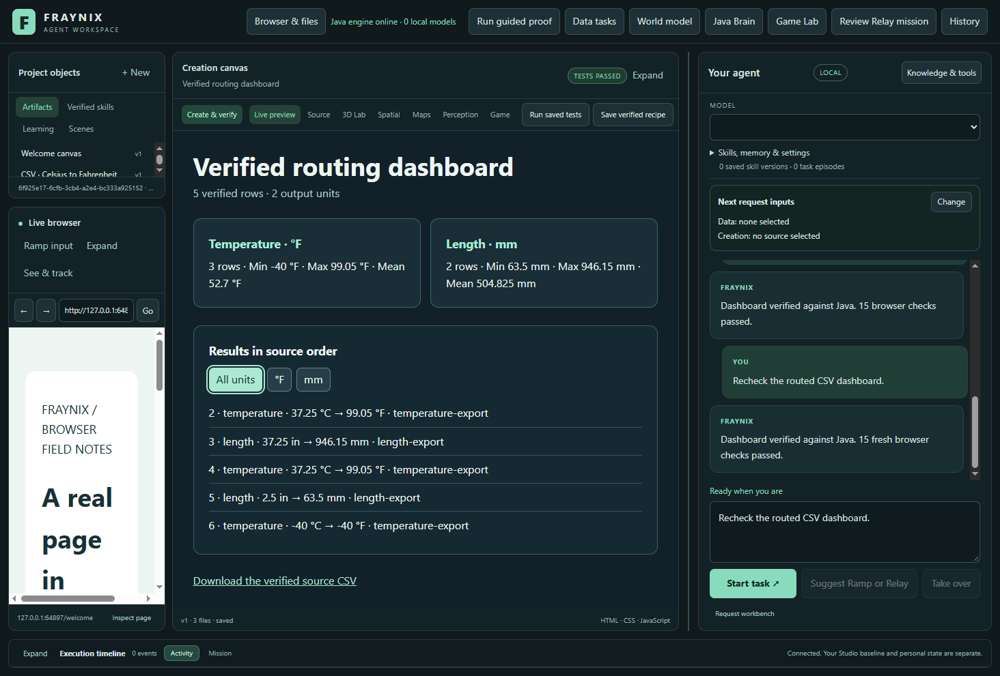
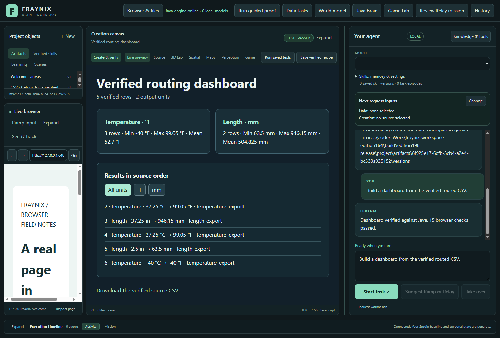
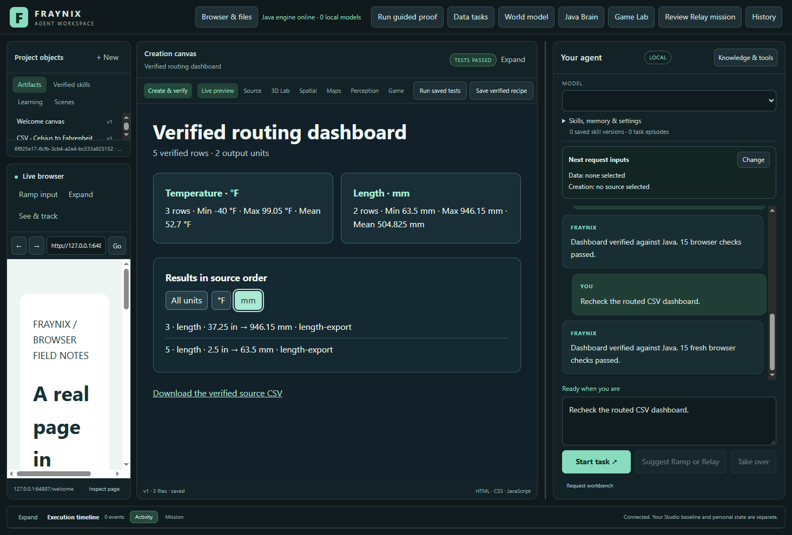

# Fraynix Agent Workspace · Edition 198

[Edition 197](README-197.md) · [Offline walkthrough](docs/readmes/198/index.html) · [Full edition history](docs/readmes/INDEX.md)

Turn the latest verified routed CSV into a dashboard with separate °F and mm summaries. Recheck the saved artifact against Java and a fresh browser run after restart.

## Try it

1. In a completed routing plan, choose **Export verified CSV**.
2. Send `Build a dashboard from the verified routed CSV.` Chat opens the completed dashboard after Java checks the disk export and actual browser results.
3. Filter to **°F** or **mm**. The rows keep their original order and duplicate entries keep their distinct row numbers.
4. After restart, send `Recheck the routed CSV dashboard.` The app runs the checks again and opens the same artifact.

## What passed

The dashboard kept 3 temperature rows and 2 length rows in separate summaries. Their means were 52.7 °F and 504.825 mm. Java checked the count, minimum, maximum and mean of each unit against independent browser calculations. The browser also checked both filters, the full source-ordered list and the source CSV link.

The desktop recovered from a blocked file write after restart using the retained checks. After a second restart, the reopened dashboard passed 15 fresh browser checks. The original receipt and artifact ID stayed intact. Java rejected a summary with the wrong units, a modified CSV with a rewritten receipt, and changes to either the dashboard receipt or a source-child receipt.

The artifact retains the original CSV and verification record. The sample HTML also rendered and calculated its summary offline. 125 root Java tests, 69 focused Java workspace tests, 181 desktop tests and 10 evidence archive tests passed locally.

[Open the sample dashboard](docs/readmes/198/dashboard.html) · [Original routed CSV](docs/readmes/198/routed-results.csv) · [Browser receipt](docs/readmes/198/dashboard-browser-receipt.json) · [Verification evidence](docs/readmes/198/verification.json) · [Reproduction](docs/publication198/plan.md)
