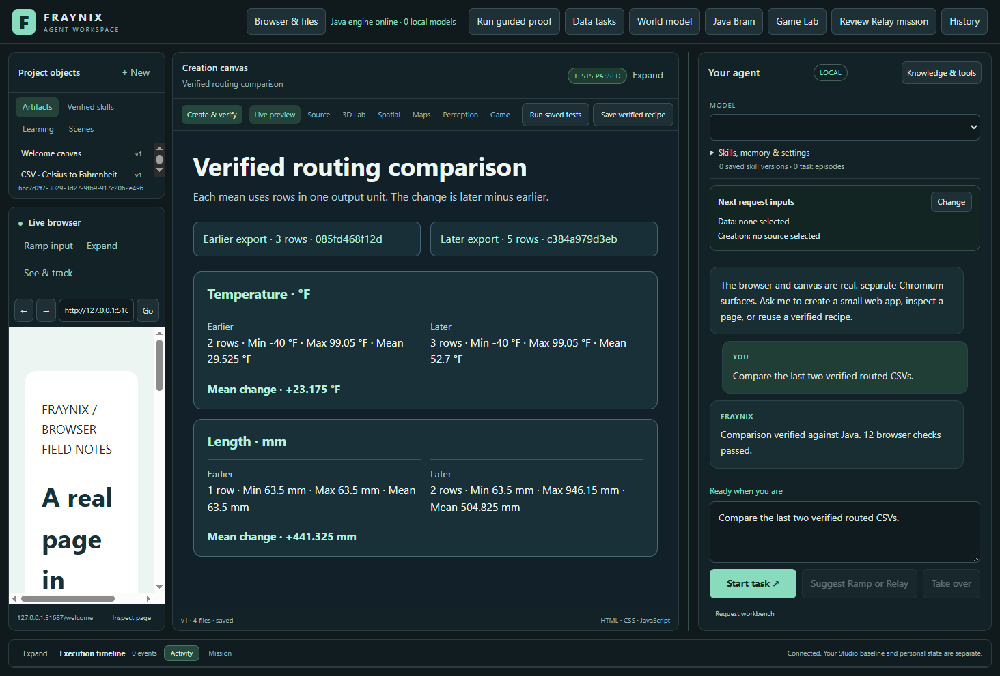
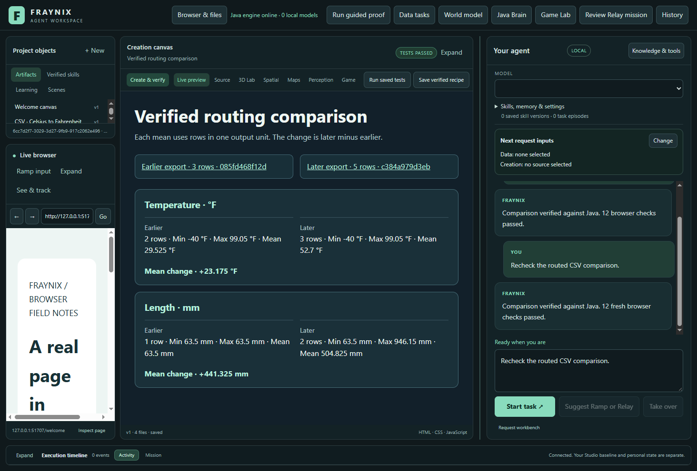

# Fraynix Agent Workspace · Edition 199

[Edition 198](README-198.md) · [Offline walkthrough](docs/readmes/199/index.html) · [Full edition history](docs/readmes/INDEX.md)

Compare the latest two verified routing exports in Chat, with separate °F and mm summaries. Recheck the same two exports against Java and the browser after restart.

## Try it

1. In each of two completed routing plans, choose **Export verified CSV**. The app picks the latest two exports from distinct plans. A second copy of a plan's CSV still counts as one plan.
2. Send `Compare the last two verified routed CSVs`. Chat opens the comparison after verification. The report shows the source exports, row counts, ranges, means and signed mean changes.
3. After restarting, send `Recheck the routed CSV comparison`. The app rechecks the original pair even if a newer export now exists.

## What passed

The sample means changed by **+23.175 °F** and **+441.325 mm** across the two exports. The change is the later mean minus the earlier mean, calculated before rounding each displayed value. A unit that appears in only one export has no numerical change. The comparison summarizes each export's available rows.

| Unit | Earlier rows | Earlier mean | Later rows | Later mean | Mean change |
| --- | ---: | ---: | ---: | ---: | ---: |
| °F | 2 | 29.525 | 3 | 52.7 | +23.175 |
| mm | 1 | 63.5 | 2 | 504.825 | +441.325 |

Java checked both CSVs against the approved routing plans and compared the browser's independently computed output with its own. After restart, the same artifact passed 12 fresh browser checks and retained the original receipt. The app refused a pair from one plan, tampering with either source even after its receipt was rewritten, and a browser result with mixed units. The edition 198 single-export dashboard also passed a fresh recheck.

The sample comparison ran offline and retains both downloadable source CSVs. 125 root Java tests, 71 focused Java workspace tests, 181 desktop tests and 10 evidence archive tests passed locally.

[Sample comparison](docs/readmes/199/comparison.html) · [Earlier CSV](docs/readmes/199/earlier-routed-results.csv) · [Later CSV](docs/readmes/199/later-routed-results.csv) · [Browser receipt](docs/readmes/199/comparison-browser-receipt.json) · [Verification record](docs/readmes/199/verification.json) · [Reproduction](docs/publication199/plan.md)
