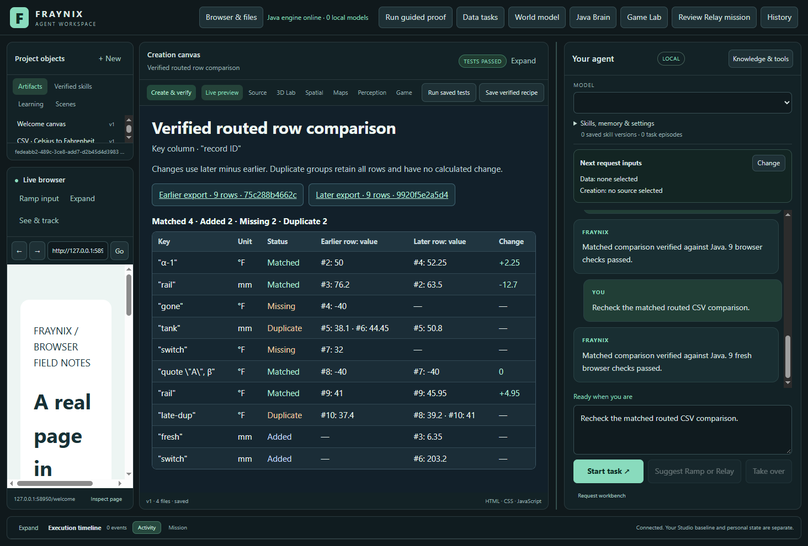
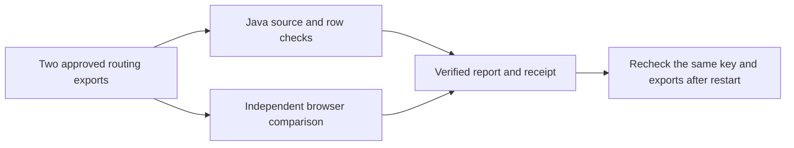

# Fraynix Agent Workspace · Edition 200

[Edition 199](README-199.md) · [Offline walkthrough](docs/readmes/200/index.html) · [Full edition history](docs/readmes/INDEX.md)

Compare rows from two verified routing exports in Chat. Match an original key and output unit, then recheck the exact rows and source files after restart.

## Try it

1. Choose **Export verified CSV** in two completed routing plans. The comparison uses the latest two exports from distinct plans.
2. Send `Compare the last two verified routed CSVs by key "record ID"`. Use the original column's exact name. Quote names that contain spaces. Blank key values cause the comparison to stop.
3. Read the **Matched**, **Added**, **Missing** and **Duplicate** groups. Each side shows the source row number and its verified value. A difference appears for a key and unit with exactly one row on each side.
4. After restarting, send `Recheck the matched routed CSV comparison`. Fraynix rechecks the original files and key against Java.

Keys are case-sensitive. The report preserves earlier key order, then appends groups first seen in the later file. A measurement that changes unit appears in two separate groups. A duplicate on either side retains all rows for that group and leaves the change blank.

## What passed

Two fresh nine-row exports produced 4 matched, 2 added, 2 missing and 2 duplicate key-unit groups. The later export moved both rows and columns. The same key **rail** matched independently in both units, with changes of **−12.7 mm** and **+4.95 °F**. The key **switch** was missing in Fahrenheit and added in millimetres. The report retained both earlier readings for **tank** and both later readings for **late-dup**.

Java revalidated both sources through their approved routing plans and checked every rendered cell against the browser's independent results. The same saved artifact passed nine fresh browser checks after restart and kept its original receipt, even after a newer export was written. The test rejected changes to either CSV, a substituted key, and an altered duplicate reading in the browser results. The edition 199 comparison also passed a fresh recheck.

The two screenshots show the actual desktop workbench on 2026-11-20 with synthetic fixtures. The sample opened offline and both downloads matched the verified files. 125 root Java tests, 73 focused Java workspace tests, 181 desktop tests and 10 evidence archive tests passed locally.

[Sample comparison](docs/readmes/200/key-comparison.html) · [Earlier CSV](docs/readmes/200/earlier-routed-results.csv) · [Later CSV](docs/readmes/200/later-routed-results.csv) · [Browser receipt](docs/readmes/200/comparison-browser-receipt.json) · [Verification record](docs/readmes/200/verification.json) · [Reproduction and next candidate](docs/publication200/plan.md)
