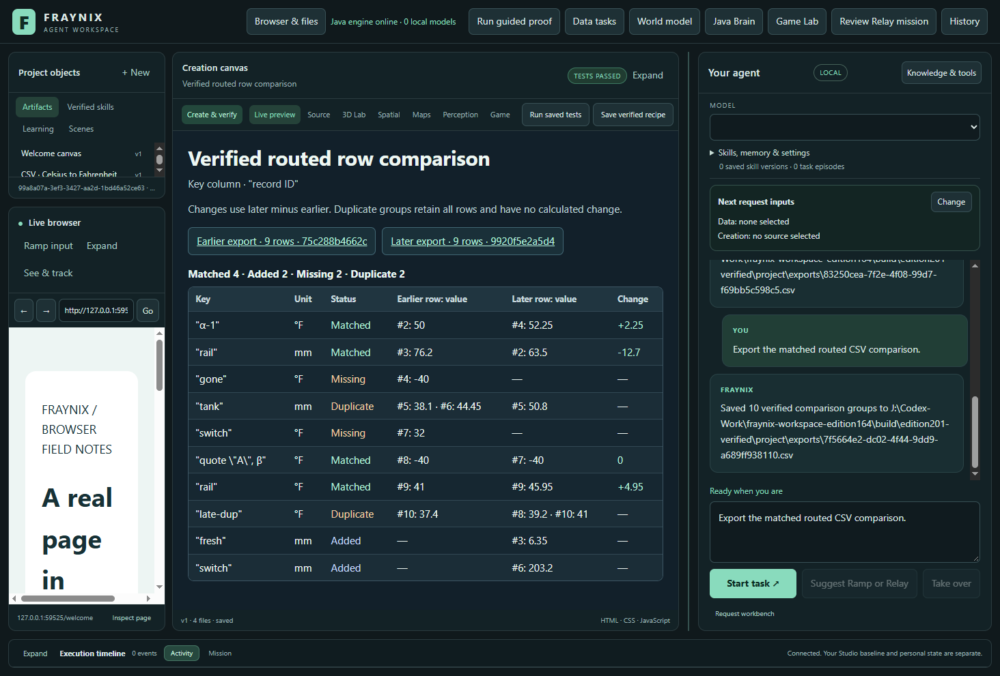
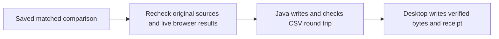

# Fraynix Agent Workspace · Edition 201

[Edition 200](README-200.md) · [Offline walkthrough](docs/readmes/201/index.html) · [Full edition history](docs/readmes/INDEX.md)

Save a checked key-and-unit comparison as a CSV, with every status and source row. After restart, Fraynix rechecks the same comparison and reproduces the exact file.

## Try it

1. Build a matched comparison in Chat. For the sample use `Compare the last two verified routed CSVs by key "record ID"`.
2. Send `Export the matched routed CSV comparison`. Chat shows where the CSV was saved in the current project's exports folder. The matching receipt sits beside it.
3. After restarting, send the same export request. Fraynix reruns the checks with the original key and pair and saves a new copy.

## CSV format

| Column | Meaning |
| --- | --- |
| `key_json` | Exact key as a JSON string so values such as `0007` keep their original form |
| `unit` | Verified output unit |
| `status` | Matched, Added, Missing or Duplicate |
| `earlier_readings` and `later_readings` | JSON arrays with each original source row number and exact decimal value |
| `delta` | Later value minus earlier value for a unique match. Other groups have an empty cell. |

The CSV follows the comparison's group order. Every duplicate reading remains with its original row number. The receipt records the artifact, original key, both export IDs and hashes, the fresh browser evidence hash, and the CSV hash.

## What passed

The exported file contains four matched, two added, two missing and two duplicate groups from the two synthetic routing exports. An independent CSV reader checked all ten groups against the saved comparison. The two exports had identical SHA-256 hashes after restart. The second came from the same comparison even after a newer source export was saved.

Java checked the saved comparison and nine fresh browser results before each export. The test refused missing browser evidence, a changed browser result, a modified retained receipt, a tampered source with a rewritten receipt, and changed CSV bytes in transit. The refusals produced no additional CSV.

The screenshots show the Java desktop running with synthetic data on 2026-11-20. 125 root Java tests, 75 focused workspace Java tests, 181 desktop tests and 10 evidence archive tests passed locally.

[Download the sample CSV](docs/readmes/201/matched-comparison.csv) · [Export receipt](docs/readmes/201/export-receipt.json) · [Source comparison proof](docs/readmes/201/source-comparison-proof.json) · [Verification record](docs/readmes/201/verification.json) · [Reproduction and next candidate](docs/publication201/plan.md)
