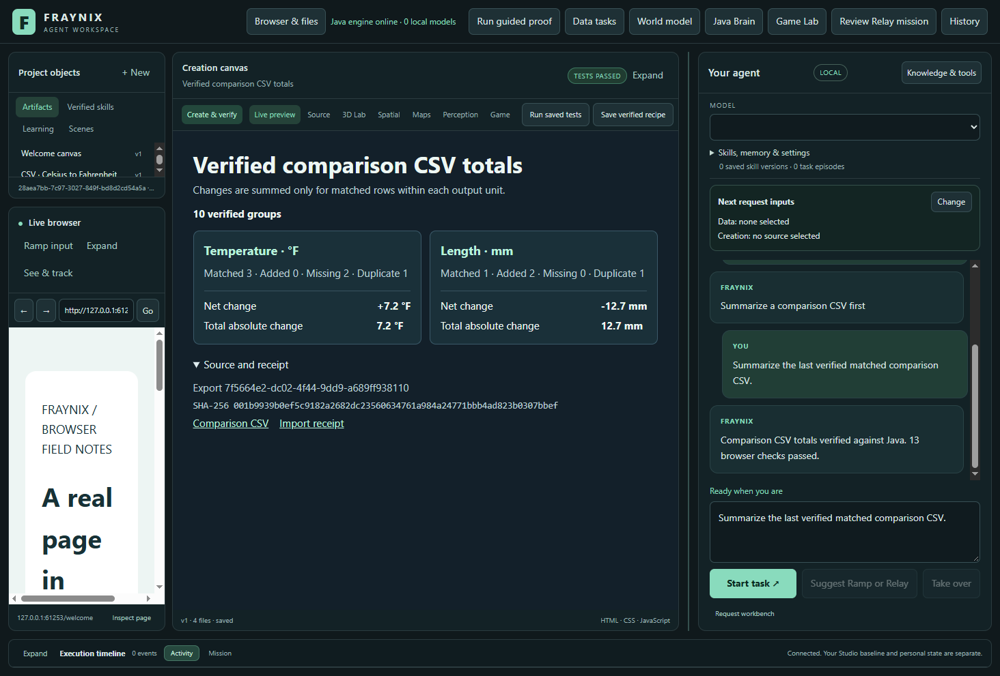
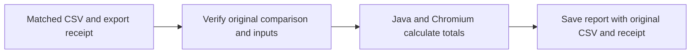

# Fraynix Agent Workspace · Edition 202

[Edition 201](README-201.md) · [Offline walkthrough](docs/readmes/202/index.html) · [Full edition history](docs/readmes/INDEX.md)

Attach a verified matched comparison CSV from the project and calculate changes separately by output unit. Check the receipt and original sources again after restart.

## Try it

1. Export a matched comparison from [edition 201](README-201.md).
2. Send `Summarize the last verified matched comparison CSV`. Fraynix attaches the newest eligible export in the current project and opens the verified report.
3. Under **Source and receipt**, find the export ID, file hash and links to both original files.
4. After restart, send `Recheck the matched comparison CSV summary`. The recheck opens the saved report with its original export, even if a newer export exists.

The report counts matched, added, missing and duplicate groups for each unit. Net change sums the signed differences. Total absolute change sums their magnitudes. Only matched groups contribute to either total. A unit with zero matches shows no total.

## What passed

The recorded import contains ten groups with net changes of +7.2 °F and −12.7 mm. The desktop checked the file and export manifest. Java reconstructed the export from the original verified comparison and routing plans. Chromium independently parsed the CSV and calculated the totals. A separate Python decimal check agreed with the report.

| Unit | Matched | Added | Missing | Duplicate | Net change | Total absolute change |
| --- | ---: | ---: | ---: | ---: | ---: | ---: |
| °F | 3 | 0 | 2 | 1 | +7.2 | 7.2 |
| mm | 1 | 2 | 0 | 1 | -12.7 | 12.7 |

After restart, the original export and artifact passed 13 fresh browser checks. The test rejected a conflicting receipt, a changed parent browser receipt, a forged browser-evidence hash, changed CSV bytes with updated hashes, and a browser result with mixed units.

The screenshots show the Java desktop running with synthetic data on 2026-11-20. Both source downloads matched their stored bytes in the offline report. 125 root Java tests, 76 focused workspace Java tests, 181 desktop tests and 10 evidence archive tests passed locally.

[Open the sample totals](docs/readmes/202/comparison-totals.html) · [Imported CSV](docs/readmes/202/matched-comparison.csv) · [Import receipt](docs/readmes/202/import-receipt.json) · [Verification evidence](docs/readmes/202/verification.json) · [Reproduction and next candidate](docs/publication202/plan.md)
