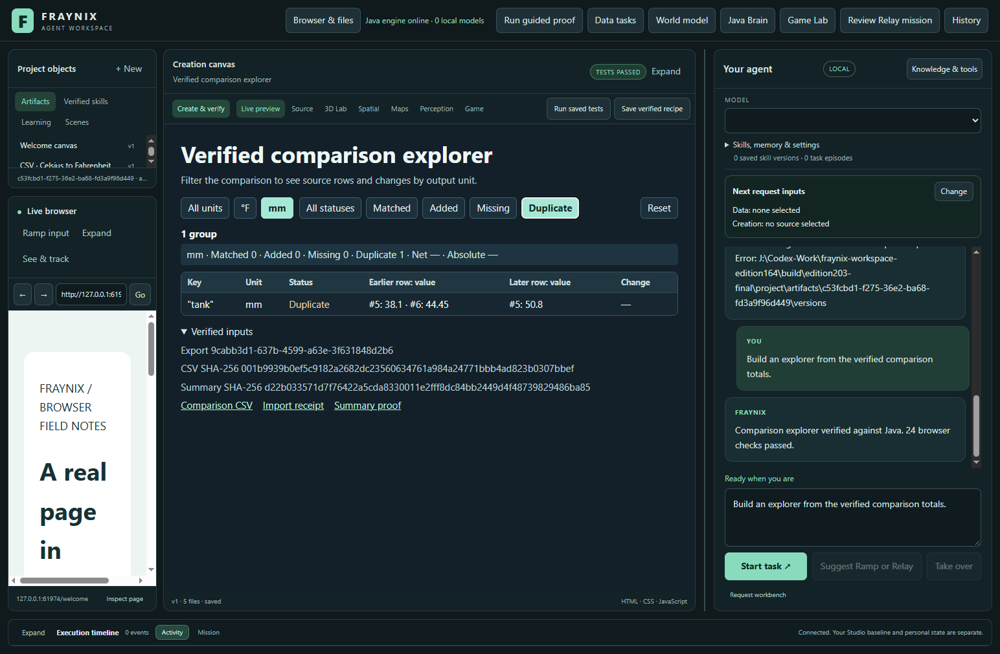
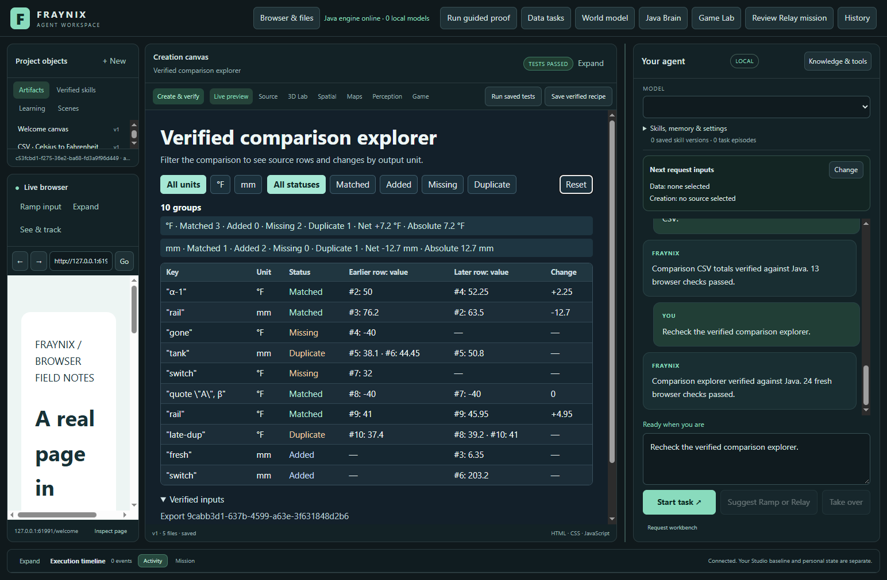
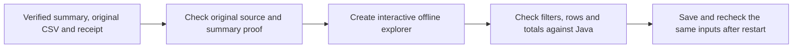

# Fraynix Agent Workspace · Edition 203

[Edition 202](README-202.md) · [Offline walkthrough](docs/readmes/203/index.html) · [Full edition history](docs/readmes/INDEX.md)

Turn a checked comparison summary into a working offline tool. Filter source rows by status and unit, then recheck the same inputs after restart.

## Try it

1. Run the verified CSV summary from [edition 202](README-202.md).
2. Send `Build an explorer from the verified comparison totals`. Fraynix uses the last verified summary from Chat and checks the report, original CSV and receipts before saving the explorer.
3. Filter by **All units**, **°F**, or **mm**, then choose a status. The table shows the exact source row numbers. The totals change to match the selection and stay separate by unit.
4. Use **Reset** to restore every group. Under **Verified inputs**, download the original CSV, import receipt and summary proof.
5. After restart, send `Recheck the verified comparison explorer`. Fraynix checks the same explorer and source again.

## What passed

The workbench recovered a blocked save. The offline explorer matched an independent decimal check for all 15 filter combinations. The recorded fixture had ten groups. The **mm** filter showed four. Adding **Duplicate** left one group and preserved all three source readings for that key. Selecting **Missing** while still on **mm** showed an empty result. Reset restored the full comparison.

| Filter | Visible groups |
| --- | ---: |
| All units and statuses | 10 |
| mm, all statuses | 4 |
| mm, Duplicate | 1 |
| mm, Missing | 0 |

The workbench restarted after a deliberately blocked write and completed the pending save with its original browser evidence. A later restart reran all 24 checks with the original export even after a newer summary had been recorded. The tests rejected a changed parent browser receipt, modified CSV bytes and an incorrect value in the filtered browser output.

The screenshots show the Java desktop running with synthetic data on 2026-11-20. The standalone HTML ran offline at a narrow viewport. All three evidence downloads matched the stored bytes. 125 root Java tests, 76 focused workspace Java tests, 181 desktop tests and 10 evidence archive tests passed locally.

[Sample explorer](docs/readmes/203/comparison-explorer.html) · [Comparison CSV](docs/readmes/203/matched-comparison.csv) · [Import receipt](docs/readmes/203/import-receipt.json) · [Summary proof](docs/readmes/203/summary-proof.json) · [Verification evidence](docs/readmes/203/verification.json) · [Reproduction and next candidate](docs/publication203/plan.md)
