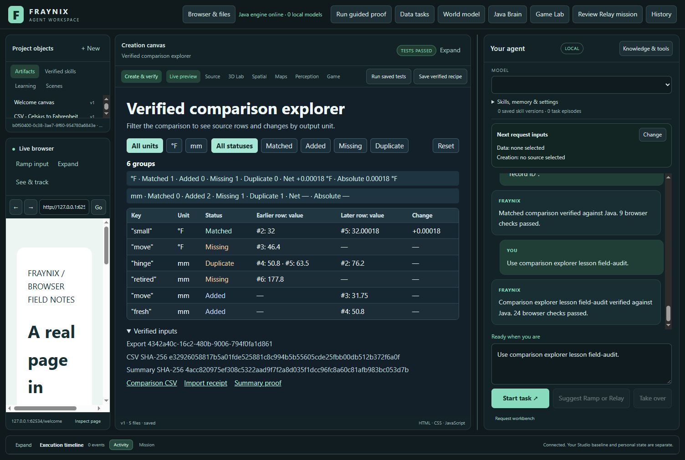
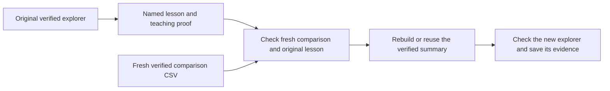

# Fraynix Agent Workspace · Edition 204

[Edition 203](README-203.md) · [Offline walkthrough](docs/readmes/204/index.html) · [Full edition history](docs/readmes/INDEX.md)

Save a verified explorer as a named lesson and reuse it on fresh comparison data. Check the lesson, the original teaching evidence and each new result.

## Try it

1. Build an original explorer through [edition 203](README-203.md).
2. Send `Teach comparison explorer lesson field-audit`. Fraynix reruns the explorer checks and saves the procedure with its teaching artifact and source hashes.
3. Export a fresh matched comparison CSV and send `Use comparison explorer lesson field-audit`. One request checks both the lesson and the new source, builds or reuses its verified summary, then creates and checks the new explorer.
4. After restart, send `Recheck comparison explorer lesson field-audit` to reopen that named lesson's last result with its original comparison export.

The lesson uses the newest export when you apply it. A new copy of the teaching CSV has the same content hash and is refused. The saved lesson binds its name to the verified original artifact. Reuse records the lesson alongside the new CSV, receipt and summary. Java selects a populated unit and status to test on each new input.

## What passed

Two fresh comparisons each passed 24 browser checks. Independent Python calculations agreed with Chromium on all 30 offline filter views.

| Fresh case | Verified result |
| --- | --- |
| Fahrenheit only | Five groups. A rise of 9 °F and a fall of 9 °F cancel, leaving a **0 °F** net change and **18 °F** total absolute change. |
| Mixed units | Six groups. The explorer preserves **+0.00018 °F**. The millimetre groups have no matched pairs, so the length totals are unavailable. |

The altered teaching receipt was rejected before creating a summary or explorer. Java also refused a changed CSV whose on-disk receipt and manifest were rewritten to match. After a newer export appeared, a restart rechecked the previous result against its original input and retained both the saved lesson and the earlier browser receipt.

The screenshots show the Java desktop on 2026-11-20 with synthetic data. The two packaged explorers ran offline at a narrow viewport, with exact downloads of their original inputs. 125 root Java tests, 76 focused workspace Java tests, 181 desktop tests and 10 evidence archive tests passed locally.

[Saved lesson](docs/readmes/204/lesson.json) · [Temperature-only explorer](docs/readmes/204/temperature-only/comparison-explorer.html) · [Mixed-unit explorer](docs/readmes/204/mixed-unmatched/comparison-explorer.html) · [Verification evidence](docs/readmes/204/verification.json) · [Reproduction and next candidate](docs/publication204/plan.md)
