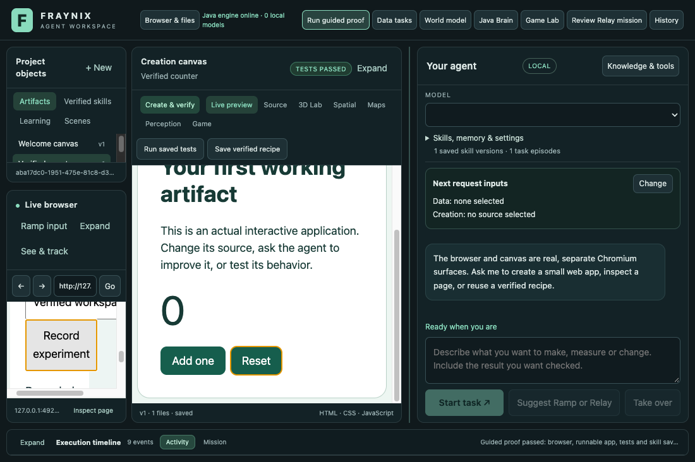
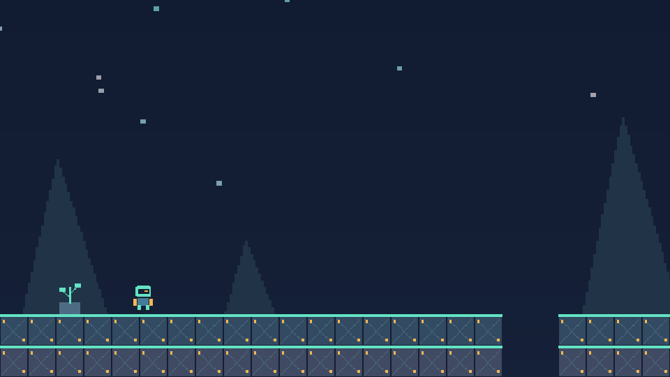

# Fraynix Agent Workspace · Edition 205

[Download and run](docs/INSTALL.md) · [Edition 204](README-204.md) · [Offline walkthrough](docs/readmes/205/index.html) · [Full edition history](docs/readmes/INDEX.md)

Download the current workspace without the full evidence archive, prepare the local app and run the guided proof on your computer.

## Run it on a Mac

1. Install **JDK 21** and **Node.js 24 LTS** for your Mac. The Electron desktop requires **macOS 13 Ventura or newer**.
2. Use the sparse Git download in the [installation guide](docs/INSTALL.md). A test checkout fetched about **15 MiB of Git objects** before downloading Java and Electron dependencies.
3. In Terminal, inside the checkout, run the first-time preparation and then open the app.

       ./Launch-Agent-Workspace.sh --prepare
       ./Launch-Agent-Workspace.sh

4. Click **Run guided proof**. It opens a local browser page, creates an artifact and verifies the result through Java. You can run it offline after the first preparation.

Linux x64 uses the same launcher. Windows x64 uses the batch launcher. An Ollama model is optional for setup and for the guided proof.

## Verified on GitHub Actions

| Runner | Desktop proof | Bullet ramp | Project restart | Native Game Lab |
| --- | --- | --- | --- | --- |
| macOS 15, Apple silicon | Passed | Passed | Passed | OpenGL display unavailable on hosted runner |
| macOS 15, Intel | Passed | Passed | Passed | OpenGL display unavailable on hosted runner |
| Ubuntu 24.04, x64 | Passed | Passed | Passed | Rendered and moved 40 ticks |
| Windows, x64 | Passed | Passed | Passed | Rendered and moved 40 ticks |

A physical Mac is still needed to confirm the native Game Lab renderer. The affected hosted runs verified that the app reports an unavailable OpenGL display. The optional neural OpenGL 4.3 experiment uses the CPU backend on macOS. 125 root Java tests, 16 focused workspace Java tests, 183 desktop tests and 10 archive tests passed locally. [GitHub Actions run](https://github.com/eyeoverthink/Fraynix-Agent-Workspace/actions/runs/44775481407)

The native game check loaded the original Relay Garden course, advanced 40 fixed ticks and checked that the player moved and the 960 × 540 PNG changed. The restart check opened the same project in a persistent Java process and read its saved artifact.

[Verification record](docs/readmes/205/verification.json) · [Reproduction and packaging plan](docs/publication205/plan.md)
