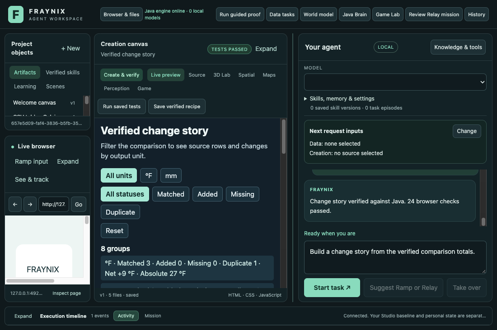
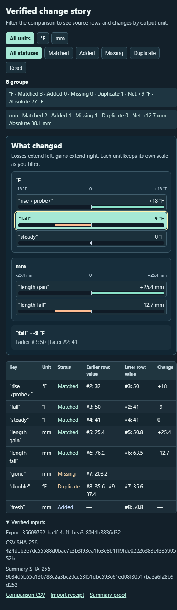
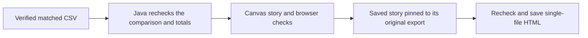

# Fraynix Agent Workspace · Edition 206

[Install on Mac, Windows or Linux](docs/INSTALL.md) · [Edition 205](README-205.md) · [Offline walkthrough](docs/readmes/206/index.html) · [Full edition history](docs/readmes/INDEX.md)

Ask Fraynix to create an interactive change story from a verified comparison. Inspect the source readings behind a bar and export a single HTML file for offline use.

## Try it in Chat

1. Export a verified matched comparison CSV for two routed datasets. See [matched comparison exports](README-201.md) for that step.
2. Send `Summarize the last verified matched comparison CSV.`
3. Send `Build a change story from the verified comparison totals.` Select a bar to see both source readings. Use the unit and status filters to explore the groups.
4. After restarting, send `Recheck the verified change story.`
5. Send `Export the verified change story.` Chat shows where the checked HTML was saved. Open that file in a browser to explore the result offline and download its original evidence.

Each unit has a fixed scale for the full comparison. Losses extend left, gains extend right, and zero has its own mark. Groups without a comparison stay in the source table. The chart works without a native Game Lab display or a local model.

## What passed

| Synthetic release case | Measured result |
| --- | --- |
| Temperature | +18 °F, −9 °F and 0 °F. Net +9 °F across three matches. |
| Length | +25.4 mm and −12.7 mm. Net +12.7 mm across two matches. |
| Other groups | One added, one missing and one duplicate. All three remained visible in the table. |
| Restart and export | The original story passed 24 fresh browser checks after a newer export appeared. Changed source bytes blocked export. An edition 204 lesson reopened with its original HTML hash. |

The tests checked actual bar positions and widths, keyboard selection, filtering and reset, and the downloaded CSV bytes. The desktop built and rechecked the story on Windows x64, Apple silicon, Intel Mac and Linux x64. All four opened the exported HTML with HTTP and HTTPS blocked. 125 root Java, 10 focused workspace Java, 183 desktop and 10 archive tests passed on Windows. [GitHub Actions results](https://github.com/eyeoverthink/Fraynix-Agent-Workspace/actions/runs/44778668741)

[Download the offline story from GitHub](https://raw.githubusercontent.com/eyeoverthink/Fraynix-Agent-Workspace/readme-206/docs/readmes/206/change-story.html) · [Story source proof](docs/readmes/206/verification.json) · [Platform and test evidence](docs/readmes/206/release-proof.json) · [Reproduction and next candidate](docs/publication206/plan.md)
