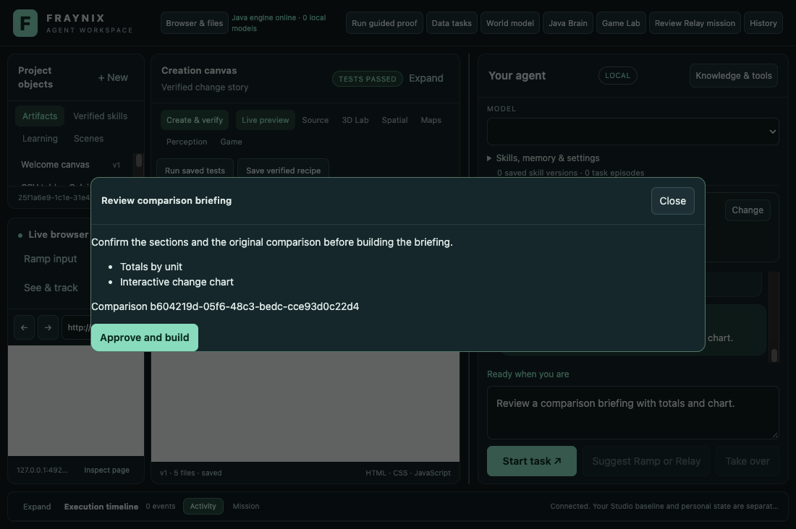
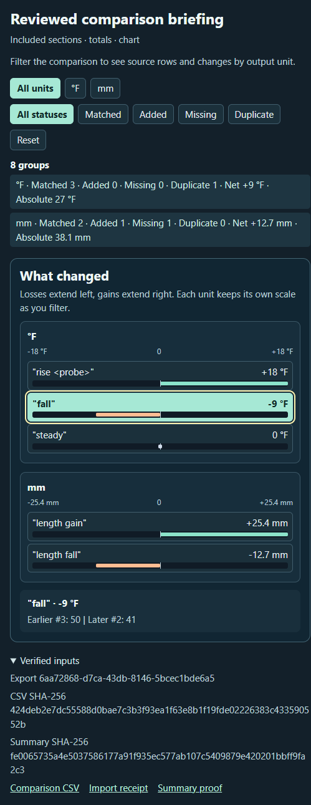
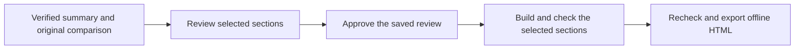

# Fraynix Agent Workspace · Edition 207

[Install on Mac, Windows or Linux](docs/INSTALL.md) · [Edition 206](README-206.md) · [Offline walkthrough](docs/readmes/207/index.html) · [Full edition history](docs/readmes/INDEX.md)

Choose the totals, chart or source rows for an offline briefing in Chat. Approve the source and the selected sections before Fraynix builds it.

## Build a briefing in Chat

1. Export a matched comparison and send `Summarize the last verified matched comparison CSV.`
2. Send `Review a comparison briefing with totals and chart.` You can choose any combination of `totals`, `chart` and `rows`. The review displays your sections and the comparison it will use.
3. Click **Approve and build**. To return after restarting, send `Resume the comparison briefing.`
4. Send `Recheck the comparison briefing.` to rerun the checks, or `Export the comparison briefing.` to save a single HTML file.

The example shows changes of −9 °F, +18 °F and 0 °F alongside −12.7 mm and +25.4 mm. You can inspect the earlier and later readings from a bar. The source CSV and original proofs remain available in the evidence panel regardless of which sections you choose.

## Verification

| Check | Result |
| --- | --- |
| Approval | A stale digest and an unapproved build created no artifact. The exact review reopened after restart. |
| Section selection | Totals and chart passed 22 browser checks. Rows only passed 18 and produced a distinct artifact. |
| Offline file | HTTP and HTTPS were blocked. The selected sections rendered and the downloaded CSV matched the original bytes. |
| Source integrity | Altering the original comparison blocked both story and briefing export. |
| Desktop recovery | Electron continued through the guided proof after both output streams received a simulated broken-pipe error. |

Windows x64, Apple silicon, Intel Mac and Linux x64 passed closed-output recovery and the reviewed briefing workflow. Each platform completed 22 browser checks for totals and chart, and 18 for rows only. 125 root Java, 10 focused workspace Java, 185 desktop and 10 archive tests passed on Windows. [Cross-platform results](https://github.com/eyeoverthink/Fraynix-Agent-Workspace/actions/runs/45235387742)

The Windows error dialog came from a test process that outlived its launcher. New builds handle the closed output pipe. Startup failures also record a diagnostic in `desktop-startup.log` in the project directory.

[Offline briefing sample](https://raw.githubusercontent.com/eyeoverthink/Fraynix-Agent-Workspace/readme-207/docs/readmes/207/comparison-briefing.html) · [Source proof](docs/readmes/207/verification.json) · [Release evidence](docs/readmes/207/release-proof.json) · [Reproduction and next candidate](docs/publication207/plan.md)
