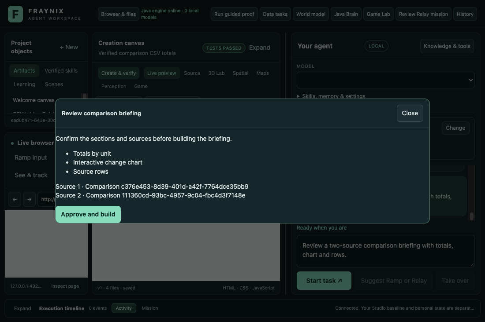
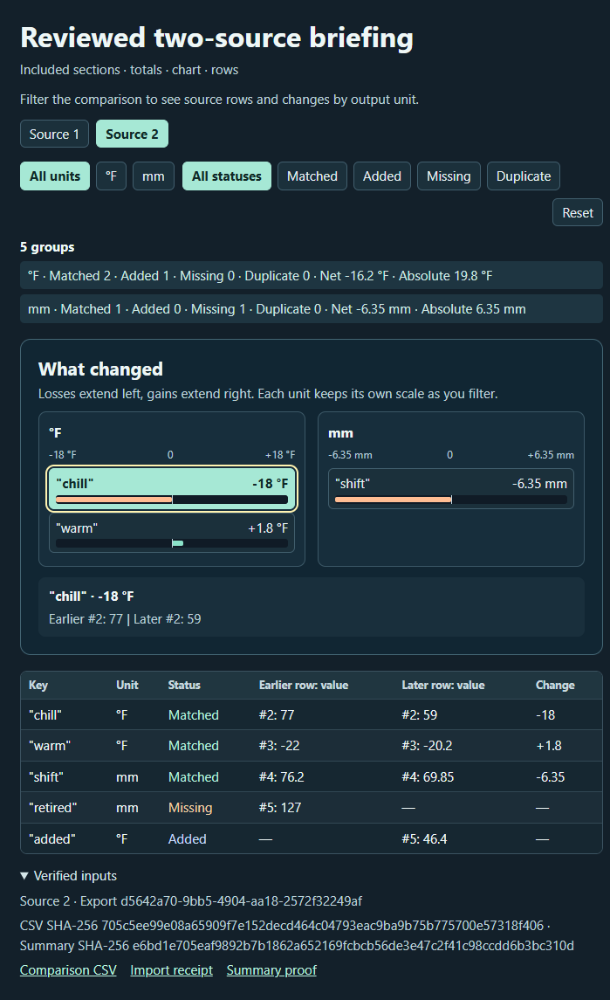
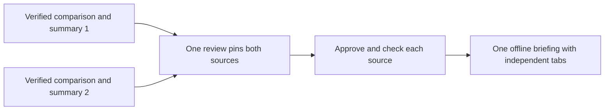

# Fraynix Agent Workspace · Edition 208

[Install on Mac, Windows or Linux](docs/INSTALL.md) · [Edition 207](README-207.md) · [Offline walkthrough](docs/readmes/208/index.html) · [Full edition history](docs/readmes/INDEX.md)

Review two verified comparisons in Chat and export one offline briefing. Each source keeps its own totals, chart, rows and proof.

## Build a two-source briefing

1. Export a verified matched comparison and send `Summarize the last verified matched comparison CSV.` Repeat with the second comparison.
2. Send `Review a two-source comparison briefing with totals, chart and rows.` Fraynix proposes the two most recently summarized exports. Confirm the source order, then choose **Approve and build**. The two exports must have different CSV contents.
3. Use **Source 1** and **Source 2** to switch the totals, chart, rows and evidence downloads in the canvas. Each source keeps its own unit scales.
4. After restarting, send `Resume the comparison briefing.` for a pending review, or `Recheck the comparison briefing.` for a completed one. A newer comparison cannot replace either pinned source.
5. Send `Export the comparison briefing.` to save one HTML file with both sets of evidence.

## What passed

| Synthetic source | Independently measured result |
| --- | --- |
| Source 1 | Eight groups, five matches. Net +9 °F and +12.7 mm. |
| Source 2 | Five groups, three matches. Net −16.2 °F and −6.35 mm. |
| Changed source | Editing either CSV gave the correct source number and blocked recheck and export. A changed Source 2 summary receipt also blocked export. |
| Offline file | The two tabs kept their own readings and downloaded all six evidence files byte for byte. On Windows, damaging either embedded CSV suppressed the chart and downloads. |

A stale approval, a missing source and an identical CSV under a new export ID were refused. The pending review survived a restart before approval, and the completed briefing survived another before rechecking. The original edition 207 briefing passed 22 fresh checks against the same HTML hash. Windows x64, Apple silicon, Intel Mac and Linux x64 each passed 24 browser checks. They resumed the same review, rechecked the original pair after restart and matched all six offline downloads. 125 root Java, 10 focused workspace Java, 185 desktop and 10 archive tests passed on Windows. [Cross-platform results](https://github.com/eyeoverthink/Fraynix-Agent-Workspace/actions/runs/45245791774)

[Offline briefing sample](https://raw.githubusercontent.com/eyeoverthink/Fraynix-Agent-Workspace/readme-208/docs/readmes/208/paired-briefing.html) · [Source proof](docs/readmes/208/verification.json) · [Release evidence](docs/readmes/208/release-proof.json) · [Reproduction and next candidate](docs/publication208/plan.md)
