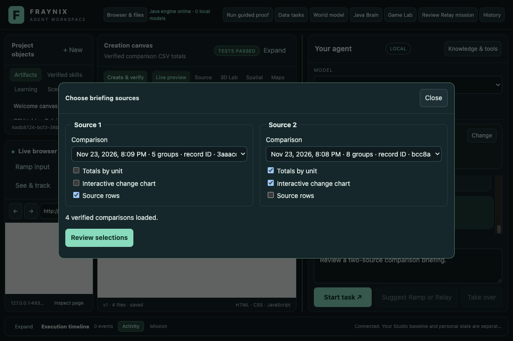
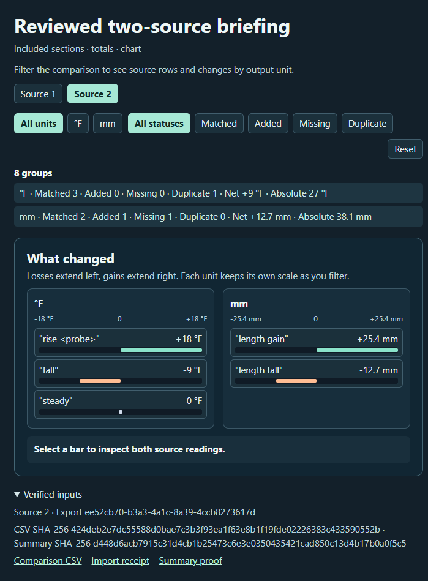
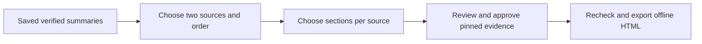

# Fraynix Agent Workspace · Edition 209

[Install on Mac, Windows or Linux](docs/INSTALL.md) · [Edition 208](README-208.md) · [Offline walkthrough](docs/readmes/209/index.html) · [Full edition history](docs/readmes/INDEX.md)

Choose two saved verified comparisons and set the sections for each. One approval preserves the selected order and the original evidence through restart and offline export.

## Pick two older comparisons

1. Export and summarize two distinct matched comparisons. See the [matched comparison workflow](README-201.md).
2. Send `Review a two-source comparison briefing.` The picker reads the project's saved verified summaries. Use **Load older comparisons** to browse earlier entries.
3. Choose **Source 1** and **Source 2** in the order you want them exported. Check the sections for each, click **Review selections**, then choose **Approve and build**.
4. After restarting, send `Resume the comparison briefing.` for a pending review or `Recheck the comparison briefing.` for a completed one. Send `Export the comparison briefing.` for one offline HTML file.

The review pins the two source IDs, original hashes and selected sections. The offline tabs and numbered downloads follow the selected order. Both sources retain their original CSV, receipt and summary proof even when the row table is hidden.

## What passed

| Synthetic test | Result |
| --- | --- |
| Browse history | The picker paged past 24 newer exports without verified summaries. It found earlier saved summaries after restart. |
| Source 1 | The second-oldest comparison appeared first, showing five source rows. |
| Source 2 | The oldest comparison appeared second, showing totals and five chart marks. Its row table stayed hidden. |
| Restart and export | The pending review and completed briefing kept the approved order, section choices and original evidence. All six offline downloads matched. |
| Compatibility | The original edition 208 briefing passed 24 fresh checks with its existing HTML hash. |

The workflow passed 18 browser checks on Windows x64, Apple silicon, Intel Mac and Linux x64. Each run preserved the expected output order, sections and six original evidence files. 125 root Java, 10 focused workspace Java, 185 desktop and 10 archive tests passed on Windows. [Cross-platform results](https://github.com/eyeoverthink/Fraynix-Agent-Workspace/actions/runs/45256058358)

[Offline briefing sample](https://raw.githubusercontent.com/eyeoverthink/Fraynix-Agent-Workspace/readme-209/docs/readmes/209/selected-briefing.html) · [Source proof](docs/readmes/209/verification.json) · [Release evidence](docs/readmes/209/release-proof.json) · [Reproduction and next candidate](docs/publication209/plan.md)
