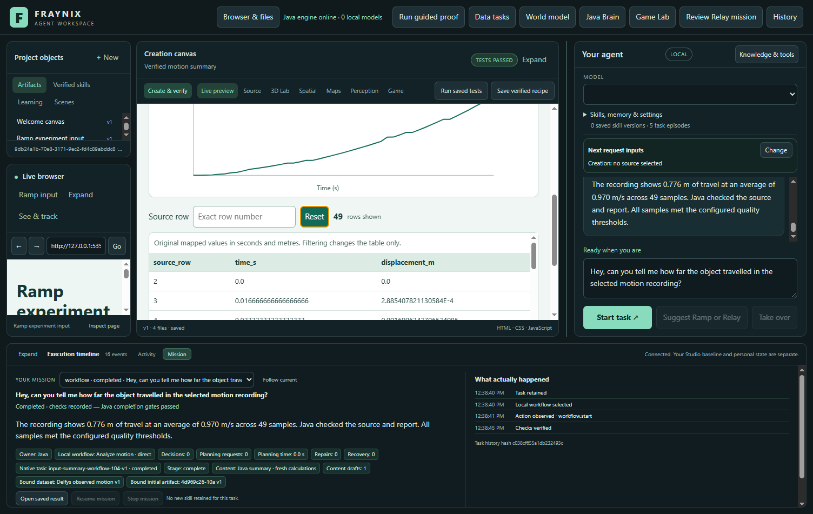
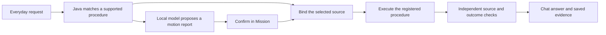

# Fraynix Agent Workspace · Edition 210

[Install on Mac, Windows or Linux](docs/INSTALL.md) · [Edition 209](README-209.md) · [Offline walkthrough](docs/readmes/210/index.html) · [Full edition history](docs/readmes/INDEX.md)

Ask Chat about a recorded object, compare two saved ramp setups, convert a file or build an offline click counter. Java binds each input and checks the result.

## Ask for an outcome

| Say or type in Chat | Give Fraynix | What it verifies |
| --- | --- | --- |
| “Which of these two ramps will the block go farther down?” | Open the Ramp input page for two saved setups with the same duration. | Java simulates both and verifies the comparison against independent replays. |
| “How far did it travel in the selected motion recording?” | Select the existing recording in Motion data. | Java reports recorded travel and average speed, checks the source and verifies the report. |
| “Turn this CSV into JSON, please.” | Attach the file in Workbench and choose **Confirm and verify**. | Java converts the table, reads it back and checks that cell text and column order survive. JSON to CSV uses the same review. |
| “Could you whip up a little offline browser app that counts clicks and resets?” | Select an installed local model. | Java sets the click and reset checks before the model writes the app. Open the result in Mission. |

For spoken input, focus the Chat field and use system dictation. On Windows 11, Voice Access can work offline after setup. On macOS, use the Dictation shortcut configured under Keyboard. Review the transcript before starting the task. [Windows Voice Access](https://support.microsoft.com/en-us/accessibility/windows/voice-access/set-up-voice-access) · [macOS Dictation](https://support.apple.com/guide/mac-help/mh40584/mac)

## What the tests measured

- The [Delfys validation recording](docs/datasets/delfys75-013/validation.csv) has 49 samples over 0.80 s. The desktop independently calculated 0.776 m of total travel and 0.970 m/s average speed from the source rows. The report retains quality flags.
- The two simulated ramp setups travelled 1.638 m and 0.236 m. Both replays and the nine browser checks passed.
- CSV conversion preserved a comma inside a quoted field, the text `001.20` and an empty cell. Missing inputs and a mixed request refused action.
- On Windows, the real local model proposed a motion report. After restart, the original proposal still required approval and the approved run used the original recorded source without a second model call. The Windows test also used `gpt-oss:20b` to generate the click counter. An independent browser session checked startup, two clicks, reset and a click after reset across nine steps.
- The model-free desktop proof passed on Windows x64, Apple silicon macOS, Intel macOS and Linux x64. [Hosted test run](https://github.com/eyeoverthink/Fraynix-Agent-Workspace/actions/runs/45261567836)

[Open the ramp comparison screen](docs/readmes/210/ramp-comparison.png) · [Open the file review](docs/readmes/210/file-conversion-review.png) · [Open the model approval screen](docs/readmes/210/local-model-review.png) · [Open the finished counter](docs/readmes/210/created-counter.png)

## How a request becomes a checked result

Use one explicit outcome and name the source when a selection is required. The simulated ramp values describe those tested configurations. The motion report describes the recorded samples. The creation example supports a click counter with fixed increment and reset checks. Model-assisted motion reports pause in Mission before execution.

## Next capability

Resolve follow-ups like “Make a chart of that” to one verified source and carry that source through a durable plan. Test new, independently written requests across data, browser, world and creation, recording both successful choices and safe clarifications.

[Reproduction and acceptance plan](docs/publication210/plan.md) · [Saved release evidence](docs/readmes/210/release-proof.json) · [Obsidian map](docs/obsidian/218-plain-language.canvas)
