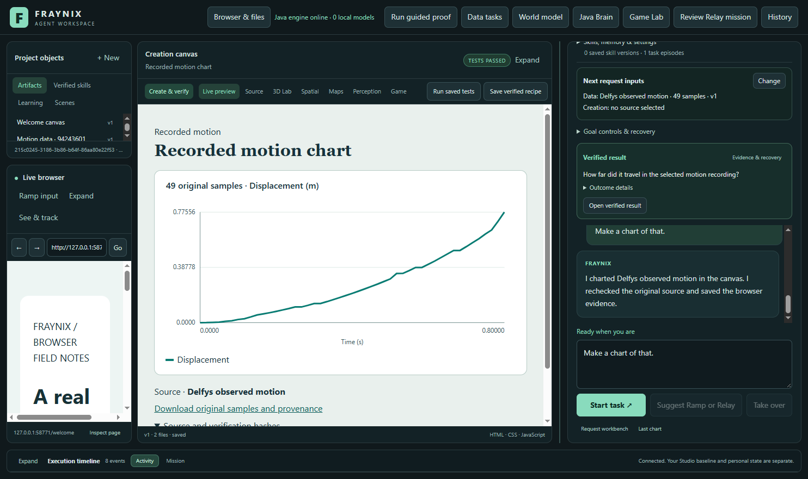

# Fraynix Agent Workspace · Edition 211

[Install on Mac, Windows or Linux](docs/INSTALL.md) · [Edition 210](README-210.md) · [Offline walkthrough](docs/readmes/211/index.html) · [Full edition history](docs/readmes/INDEX.md)

Ask “Make a chart of that.” Fraynix uses a single verified source or asks you to choose. The question, selection and checked chart survive restart.

## Try it in Chat

1. Finish a verified motion summary or a two-ramp comparison.
2. Ask **“Make a chart of that.”** With one eligible verified source, the saved source is rechecked and the chart opens in the canvas.
3. With more than one distinct verified source, choose one from the question. **Chart request** restores the original options after restart. A result completed later appears when you start a new chart request.
4. After saving, use **Last chart** to recheck the evidence and reopen the same chart. Use **Download original samples and provenance** in the chart to save the plotted values and their source and evidence hashes.

| Source | Chart |
| --- | --- |
| Verified motion summary | Mapped displacement in metres against the original timestamps in seconds. The label distinguishes recorded from synthetic data. |
| Verified two-ramp comparison | Both original simulated travel traces on a shared time axis in seconds. |

The chart uses the saved input version and the original completed task's evidence. It plots the original samples without smoothing or resampling. Archived verified motion summaries can still supply the chart. When the selected source fails verification, Fraynix reports the refusal and keeps the selected source on the request.

## What was verified

- Windows x64, Apple silicon macOS, Intel macOS and Linux x64 each verified 49 recorded samples and two simulated traces of 18 samples each. Each saved chart passed six browser checks and a comparison of every rendered point against the Java projection.
- The test reopens the unanswered question in a compact window, reopens the pinned selection after a second restart, and rechecks the same saved artifact after another restart.
- With no verified source, Chat asks for a verified result. The test also rejects a newly completed source that was absent from the original choices, a request with no browser evidence, and reopening a chart after editing the original ramp report. None of those refusals creates a new chart.
- The desktop workflow ran without a local model. [Portable workspace CI](https://github.com/eyeoverthink/Fraynix-Agent-Workspace/actions/runs/45299430768) · [Test evidence](docs/readmes/211/release-proof.json)

[Source question](docs/readmes/211/needs-source-choice.png) · [Choice after restart](docs/readmes/211/choice-after-restart.png) · [Simulated ramp chart](docs/readmes/211/simulated-chart.png) · [Changed source refusal](docs/readmes/211/changed-source-refusal.png)

## How the reference stays attached

```mermaid
flowchart LR
    Chat["Chart of that"] --> Saved["Saved verified chat results"]
    Saved --> Choice["Select one source or ask"]
    Choice --> Pin["Save exact source and revision"]
    Pin --> Source["Recheck original evidence"]
    Source --> Plot["Project originals and check browser coordinates"]
    Plot --> Chart["Versioned chart and provenance"]
    Chart --> Reopen["Recheck source and receipt on reopen"]
```

## Next acceptance test

Resolve an explicitly named source and build a requested chart from a verified table comparison. Carry the exact row selection and units through restart and recheck them when the project contains newer results.

[Reproduction and verification plan](docs/publication211/plan.md) · [Obsidian map](docs/obsidian/219-verified-chart.canvas)
