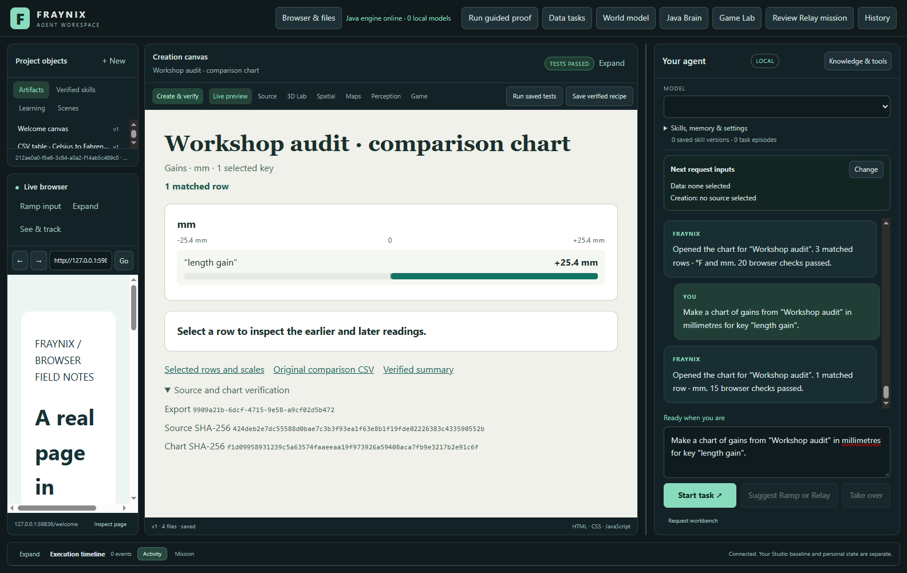
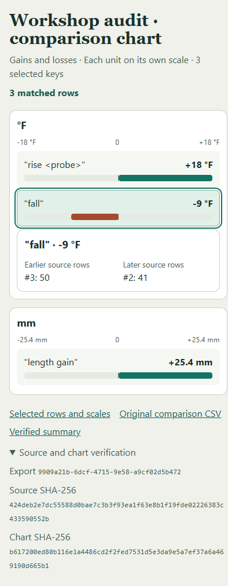
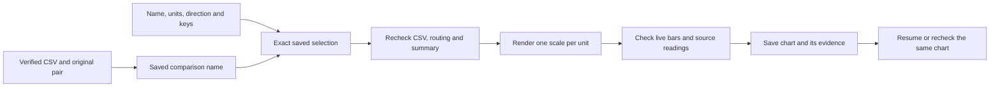

# Fraynix Agent Workspace · Edition 212

[Install on Mac, Windows or Linux](docs/INSTALL.md) · [Edition 211](README-211.md) · [Offline walkthrough](docs/readmes/212/index.html) · [Full edition history](docs/readmes/INDEX.md)

Name a verified comparison, then ask Chat to plot gains, losses or exact rows. Fraynix gives each unit its own scale and lets you inspect both original readings.

## From a saved comparison to a chart

1. Export a matched comparison and run **Summarize the last verified matched comparison CSV**. See the [matched comparison workflow](README-201.md).
2. Say `Name the last verified comparison "Workshop audit"`. Use `Name comparison export <export ID> as "Workshop audit"` to name an older verified summary.
3. Ask `Chart gains from "Workshop audit" in millimetres for key "length gain"`. You can ask for losses, gains and losses, or all matched changes. Use **both units** to give Fahrenheit and millimetres separate scales. Quote each original key you want.
4. Click a bar to see the earlier and later source row numbers and exact readings. The chart includes downloads for the selected rows, the original CSV, and the checked summary.
5. After restarting, say **Open my last comparison chart**. The saved chart keeps its original source, units and selection even if newer comparisons exist.

The example uses synthetic records. The three requested rows contain a gain of **18 °F**, a loss of **9 °F**, and a gain of **25.4 mm**. Each unit scales to its own largest selected magnitude. The generated page works offline with its accompanying evidence files. [Open the sample chart](docs/readmes/212/chart.html) · [Selected rows and scales](docs/readmes/212/chart-data.json)

## Verification

- Windows x64, Apple silicon macOS, Intel macOS and Linux x64 passed 20 browser checks for the mixed chart, 15 for the one-row chart and 10 for the empty chart.
- The named source and row selection survived a restart before rendering and a restart after saving. The checks also refused a name collision, an unknown row in the requested units, changed original CSV bytes, and a changed browser proof.
- The offline browser used the keyboard to open the 9 °F loss. The selected-row download matched the saved file byte for byte. The existing explorer, change story, and briefing checks also passed. [CI run](https://github.com/eyeoverthink/Fraynix-Agent-Workspace/actions/runs/45304991337) · [Release proof](docs/readmes/212/release-proof.json)

## How the source stays attached

## Next acceptance test

Build a briefing from a named chart in the same conversation. Check every number and row citation against its selected data and use separate evidence for claims about causes.

[Reproduction and verification plan](docs/publication212/plan.md) · [Obsidian map](docs/obsidian/220-named-comparison-chart.canvas)
