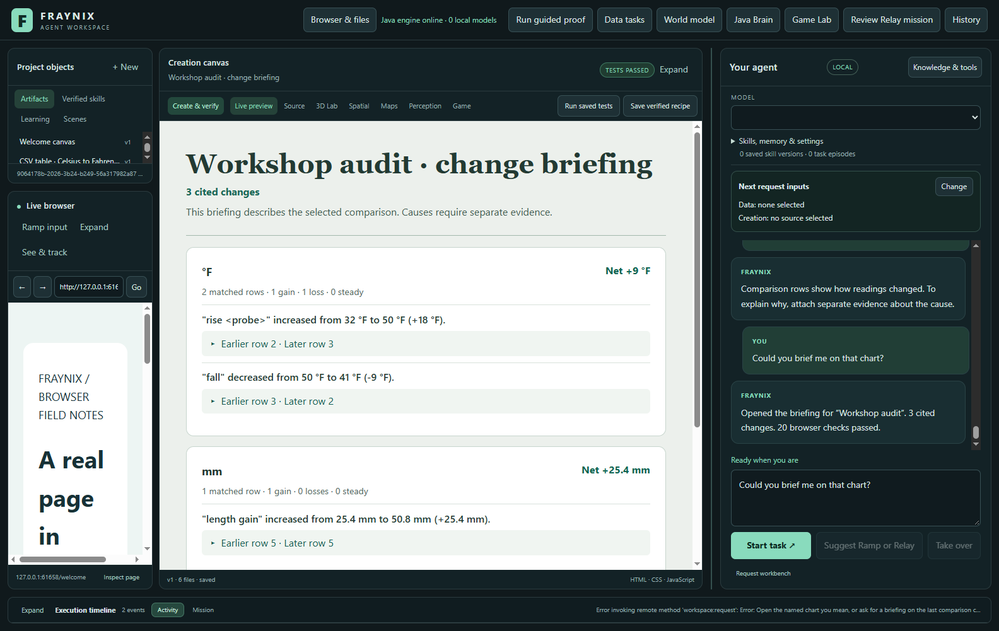
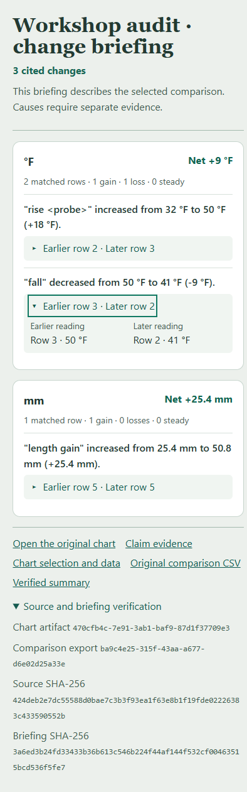
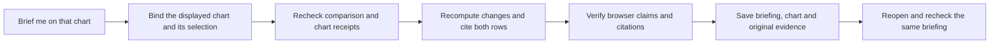

# Fraynix Agent Workspace · Edition 213

[Install on Mac, Windows or Linux](docs/INSTALL.md) · [Edition 212](README-212.md) · [Offline walkthrough](docs/readmes/213/index.html) · [Full edition history](docs/readmes/INDEX.md)

Turn an open named comparison chart into a briefing. Each claim carries the original earlier and later row citations, and the totals stay separate by unit.

## Ask for a briefing

1. Open a verified named comparison chart through [edition 212](README-212.md).
2. Ask **“Brief me on that chart.”** The visible chart supplies the exact selection, including when you reopen an older chart. **Brief me on the last comparison chart** explicitly selects the latest named chart.
3. Expand the citation below a claim to read both original rows and their exact values.
4. After restart, ask **Open my last chart briefing**. The saved request keeps its original chart and selection.
5. Open the original chart from the briefing or download the claim evidence. The sample files work together offline.

## Synthetic example

| Selected key | Earlier source row | Later source row | Verified delta |
| --- | --- | --- | --- |
| `rise <probe>` | Row 2 at 32 °F | Row 3 at 50 °F | +18 °F |
| `fall` | Row 3 at 50 °F | Row 2 at 41 °F | −9 °F |
| `length gain` | Row 5 at 25.4 mm | Row 5 at 50.8 mm | +25.4 mm |

The selected temperature rows net to **+9 °F**. The length row nets to **+25.4 mm**. Java recomputes each difference and verifies the browser’s claims, totals, and citations against those values. The request for causes is handled separately. [Open the sample briefing](docs/readmes/213/briefing.html) · [Claim evidence](docs/readmes/213/claim-evidence.json)

## Verification

- Windows x64, Apple silicon macOS, Intel macOS, and Linux x64 passed 20 browser checks for the mixed briefing and 13 for the empty briefing.
- After restart, the saved briefing reopens against its original chart even when a newer chart exists. A pending briefing can resume before any output exists.
- A changed receipt, changed comparison bytes, and a falsified citation were refused. A request for causes asks for independent evidence. The offline browser opened the row citations by keyboard, downloaded the exact claim evidence, and followed the original chart link. [CI run](https://github.com/eyeoverthink/Fraynix-Agent-Workspace/actions/runs/45309285750) · [Release proof](docs/readmes/213/release-proof.json)

## How the briefing stays grounded

## Next acceptance test

Attach a separate observation and audit one proposed explanation for a change. Record its date, assumptions, and uncertainty. Test the claim with missing or conflicting evidence.

[Reproduction and verification plan](docs/publication213/plan.md) · [Obsidian map](docs/obsidian/221-cited-chart-briefing.canvas)
