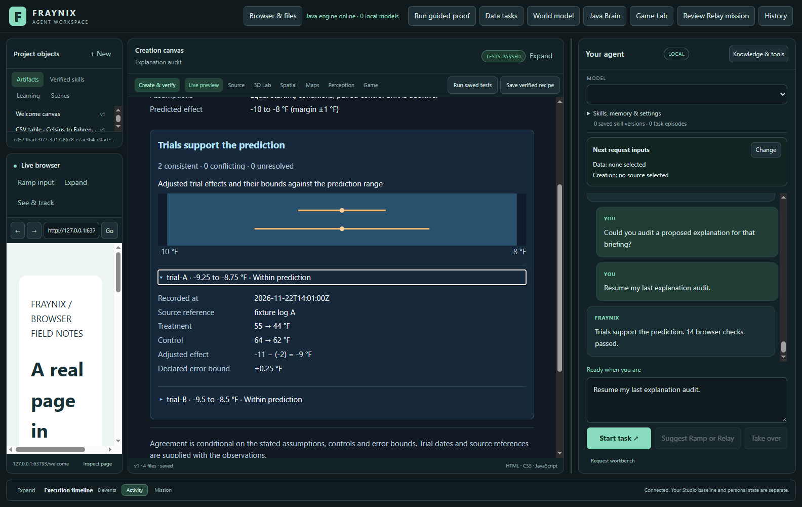
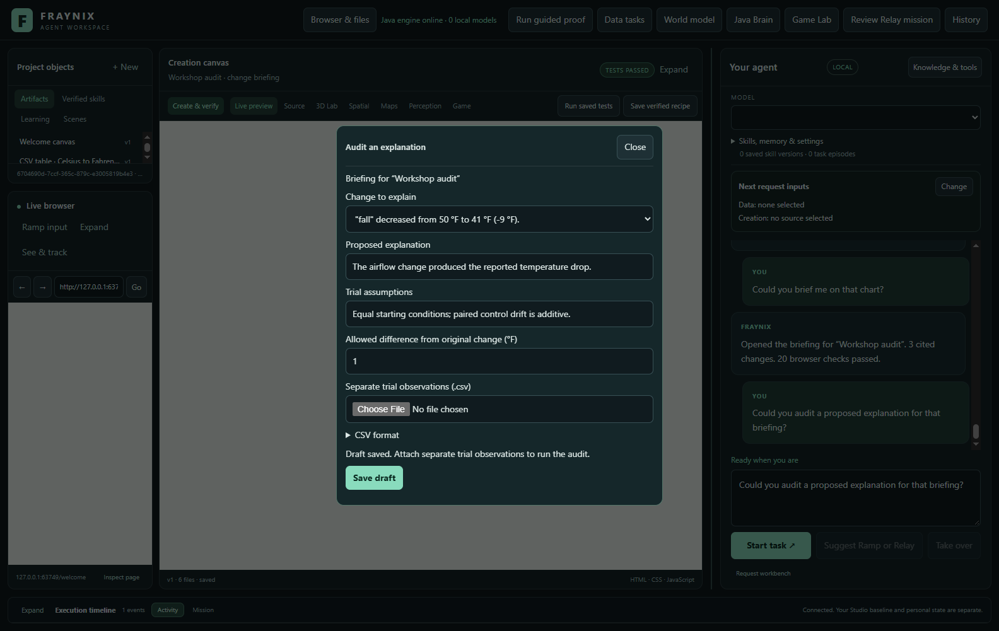
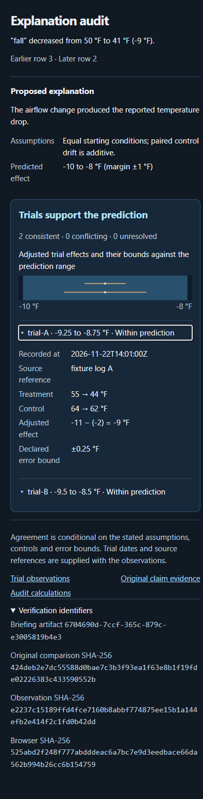

# Fraynix Agent Workspace · Edition 214

[Install on Mac, Windows or Linux](docs/INSTALL.md) · [Edition 213](README-213.md) · [Offline walkthrough](docs/readmes/214/index.html) · [Full edition history](docs/readmes/INDEX.md)

Ask Fraynix to audit a proposed explanation for a cited change. Attach separate trial observations to see the assumptions, interval and outcome in a verified offline report.

## Try it in Chat

1. Open a [verified chart briefing](README-213.md) and ask **“Audit a proposed explanation for that briefing.”**
2. Select one change. Enter the proposed explanation, assumptions, and the allowed difference from the original change.
3. Attach a [separate trial CSV](docs/readmes/214/observations.csv) and select **Run audit**. If the observations are pending, select **Save draft**.
4. Expand each trial to inspect the source reference, timestamp, treatment and control readings, and adjusted effect.
5. Say **“Resume my last explanation audit.”** The draft or artifact reopens with its original briefing after restart. Say **“Audit an explanation for the last chart briefing”** to deliberately select the latest briefing.

## See the reasoning

For the synthetic temperature example, the original measured change is **−9 °F**. A tolerance of **1 °F** sets a prediction of **−10 to −8 °F**. Each trial supplies treatment and control readings before and after.

| Trial | Treatment change | Control change | Adjusted effect | Declared error bound | Assessed interval |
| --- | --- | --- | --- | --- | --- |
| A | −11 °F | −2 °F | −9 °F | ±0.25 °F | −9.25 to −8.75 °F |
| B | −9 °F | 0 °F | −9 °F | ±0.5 °F | −9.5 to −8.5 °F |

Both intervals fit inside the prediction. The app reports **Trials support the prediction**. Separate tested inputs produce **Mixed trial evidence**, **Trials conflict with the prediction**, and **Trial evidence is inconclusive**. The result measures numerical agreement under the declared assumptions. The references, trial design, and error bounds come from the attached observations and proposal. [Open the sample audit](docs/readmes/214/audit.html)

## Verification

- Windows x64, Apple silicon macOS, Intel macOS, and Linux x64 each passed the audit suite. Each completed fixture passed 14 live browser checks against Java. The report works without a model.
- The draft and completed audit reopen after separate desktop restarts. The app refuses changed original files, receipts, trial attachments or browser evidence.
- The standalone audit opens with network access blocked and exports the original trial CSV byte for byte. [CI run](https://github.com/eyeoverthink/Fraynix-Agent-Workspace/actions/runs/45313345164) · [Release proof](docs/readmes/214/release-proof.json)

## Next acceptance test

Let the local model propose one observation that distinguishes two competing explanations. Review its expected outcomes and cost, then use Game Lab to run a bounded experiment and audit the observed result.

[Reproduction and verification plan](docs/publication214/plan.md) · [Obsidian map](docs/obsidian/222-explanation-audit.canvas)
