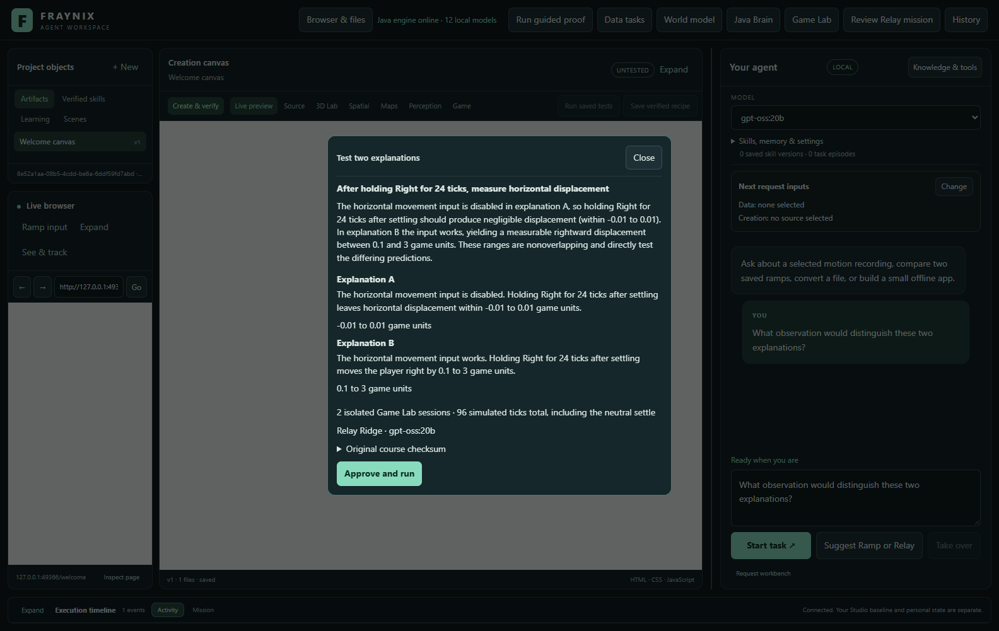
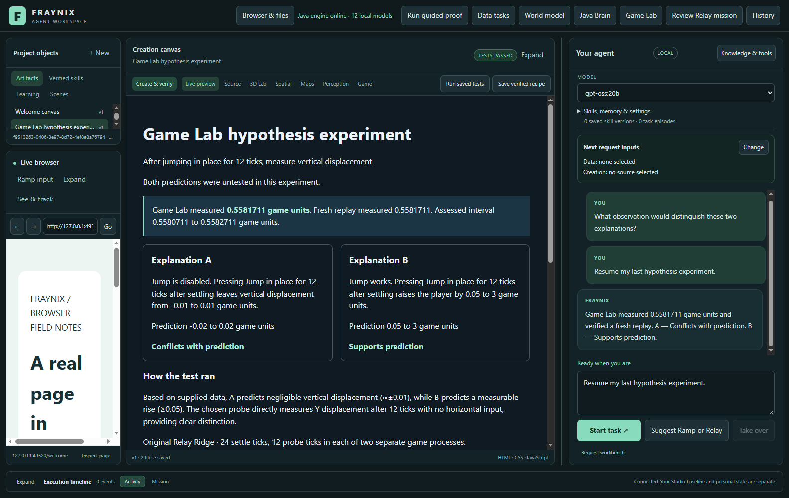

# Fraynix Agent Workspace · Edition 215

[Install on Mac, Windows or Linux](docs/INSTALL.md) · [Edition 214](README-214.md) · [Offline walkthrough](docs/readmes/215/index.html) · [Full edition history](docs/readmes/INDEX.md)

A local model suggests one observation to distinguish two Game Lab explanations. You review its predictions and budget before Java runs the original course, replays it and reports the result.

## Try it in Chat

1. Select a tool-capable local model and ask **“What observation would distinguish these two explanations?”**
2. Describe two explanations that make different predictions in the original Relay Ridge scene. You can supply expected ranges in game units for clearer comparisons.
3. Review the model’s proposed observation, ranges, original course and tick budget. Select **Approve and run**.
4. Inspect the result for each explanation, the original and replay positions, and the captured Game Lab frame.
5. Say **“Resume my last hypothesis experiment”** after restart to reopen the review or recheck the completed report.

## What the model chose and Java measured

| Question | Measured tick | Original displacement | Fresh replay |
| --- | --- | --- | --- |
| Right | 48 | 0.1413187 | 0.1413187 |
| Jump | 36 | 0.5581711 | 0.5581711 |

For the horizontal question, the local model chose to hold Right for 24 ticks and measure X. For the jump question, it chose to press Jump without horizontal input for 12 ticks and measure Y. In both examples, the measured interval fit the enabled-input prediction and fell outside the disabled-input prediction. The verdict applies to the approved ranges and original simulated scene. In the Jump example, the starting explanation gave −0.01 to 0.01 game units for A. The model proposed -0.02 to 0.02. The review showed that range, and Java used the approved numbers. [Right report](docs/readmes/215/right/index.html) · [Jump report](docs/readmes/215/jump/index.html)

## Verification

- Two Windows desktop runs used the real gpt-oss:20b local model. Both reviews survived restart and a changed measurement checkpoint was refused.
- Native approval and replay tests with a supplied proposal passed on Windows x64 and Linux x64. Hosted Apple silicon macOS and Intel macOS runners reported no OpenGL 4.1 display and verified that the review stopped without a result.
- Each run starts after an explicit approval of the exact saved plan. The original course, installed engine, clock, player identity, measured positions and native game frame are checked. Replay runs in a second process. Java checks six browser assertions against the displayed verdict and native measurements. The active Game Lab session is separate. [CI run](https://github.com/eyeoverthink/Fraynix-Agent-Workspace/actions/runs/45319265853) · [Release proof](docs/readmes/215/release-proof.json)

## Next acceptance test

Offer two credible probes for the same competing explanations, then measure which one separates predictions at lower cost across different starting conditions.

[Reproduction and verification plan](docs/publication215/plan.md) · [Obsidian map](docs/obsidian/223-hypothesis-experiment.canvas)
