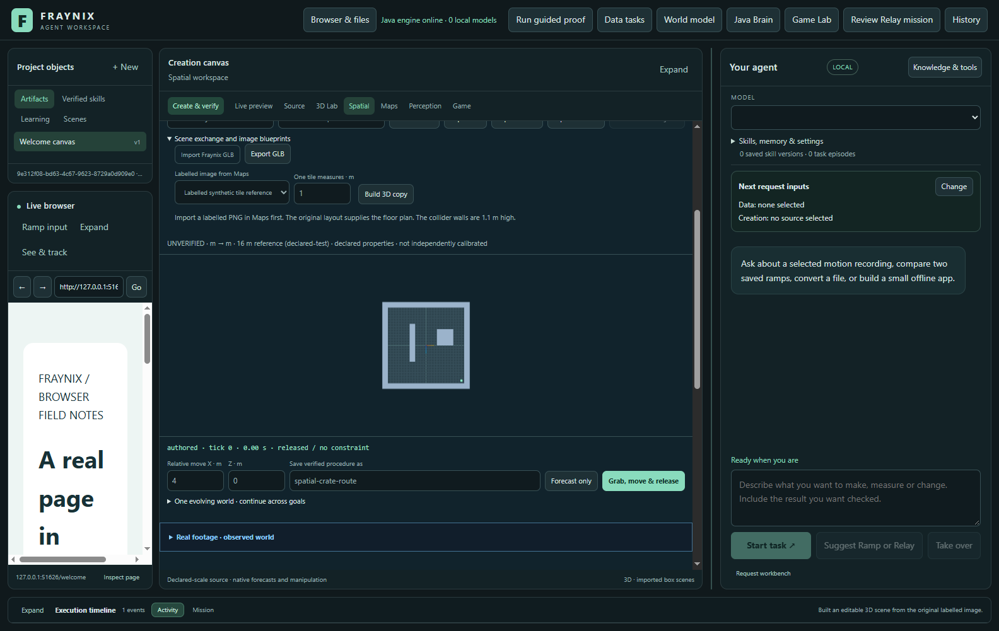
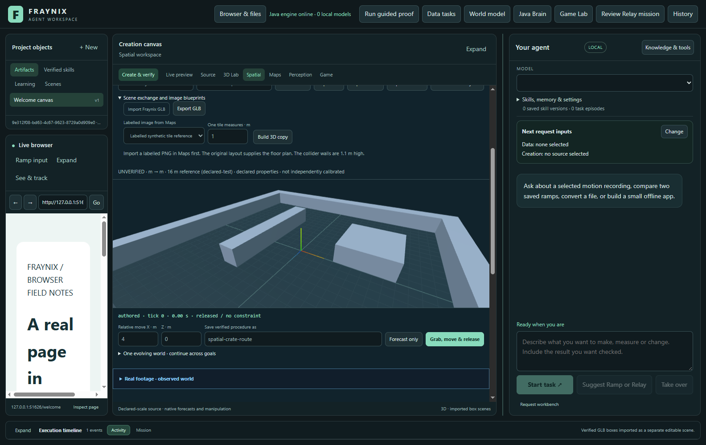
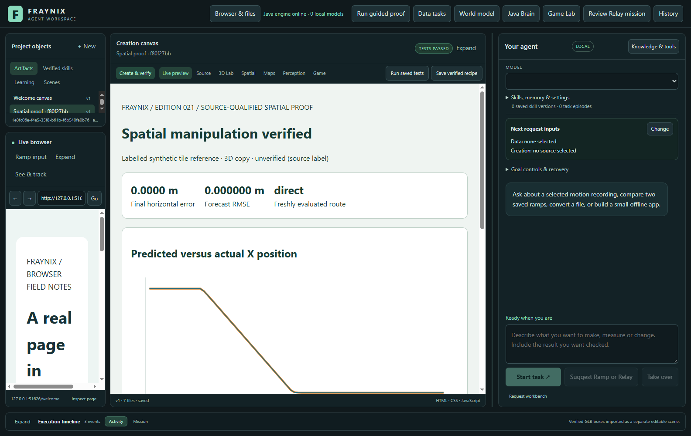

# Fraynix Agent Workspace · Edition 216

[Install on Mac, Windows or Linux](docs/INSTALL.md) · [Edition 215](README-215.md) · [Offline walkthrough](docs/readmes/216/index.html) · [Full edition history](docs/readmes/INDEX.md)

Convert a labelled plan into an editable 3D scene, exchange it with Blender via GLB, and move a returned object using the existing verified agent tool.

## Try the full scene workflow

You can open either sample GLB directly with **Import Fraynix GLB**.

1. Import an opaque, labelled PNG into **Maps** and declare which tile colours mean floor. For the sample, choose #d9efe5 as floor. [Reference used in testing](docs/readmes/216/reference.png)
2. Open **Spatial → Scene exchange and image blueprints**, choose the saved image, set the metre width of one tile, and select **Build 3D copy**.
3. Use **Top down** to compare the scene with the source. **Export GLB** saves the box scene, positions, and Fraynix physics properties as a single file. [Original GLB](docs/readmes/216/blueprint.glb)
4. In Blender, keep the metadata empty and the box custom properties. Export as GLB with **Custom Properties** enabled. Use **Import Fraynix GLB** to open the edited copy. [File edited in Blender](docs/readmes/216/blender-edited.glb)
5. Select the movable marker. Use the existing **Grab, move & release** action to forecast the route, run it, and inspect the verified result.

## What was proved

- The Windows desktop test checked all 256 source cells against 8 native boxes. Blender 5.3.0 moved the marker’s parent by 0.15 m. The reimport retained that offset and the original scene stayed intact. The agent run passed eight browser assertions alongside the native grab, move and release checks.
- Reopening a copy rechecks the original GLB bytes. An altered retained source was refused, and the valid scene and native goal were still available after restart.
- Java’s format, hierarchy and image-source tests passed on Windows x64, Linux x64, Apple silicon macOS and Intel macOS. [CI results](https://github.com/eyeoverthink/Fraynix-Agent-Workspace/actions/runs/45323857696) · [Release proof](docs/readmes/216/release-proof.json)

This workflow covers static box geometry with Fraynix metadata and a labelled top-down image. The tile size and wall height are declared. Ordinary photos, high-detail visual meshes, materials, rigs and animation are outside this edition. [Scene contract and implementation plan](docs/publication216/plan.md)

## Next acceptance test

Bring a detailed original mesh and a separate authored collider into the same scene. Verify that the agent can copy and transform the visual prop while physics uses the reviewed collider.

[Source and progress map](docs/obsidian/224-spatial-scene-exchange.canvas)
