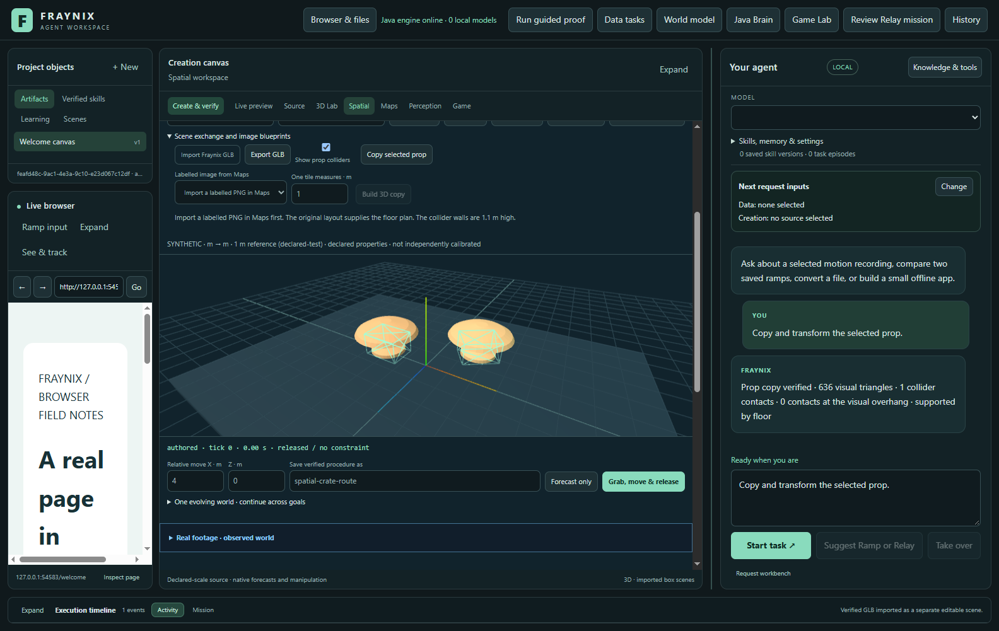
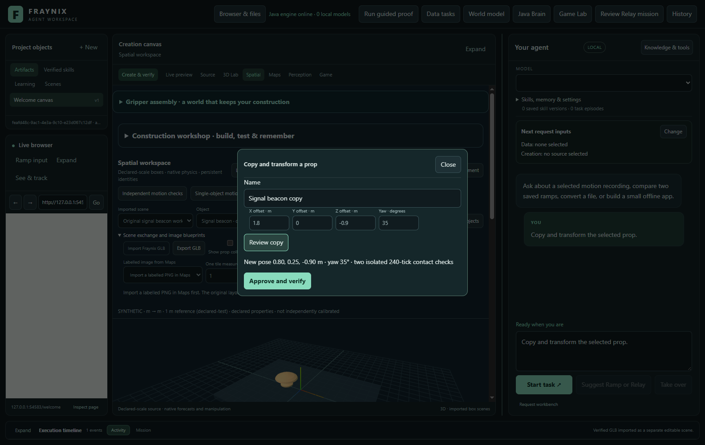

# Fraynix Agent Workspace · Edition 217

[Install on Mac, Windows or Linux](docs/INSTALL.md) · [Edition 216](README-216.md) · [Offline walkthrough](docs/readmes/217/index.html) · [Full edition history](docs/readmes/INDEX.md)

Import a Blender prop as a detailed triangle surface with a separate box collider. Use Chat to review a transformed copy, verify contacts in two native worlds, and return it to Blender.

## Try it

1. Open **Spatial → Scene exchange and image blueprints → Import Fraynix GLB**. [Original Blender beacon](docs/readmes/217/source.glb)
2. Select **Signal beacon**, then ask **“Copy and transform the selected prop.”** Enter the desired name, position offset and yaw.
3. Choose **Review copy**, confirm its target and select **Approve and verify**. Use **Show prop colliders** to see collision geometry in the viewport.
4. Keep the copied scene selected and choose **Export GLB**. Blender can reopen the export with both the original and the copy. [Tested return file](docs/readmes/217/copied.glb)

## What the test measured

- The original Blender beacon has 636 visual triangles. Two fresh native worlds each reported 1 contact inside the box, zero at a sampled point on the visual overhang, and support from the floor. Java refused an overlapping placement before committing the scene.
- Blender 5.3.0 reimported the independently exported file and measured the requested **1.8 m X offset**, **−0.9 m Z offset** in Fraynix coordinates, and **35° yaw**. Corresponding local visual vertices agreed within **2.6e-07 m**. [Blender report](docs/readmes/217/blender-verification.json)
- Both copies share one immutable visual asset in the edited scene. Each has its own object ID and collider. Restart recovers the verified scene, and reapproving the same transform opens the same copy.
- The Java import, approval, native collision and saved-receipt checks passed on Windows x64, Linux x64, Apple silicon and Intel macOS. [Portable CI](https://github.com/eyeoverthink/Fraynix-Agent-Workspace/actions/runs/45346972841) · [Release evidence](docs/readmes/217/release-proof.json)

The current exchange covers one indexed triangle surface and one box collider per detailed prop. The Chat path uses a reviewed local procedure. [Blender authoring, collision tests and next step](docs/publication217/plan.md)

## Next acceptance test

Edit a part of one copy and verify which visual asset and collider changed. Then place a prop measured from calibrated multi-view observations and review its collider before acting.

[Source and progress map](docs/obsidian/225-detailed-prop.canvas)
