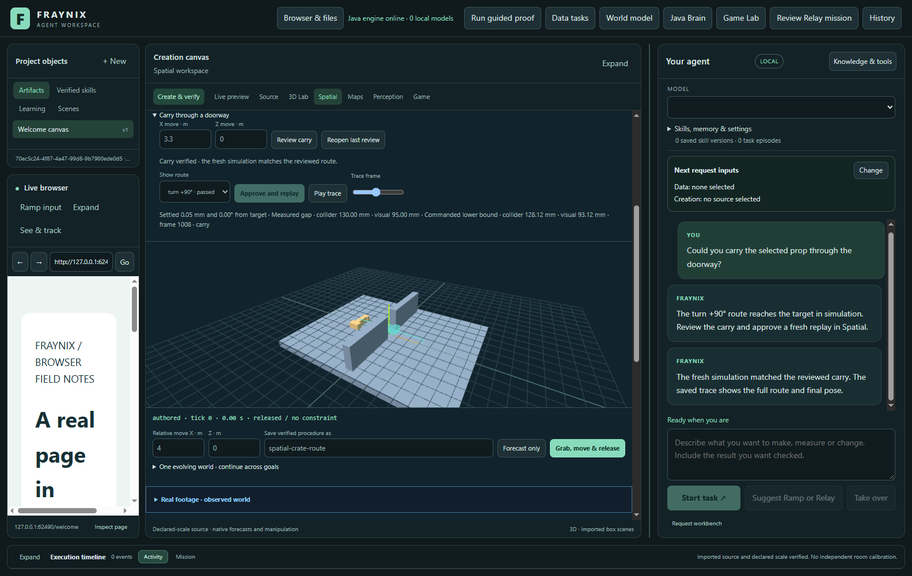
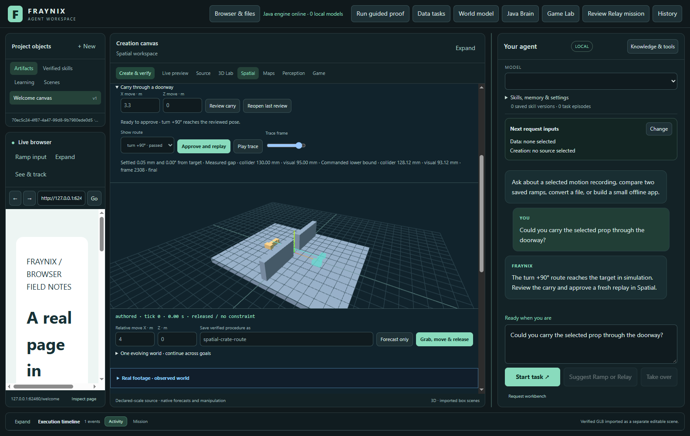
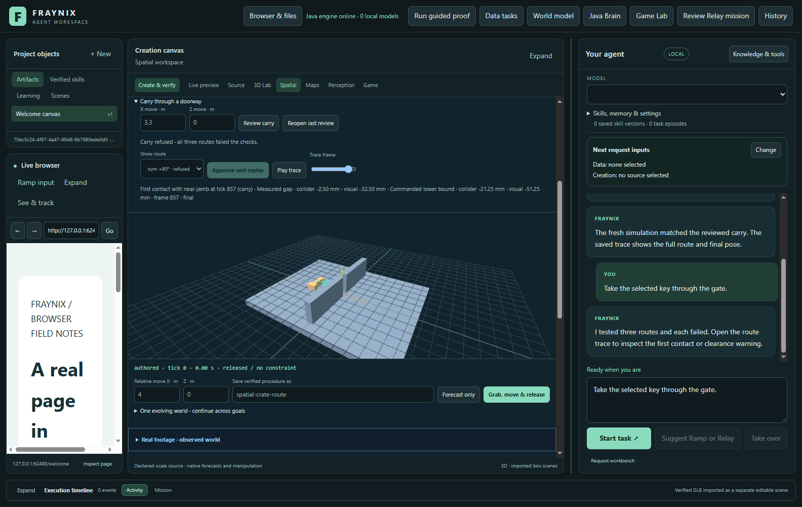

# Fraynix Agent Workspace · Edition 218

[Install on Mac, Windows or Linux](docs/INSTALL.md) · [Edition 217](README-217.md) · [Offline walkthrough](docs/readmes/218/index.html) · [Full edition history](docs/readmes/INDEX.md)

Ask Chat to carry a prop through a doorway. Fraynix compares a straight carry with two quarter-turns in separate physics worlds. Approve a successful route to replay it in a fresh world, or inspect the first contact and clearance warning when a route fails. The imported scene remains available as the source for the next experiment.

## Try it

1. Download a [turnable gate](workspace-engine/src/test/resources/spatial/doorways/gate-a-turn.glb), a [blocked gate](workspace-engine/src/test/resources/spatial/doorways/gate-a-blocked.glb) or the [visual clearance control](workspace-engine/src/test/resources/spatial/doorways/gate-a-visual.glb).
2. Open **Spatial → Scene exchange and image blueprints → Import Fraynix GLB**. Select **Gate key**. Leave X at **3.3 m** and Z at **0 m** for these fixtures.
3. Ask **“Carry the selected prop through the doorway.”** Chat opens a review and reports the outcome. The **Show route** menu lets you inspect each trial. Use **Play trace** or the frame slider to see the simulated position and orientation.
4. Select **Approve and replay** when a route qualifies. To resume after closing the desktop app, open **Spatial → Carry through a doorway → Reopen last review**. Java checks the saved review and original source before allowing approval.

## What the experiment found

Every gate pair has the same start pose and target pose. The opening changes between the two fixtures. Cases B and C also vary gate position, centerline and initial key yaw relative to case A.

| Blender-authored pair | Straight route in turnable case | Approved route | Collider and visual gaps | Blocked case |
| --- | --- | --- | --- | --- |
| A | Contact at tick 659 | +90° turn | 130.0 / 95.0 mm | 3 refused |
| B | Contact at tick 584 | +90° turn | 104.0 / 67.0 mm | 3 refused |
| C | Contact at tick 712 | +90° turn | 82.0 / 45.0 mm | 3 refused |

The three verified runs finished within **0.050 mm** of the target position and **0.00021°** of the target orientation in simulation. All three settled for 240 ticks after release. The seventh fixture gave the rotated collider **20.0 mm** of clearance while the visual envelope overlapped by about **15.0 mm**. The plan refused that route without an obstacle contact. [Complete run receipts](docs/readmes/218/desktop-evidence.json) · [Implementation and reproduction](docs/publication218/plan.md)

## Scope and next experiment

Chat sends supported carry phrases directly to the Java procedure. A local language model is optional for the rest of the workspace. This offline procedure handles one upright dynamic prop on a flat deck, a horizontal target and a fixed carry height. The three candidates keep the same crossing line. Java checks conservative visual envelopes, the interpolated commanded path and the physical pose at each native tick. The desktop trace retains a subset of those ticks. The results come from declared synthetic scenes. Position errors above describe the simulated final pose.

Next, give the agent two props with the same overhead outline and different heights. Let it choose the calibrated second view, then test its inferred dimensions on a withheld view and a separately measured physical prop. [Source map](docs/obsidian/226-doorway-carry.canvas)
