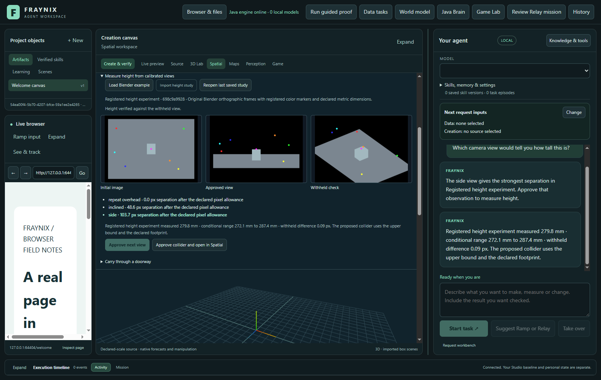
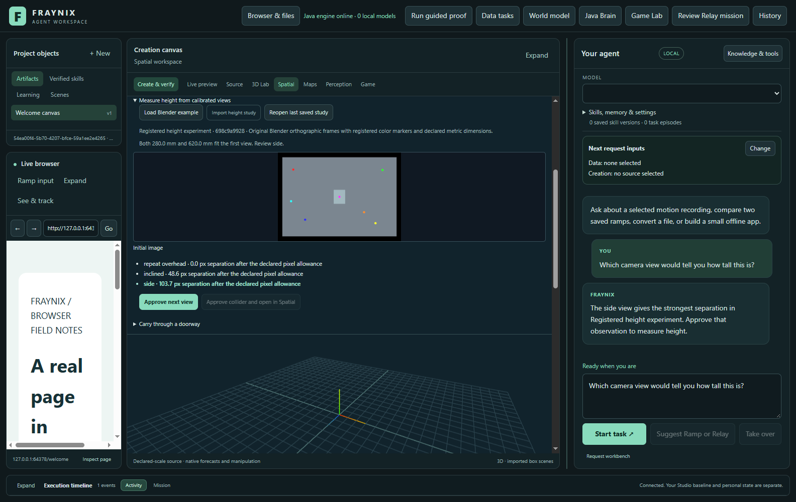
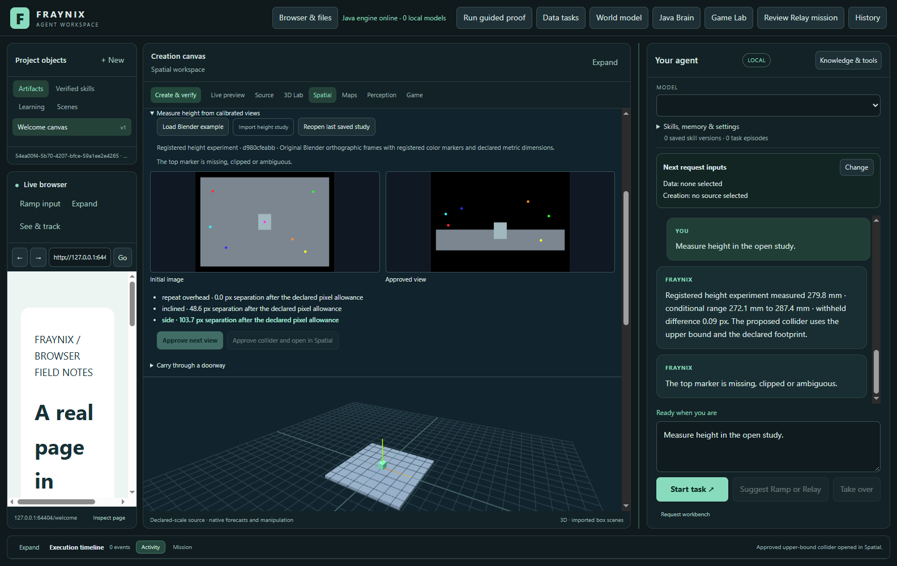

# Fraynix Agent Workspace · Edition 219

[Install on Mac, Windows or Linux](docs/INSTALL.md) · [Edition 218](README-218.md) · [Offline walkthrough](docs/readmes/219/index.html) · [Full edition history](docs/readmes/INDEX.md)

Fraynix chooses a calibrated view to resolve a hidden dimension. Java scores how far apart the two proposed heights would appear in each camera. After you approve a view, it measures height from that image, checks another camera, and proposes a collider that uses the upper end of the interval.

## Try it

1. Open **Spatial → Measure height from calibrated views → Load Blender example**. The package includes prerecorded Blender views of a registered prop and calibration markers.
2. Ask Chat **“Which camera view would tell you how tall this is?”** while the study is open. If another Spatial scene is showing, ask **“Measure height in the open study.”** The panel names the active study and shows each camera score.
3. Choose **Approve next view**. The example supplies the selected image and an independent viewing angle. Before approval, the study can be closed and reopened with **Reopen last saved study**.
4. Inspect the interval and select **Approve collider and open in Spatial**. The collider uses the upper height bound and the supplied footprint. The study and collider have separate approvals.

## Measured results

Blender 5.3.0 rendered the two props with the same overhead footprint. Direct Blender mesh bounds supplied the reference measurements and were kept out of the study packages. Both overhead plans were identical. Repeating the overhead view yielded **0 px** of separation after the declared pixel allowance, the inclined view yielded **48.6 px**, and the side view yielded **103.7 px**.

| Fixture | Reference height | Estimated height | Conditional interval | Withheld image error |
| --- | --- | --- | --- | --- |
| Low | 280.0 mm | 279.8 mm | 272.1–287.4 mm | 0.09 px |
| Tall | 620.0 mm | 620.6 mm | 612.9–628.2 mm | 0.19 px |

The hidden-marker fixture produced a refusal. Java also refused transparent marker pixels, a partially covered marker, a contradictory withheld image, and changed original bytes. The Windows desktop test reopened the pending study, verified an exact approval, and imported the approved collider once on repeated requests. [Receipts](docs/readmes/219/evidence.json) · [Verification contract and reproduction](docs/publication219/plan.md)

## Scope and next experiment

This offline workflow uses registered orthographic images, a known marker offset, fixed reference points and a declared footprint. The interval assumes that the images show the same marked prop and that the declared localization allowance applies. The demonstration validates the estimator on Blender images. Physical camera accuracy and the treatment of lens distortion still need separate validation.

Next, record two calibrated views of one uniquely marked physical prop and measure its height separately. Test whether the interval covers that measurement and whether partial visibility triggers a refusal. [Source and evidence map](docs/obsidian/227-height-study.canvas)
