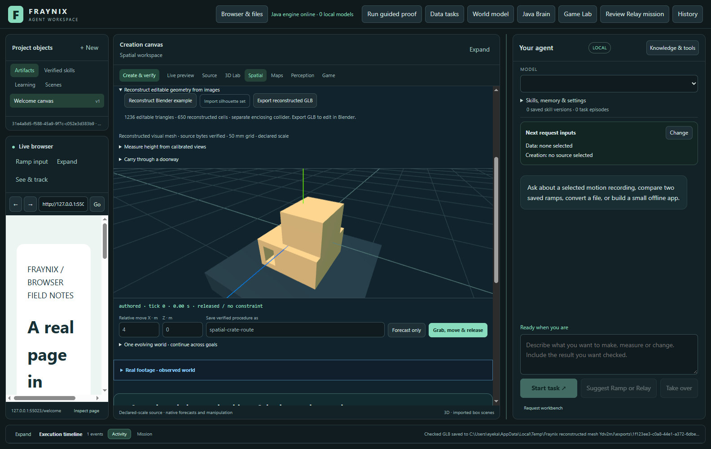
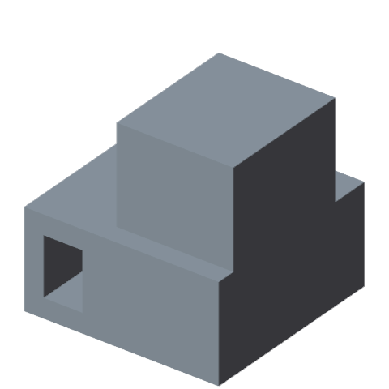

# Fraynix Agent Workspace · Edition 220

[Install on Mac, Windows or Linux](docs/INSTALL.md) · [Edition 219](README-219.md) · [Offline walkthrough](docs/readmes/220/index.html) · [Full edition history](docs/readmes/INDEX.md)

Fraynix reconstructs an editable 3D surface from three registered PNG silhouettes. Java builds the triangles, opens them in Spatial, and exports GLB for Blender. The original image package stays tied to the reconstructed asset.

## Try it

1. Open **Spatial → Reconstruct editable geometry from images → Reconstruct Blender example**.
2. Inspect the new mesh. Its appearance comes from the reconstructed triangles. Physics uses a separate enclosing box.
3. Choose **Export reconstructed GLB** and open it in Blender. The sample files below can also be opened directly.

[Editable Blender project](docs/readmes/220/editable-prop.blend) · [Java’s exported GLB](docs/readmes/220/reconstructed.glb) · [Blender-edited return](docs/readmes/220/blender-edited-reconstruction.glb) · [Registered input images](workspace-engine/src/main/resources/spatial/reconstruction/bracket.json)

## Independent Blender check

| Withheld view of the Blender source | Withheld view of the Java reconstruction |
| --- | --- |
|  |  |

- Java reconstructed **618 vertices and 1,236 triangles** from the three input images. Blender’s original mesh and the fourth camera image stayed out of reconstruction.
- The fourth-angle silhouettes matched pixel for pixel. Blender measured a maximum bidirectional sampled surface difference of **0.0041 mm** on this grid-aligned fixture.
- Blender raised the reconstructed shoulder by **50 mm**. Fraynix reimported the edit and checked the measured displacement, a distinct visual asset, and the original scene’s preservation.
- A hidden-recess control differed in solid volume by **2.25 L** with identical input silhouettes at all three angles. Both input sets produced the same visual hull. A new view or depth evidence would be needed to distinguish the recess.

[Run evidence](docs/readmes/220/reconstruction-evidence.json) · [Independent audit of prior work](docs/publication220/reconstruction-audit.md)

## Scope

This release works with three registered orthographic silhouettes on a declared metric grid. The benchmark measures silhouette agreement, volume and sampled surface distance on the slotted bracket. Colour, textures and topology beyond the observed surfaces need their own inputs and validation. The displayed mesh and the collision proxy are independently editable assets. [Technical contract and reproduction](docs/publication220/plan.md) · [Source map](docs/obsidian/228-visual-reconstruction.canvas)
