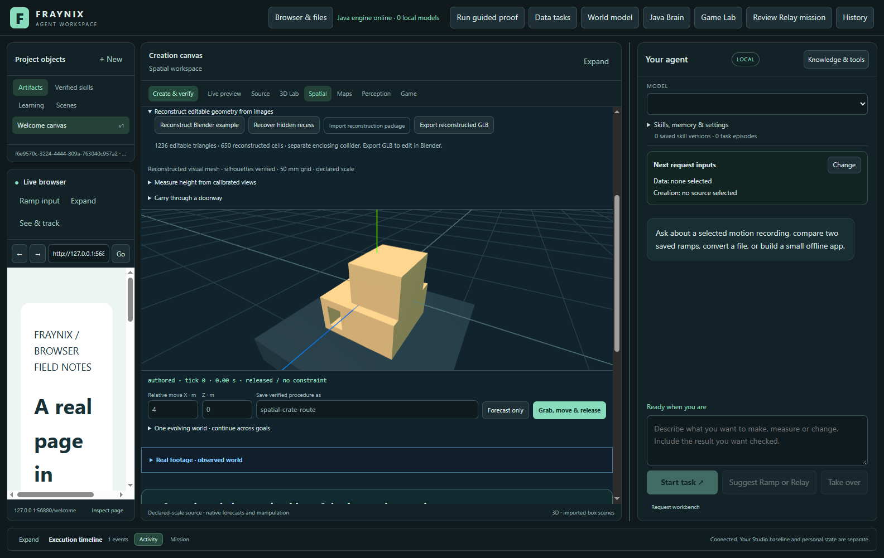

# Fraynix Agent Workspace · Edition 221

[Install on Mac, Windows or Linux](docs/INSTALL.md) · [Edition 220](README-220.md) · [Offline walkthrough](docs/readmes/221/index.html) · [Full edition history](docs/readmes/INDEX.md)

Blender depth reveals the bracket recess that edition 220’s silhouettes could not distinguish. Fraynix turns that evidence into an editable triangle mesh, preserves the original silhouette-only workflow, and exports the result to Blender.

| Same images with silhouettes only | Same images plus Blender first-hit depth |
| --- | --- |
|  |  |

## Try it

1. Open **Spatial → Reconstruct editable geometry from images → Recover hidden recess**. The example uses checked Blender images and depth.
2. Inspect the shoulder from the side where the opening faces the camera. The reconstruction panel reports the **18 cells carved by depth**.
3. Choose **Export reconstructed GLB** to open your copy in Blender. The sample project and GLB are available directly.

[Editable Blender project](docs/readmes/221/editable-recess.blend) · [Recovered GLB](docs/readmes/221/recovered-recess.glb) · [Blender-edited return](docs/readmes/221/blender-edited-recess.glb) · [Source package](workspace-engine/src/main/resources/spatial/reconstruction/recess-depth.json)

## What Blender verified

| Check | Silhouette-only result | Depth-backed result | Original Blender mesh |
| --- | --- | --- | --- |
| Recess depth beyond the neighboring face | 0 mm | 100 mm | 100 mm |
| Volume | 0.08125 m³ | 0.07900 m³ | 0.07900 m³ |

- Blender rebuilt the original and compared it with the opened GLB at **196 withheld rays**, shifted off the input cell centres in the same rear direction. All 74 hits and 122 misses agreed. The largest hit difference was approximately **0.00006 mm** in this synthetic calculation.
- The separate oblique silhouette matched pixel for pixel. The maximum bidirectional sampled surface difference was **0.0041 mm**.
- Blender edited the recess **25 mm deeper** and re-exported the GLB. Fraynix checked the 125 mm recess on reimport, retained the enclosing box and preserved the original scene.
- Missing recess rays leave those cells in place. Java refuses contradictory projections and samples outside the supported grid tolerance. Desktop replay restored the result after restart and refused export after a saved depth sample was altered.

[Evidence and reviewer notes](docs/publication221/plan.md) · [Original withheld view](docs/readmes/221/withheld-recess-original.png) · [Reconstructed withheld view](docs/readmes/221/withheld-recess-reconstructed.png)

## Scope

This edition uses registered orthographic first-hit depth from Blender on a declared metric grid. Java carves in front of the fitted grid face, within the declared **0.5 mm** snap tolerance. The fixture had zero snap residual. Detail behind the first hit needs its own evidence. The mesh carries the recovered cavity and the physics body uses a separate enclosing box.
