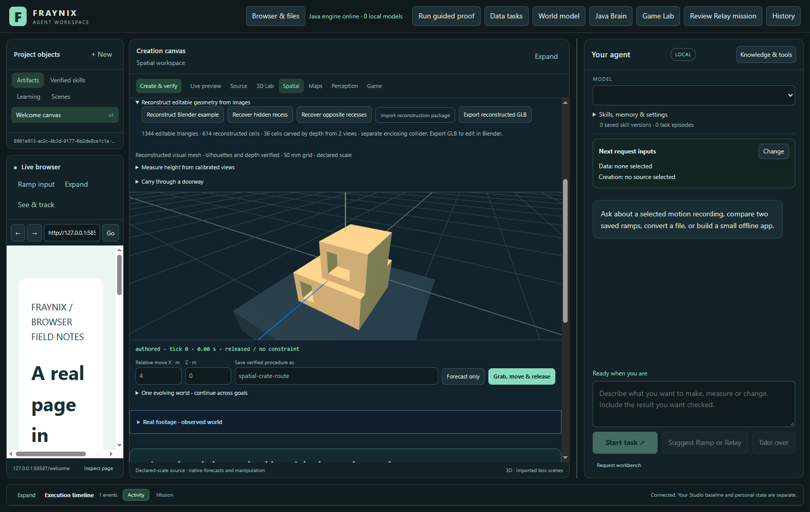
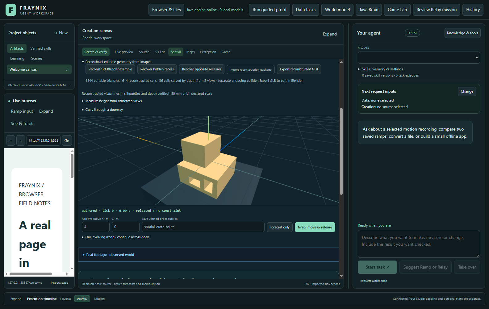

# Fraynix Agent Workspace · Edition 222

[Install on Mac, Windows or Linux](docs/INSTALL.md) · [Edition 221](README-221.md) · [Offline walkthrough](docs/readmes/222/index.html) · [Full edition history](docs/readmes/INDEX.md)

Fraynix combines registered depth from opposite sides of a bracket. Each view sees one recess. Java preserves both measured surfaces, checks for contradictory evidence and exports the resulting editable mesh.

| Fraynix from the first side | Fraynix from the opposite side |
| --- | --- |
|  |  |

## Try it

1. Open **Spatial → Reconstruct editable geometry from images → Recover opposite recesses**.
2. Rotate the model to inspect the opening on each side. The panel reports **36 cells carved by depth from two views**.
3. Choose **Export reconstructed GLB** to continue in Blender. The samples below are ready to open.

[Editable Blender project](docs/readmes/222/editable-opposed-recesses.blend) · [Recovered GLB](docs/readmes/222/opposed-depth.glb) · [Registered input package](workspace-engine/src/main/resources/spatial/reconstruction/opposed-depth.json)

## What Blender verified

| Input held constant across controls | Upper recess | Lower recess | Reconstructed volume |
| --- | --- | --- | --- |
| Silhouettes | Filled | Filled | 0.08125 m³ |
| Silhouettes and positive-Z depth | 100 mm | Filled | 0.07900 m³ |
| Silhouettes and negative-Z depth | Filled | 150 mm | 0.07900 m³ |
| Silhouettes and both depth grids | 100 mm | 150 mm | 0.07675 m³ |
| Original Blender mesh | 100 mm | 150 mm | 0.07675 m³ |

- Blender compared the exported mesh against the original with **392 withheld rays** at offset positions across the two known directions. There were zero hit or miss disagreements. The two withheld oblique silhouettes each had more than **99.999%** overlap, and the maximum bidirectional sampled surface difference was **0.0041 mm**.
- A pair of depth grids that each fit the silhouette hull was refused when one grid’s free space would erase the other’s measured first hit. Reversing the order of valid grids generated the same mesh.
- Fraynix restored the scene after restart and refused to export it after a retained depth grid was altered. The original single-depth workflow still opens and exports.

[Run evidence](docs/readmes/222/multidepth-evidence.json) · [Independent review and reproduction](docs/publication222/plan.md)

## Scope

The two depth grids use registered orthographic views on a declared metric lattice. This test used generated Blender evidence. A surface behind both first hits can still be unresolved. The geometry of the recesses is in the editable triangle mesh, and physics uses a separate enclosing box.
