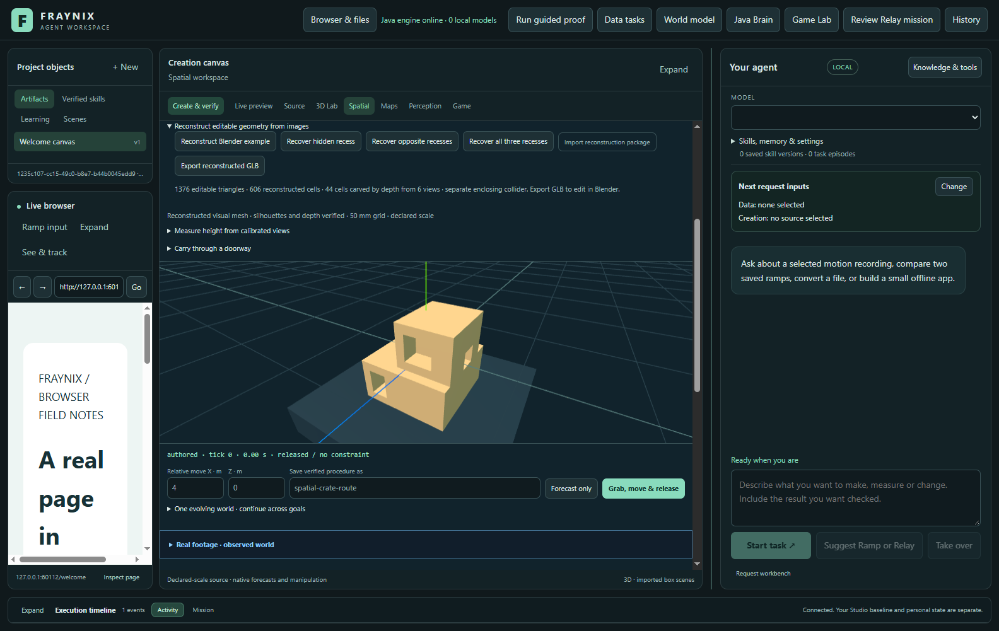
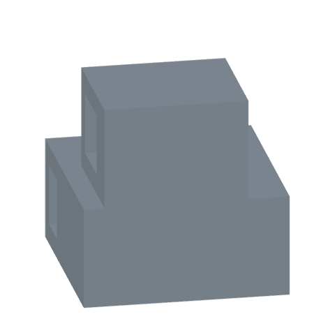

# Fraynix Agent Workspace · Edition 223

[Install on Mac, Windows or Linux](docs/INSTALL.md) · [Edition 222](README-222.md) · [Offline walkthrough](docs/readmes/223/index.html) · [Full edition history](docs/readmes/INDEX.md)

Fraynix can now reconstruct an editable mesh from depth captured at any of the six orthographic faces of a registered grid. For this Blender bracket, looking along +X exposed a **100 mm side recess** that neither of the opposed Z views could detect. Java checks every view against the original silhouette hull before carving it.

## Try it

1. Open **Spatial → Reconstruct editable geometry from images → Recover all three recesses**.
2. Rotate the bracket to inspect its side and back. The mesh contains **606 occupied cells and 1,376 editable triangles** on a 50 mm grid.
3. Choose **Export reconstructed GLB** and open it in Blender. Use **Import reconstruction package** to load your own registered silhouettes and depth grids.

[Editable Blender project](docs/readmes/223/editable-three-recesses.blend) · [Recovered GLB](docs/readmes/223/three-recesses.glb) · [Registered Blender input](workspace-engine/src/main/resources/spatial/reconstruction/side-depth.json)

## What the side view changes

| Blender comparison | Opposed Z views | Opposed Z plus +X | All six views | Original Blender mesh |
| --- | ---: | ---: | ---: | ---: |
| Occupied grid cells | 614 | 606 | 606 | — |
| Side recess depth | 0 mm | 100 mm | 100 mm | 100 mm |
| Mesh volume | 76.75 L | 75.75 L | 75.75 L | 75.75 L |

| Opposed depth leaves the side filled | The perpendicular view exposes the recess |
| --- | --- |
|  |  |

- Blender independently checked **1,176 offset rays** across six directions with zero hit-or-miss disagreements. The separate oblique silhouette overlapped the original by **more than 99.999%**. The largest sampled surface difference was **0.0041 mm**.
- Two claims that passed independently were refused when a +X free-space ray would erase a measured +Z first hit. Reversing the input order preserved the mesh and the geometry proof. After restart, Fraynix reopened the same mesh and refused export when the retained source changed.
- A separate **0.125 L sealed cavity** left all six first-hit grids identical. The method measures visible depth on a registered lattice. Fully enclosed spaces are unresolved, and physics uses the enclosing box defined separately from the visual mesh.

[Full measurement receipt](docs/readmes/223/side-depth-evidence.json) · [Verification, independent review and reproduction](docs/publication223/plan.md)
