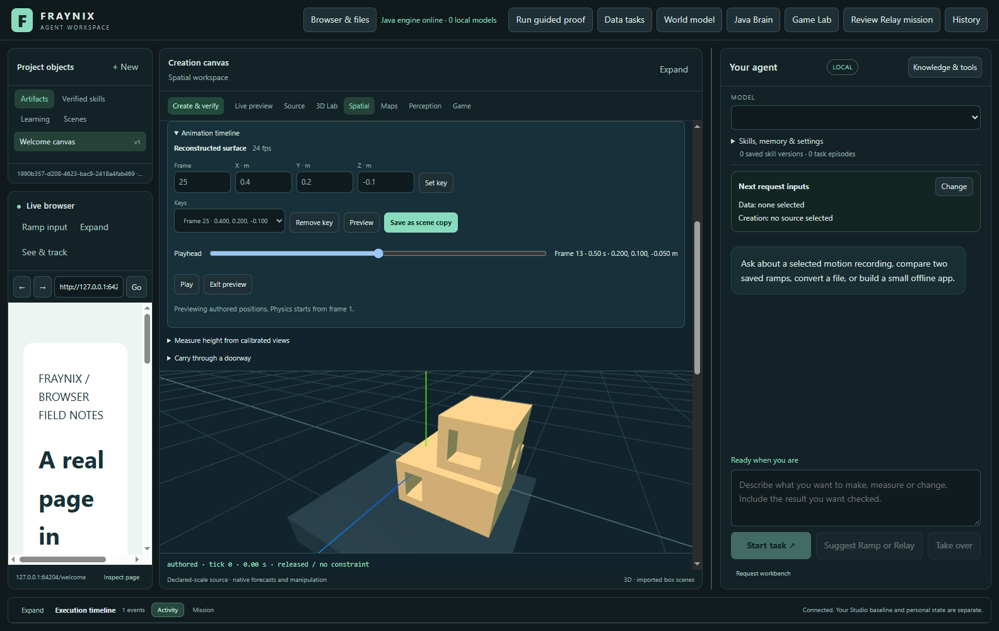
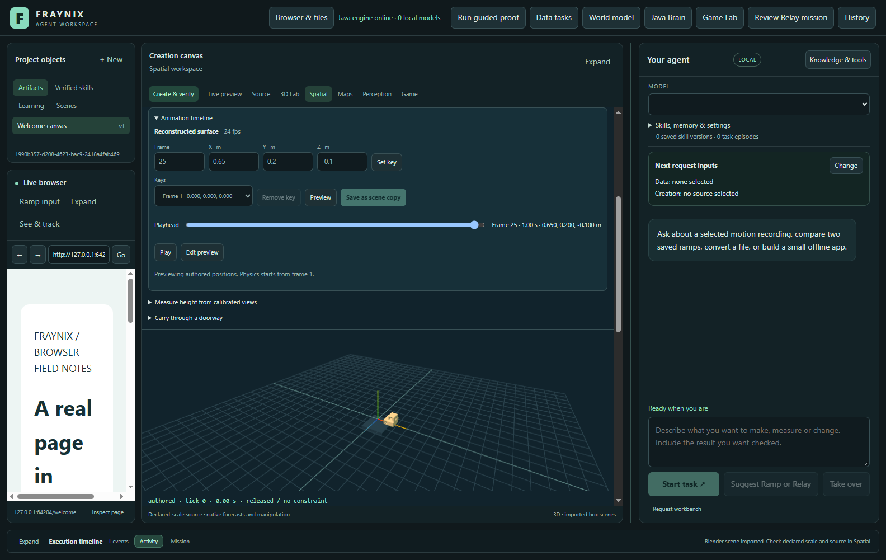

# Fraynix Agent Workspace · Edition 224

[Install on Mac, Windows or Linux](docs/INSTALL.md) · [Edition 223](README-223.md) · [Offline walkthrough](docs/readmes/224/index.html) · [Full edition history](docs/readmes/INDEX.md)

This is the first edition of the integrated 3D production workbench. You can now author, scrub, play and save linear position keyframes for rigid props in Spatial, then exchange the editable timeline and mesh with Blender. Local authoring and playback run in Fraynix. Native .blend exchange uses the installed Blender executable.

## Author and exchange a scene

1. Open **Spatial** and load a scene. For a detailed mesh choose **Recover all three recesses**.
2. Select a dynamic prop and open **Animation timeline**. Its authored position is the frame 1 key. Enter a later frame and a position in metres, then select **Set key**.
3. Use **Preview** to scrub or play the resulting motion. Exit preview to see the current physics state again.
4. Select **Save as scene copy**, then **Export Blender**. Open the .blend in Blender, edit the location keys, and use **Import Blender** in Spatial to bring the edited scene back.

The timeline currently supports linear translation at 24 frames per second. A prop can have 2–32 synchronized XYZ keys starting at frame 1, with a maximum of 30 seconds. Up to eight dynamic props can have tracks in one scene. The static GLB path refuses animated scenes so the timeline cannot disappear during export.

## Verified round trip

Fraynix authored a movement of 0.4 m in X, 0.2 m in Y, and −0.1 m in Z. Blender independently evaluated five frames, then moved the last key 0.25 m farther along X. Fraynix imported the edit, kept the exact triangle asset and checked the separate collider dimensions and mass. Both the original motion and edited copy survived restart. The in-app animation preview left native physics state intact.

The exchange was exercised on Windows with **Blender 5.3.0** and **Blender 4.5.17 LTS**. Blender 4.5.17 also opened and edited the file produced by Blender 5.3.0 for this scene.

[Fraynix-authored Blender scene](docs/readmes/224/fraynix-authored.blend) · [Edited Blender scene](docs/readmes/224/edited-in-blender.blend) · [Cross-version evidence](docs/readmes/224/animation-evidence.json) · [4.5 LTS adapter run](docs/readmes/224/lts-animation-evidence.json)

## Nine production workflows

The workbench roadmap covers modeling, rigging, animation, simulation, rendering, compositing, motion tracking, 2D animation and video editing. The roadmap gives each area an in-app acceptance test and a Blender round-trip target. Edition 224 adds a working translation workflow within animation, alongside the existing reconstruction, physics and tracking features.

[Production workbench roadmap](docs/publication224/plan.md)
