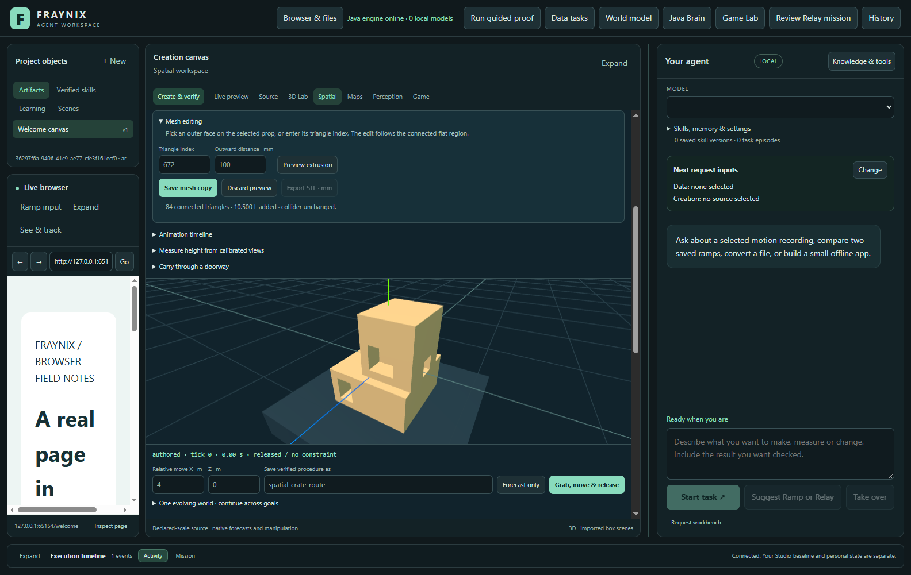
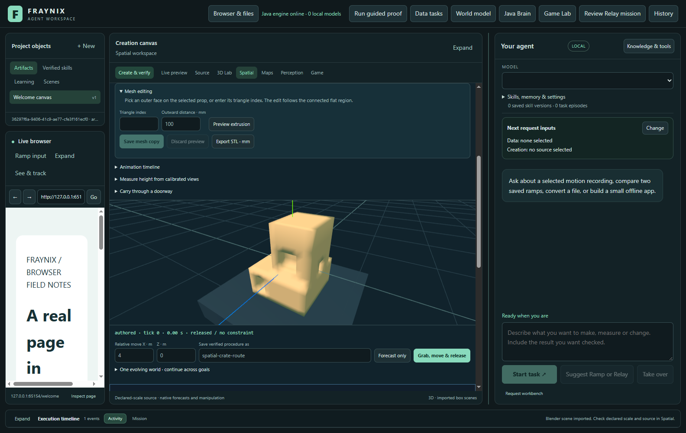

# Fraynix Agent Workspace · Edition 225

[Install on Mac, Windows or Linux](docs/INSTALL.md) · [Edition 224](README-224.md) · [Offline walkthrough](docs/readmes/225/index.html) · [Full edition history](docs/readmes/INDEX.md)

Fraynix now edits a connected outer face of a triangle mesh, previews the change in the viewport, and saves it as a new scene. The editor keeps the detailed surface, collision box, and any existing translation timeline in their own data. You can exchange the editable scene with Blender or export the selected surface as a millimetre STL.

## Edit and exchange

1. In **Spatial**, choose **Recover all three recesses** or open a supported scene with a detailed triangle prop.
2. Select the prop and expand **Mesh editing**. Click an outer face on the selected prop. For the sample's roof you can also enter triangle index **672**.
3. Enter **100 mm** and choose **Preview extrusion**. Discard the preview to return to the original view, or choose **Save mesh copy** to keep the result.
4. Use **Export Blender** for an editable native scene. Choose **Export STL · mm** for the selected visual surface. STL contains the local surface in Z-up coordinates with its lowest point at Z = 0. In a metre scene in Blender, import it at scale 0.001.

## Results

| Measurement | Original | Fraynix edit | Further Blender edit |
| --- | ---: | ---: | ---: |
| Cap movement from original | 0 mm | 100 mm | 125 mm |
| Visual volume | 75.75 L | 86.25 L | 88.875 L |
| Triangle count | 1,376 | 1,428 | 1,428 |
| Collider height | 500 mm | 500 mm | 500 mm |

Blender 4.5.17 LTS opened the scene written by Blender 5.3.0, independently checked mesh closure and volume, and moved the cap an additional 25 mm. Fraynix reopened the edit after restart. Blender also measured the STL at **600 mm tall** with a closed surface and the expected volume.

| Native scene edited in Fraynix | Further mesh edit returned from Blender |
| --- | --- |
|  |  |

[Fraynix scene](docs/readmes/225/fraynix-extrusion.blend) · [Blender edit](docs/readmes/225/mesh-blender-edit.blend) · [Millimetre STL](docs/readmes/225/extruded-shell-mm.stl) · [Measurement receipt](docs/readmes/225/mesh-edit-evidence.json)

This operation supports connected planar faces on the outside of closed, consistently oriented triangle meshes. The STL check covers topology and scale. Wall thickness, supports, self-intersection certification and slicer output need their own checks. The production roadmap includes the additional modeling, sculpting, rigging, rendering, simulation, VFX, game asset and scripting requirements.

[Expanded production roadmap](docs/publication225/plan.md)
