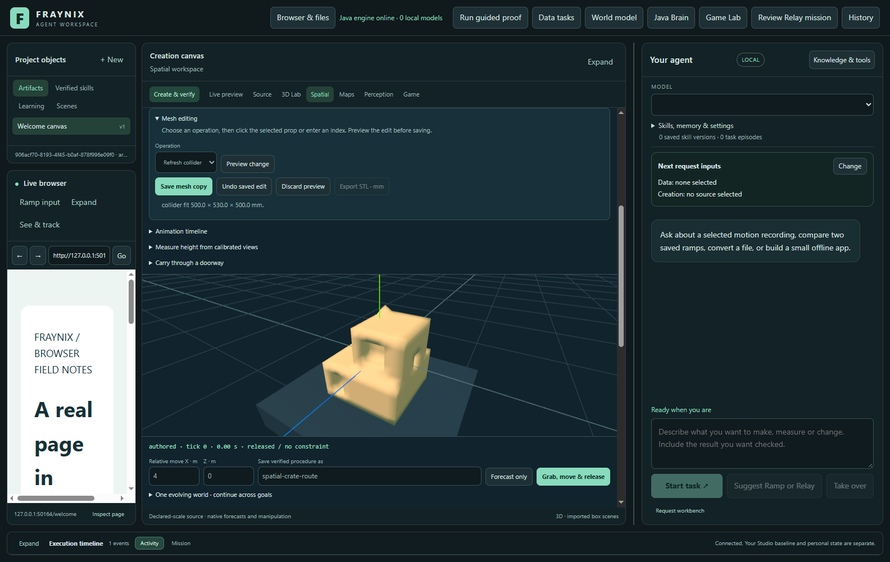
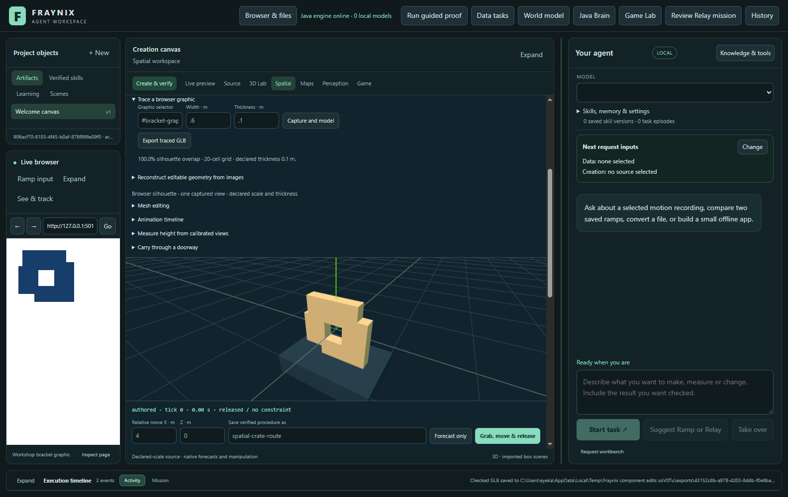

# Fraynix Agent Workspace · Edition 226

[Install on Mac, Windows or Linux](docs/INSTALL.md) · [Edition 225](README-225.md) · [Offline walkthrough](docs/readmes/226/index.html) · [Full edition history](docs/readmes/INDEX.md)

Edition 226 adds vertex, edge and face moves, saved undo, a fitted collision box, and a first workflow for turning a visible browser graphic into an editable 3D model.

## Edit a mesh and refresh its collider

1. In **Spatial**, load a detailed prop and open **Mesh editing**.
2. Select **Move vertex**, **Move edge**, or **Move face**. Click the prop or enter an index, set a local offset in millimetres, and preview. A face move translates one triangle's three shared vertices.
3. Choose **Save mesh copy**. Use **Undo saved edit** to reopen the last checked scene, including after restart. Both versions remain selectable.
4. Select **Refresh collider** and preview and save the new box. You can also tick **Fit collider after edit** before previewing a component change.

The test moved one, two and three vertices in successive edits. It then fitted a **500 × 530 × 500 mm** collider, shifting the pivot **15 mm** while preserving the edited surface's world positions. Blender 4.5.17 LTS opened the file exported through Blender 5.3, checked the box, moved the visual cap by another 5 mm, and returned the edit to Fraynix.

## Trace a visible browser graphic

1. Open a page in the in-app browser and leave a single image, SVG or canvas fully visible against a plain contrasting background.
2. Under **Spatial → Trace a browser graphic**, enter the element's unique CSS selector, its declared width, and the thickness you want for the model.
3. Click **Capture and model**. Fraynix captures the pixels, isolates the foreground, compares three model resolutions, and keeps the best checked fit. Use **Export traced GLB** to take the mesh to Blender or continue editing in Spatial.

On the original test graphic, the 16-cell model matched **83.7%** of the foreground and the selected 20-cell model reached **100%**. The hole remained visible. The captured pixels and verification receipt are stored in the local project. Changing the saved capture caused re-export to refuse after restart. This workflow models a silhouette with declared depth and scale. It requires selection of the graphic and leaves hidden geometry and materials unresolved.

[Blender input](docs/readmes/226/fraynix-components.blend) · [Blender edit](docs/readmes/226/blender-component-edit.blend) · [Captured graphic](docs/readmes/226/browser-graphic.png) · [Traced GLB](docs/readmes/226/browser-trace.glb) · [Evidence](docs/readmes/226/component-trace-evidence.json) · [Verification and roadmap](docs/publication226/plan.md)
