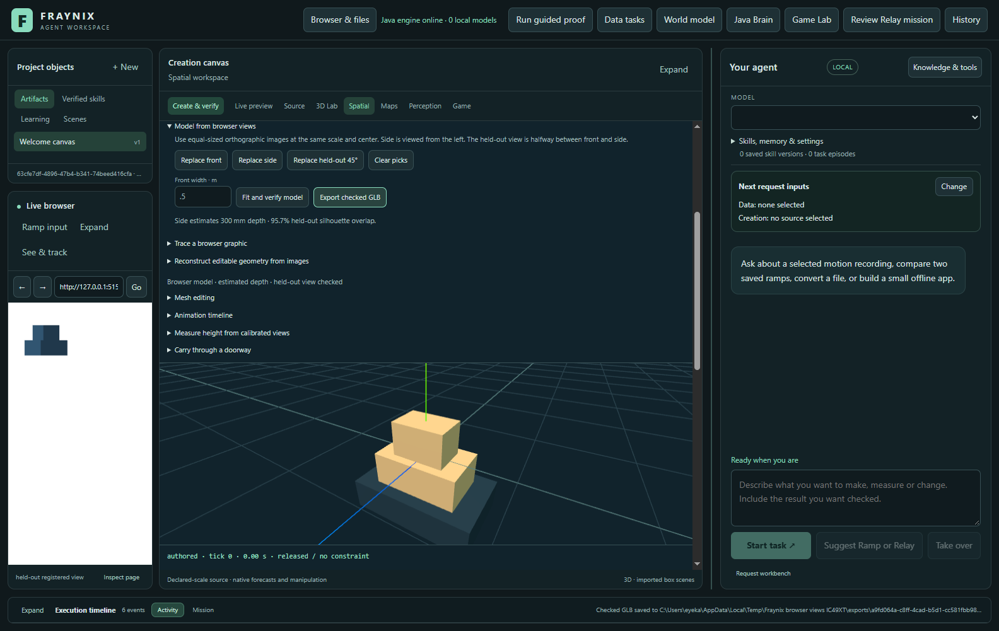

# Fraynix Agent Workspace · Edition 227

[Install on Mac, Windows or Linux](docs/INSTALL.md) · [Edition 226](README-226.md) · [Offline walkthrough](docs/readmes/227/index.html) · [Full edition history](docs/readmes/INDEX.md)

Click an item in the in-app browser to isolate its rendered pixels. Fraynix uses registered front and left-side views to fit an editable mesh, then checks the mesh against a separate view taken halfway between them.

## Build a model from three browser views

1. Open **Spatial → Model from browser views**. Keep the in-app browser visible.
2. Navigate to the front image and select **Pick front**, then click the image in the browser. Repeat with the left-side view and **Pick side**.
3. Pick a distinct **held-out 45°** view taken halfway between those two viewpoints at the same height. Use square orthographic views with a common center, scale, framing and plain contrasting background.
4. Enter the known front width in metres and choose **Fit and verify model**. If the held-out view passes, use **Export checked GLB** to take the mesh to Blender or continue working in Spatial. Press Escape in the browser to cancel a pick.

## Test result

| Measurement | Result |
| --- | ---: |
| Known front width | 500 mm |
| Estimated depth from the side | 300 mm |
| Selected grid resolution | 50 mm per cell |
| Correct held-out view, Fraynix raster comparison | 95.7% overlap |
| Different prop in the held-out slot | 47.0% overlap, refused at an 86% threshold |
| Blender depth readback from GLB | 300 mm |
| Volume difference measured by Blender | 0.43% |

The picker captured the real visible browser pixels without following the image's link. Java picked the grid using front and side only. The third view verified the resulting mesh. Blender independently reopened the GLB, matched the original dimensions, and re-rendered both geometries at an oblique angle.

| Front | Left side | Held-out |
| --- | --- | --- |
|  |  |  |

The workflow works with visible images, SVGs and canvases. Scale and camera registration are supplied with the views. A silhouette leaves hidden geometry and materials unresolved. The original capture package is retained locally, and an altered package refuses re-export after restart. The single-view workflow from edition 226 remains available.

[GLB](docs/readmes/227/browser-verified.glb) · [Refused comparison](docs/readmes/227/held-out-refused.png) · [Measurement receipt](docs/readmes/227/browser-views-evidence.json) · [Registration and verification](docs/publication227/plan.md)
