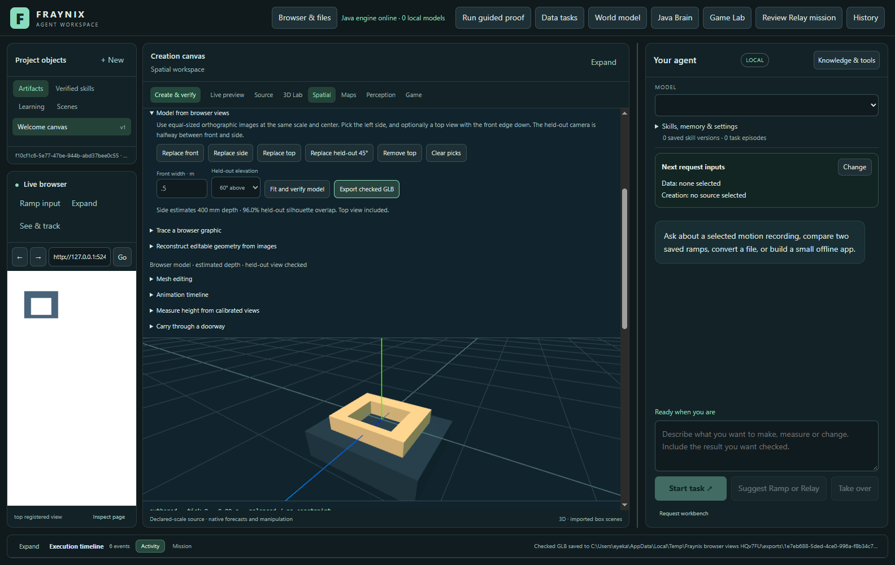
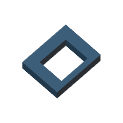
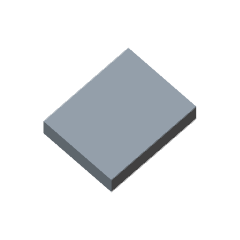

# Fraynix Agent Workspace · Edition 228

[Install on Mac, Windows or Linux](docs/INSTALL.md) · [Edition 227](README-227.md) · [Offline walkthrough](docs/readmes/228/index.html) · [Full edition history](docs/readmes/INDEX.md)

A top view can reveal geometry that front and side both hide. Fraynix can now include a top capture in the fit and verify the result against a separate elevated silhouette.

## Try it

1. In **Spatial → Model from browser views**, pick the registered front and left-side graphics.
2. Select **Pick top** and click the orthographic top image with the front edge at the bottom. Keep the crops square, centered, and at the same scale.
3. Set **Held-out elevation** to **60° above**. Under **Pick held-out 45°**, click a separate view halfway between the front and left-side cameras, raised 60° above the horizontal.
4. Enter the known front width and select **Fit and verify model**. Use **Remove top** to rerun the comparison with the same front, side and elevated witness. Export a passing mesh with **Export checked GLB**.

The level witness and the two-view workflow from edition 227 are still available.

## Measured result

| Test on the perforated plate | Front and side | Front, side and top |
| --- | ---: | ---: |
| Fraynix's overlap with the same elevated witness | 76.5%, refused | 96.0%, passed |
| Exported mesh volume measured by Blender | 20.0 L | 12.5 L |
| Front and side silhouette overlap measured by Blender | 100% each | 100% each |
| Elevated overlap measured by Blender | 77.1% | 100% |

Blender measured the original at **12.5 L**. The front and side led to a filled model that passed a level witness. The elevated view rejected it. Adding the top recovered the through-opening, while the same elevated witness stayed outside the fit. The accepted model also passed a narrow-pane test at **93.6% overlap**.

| Real elevated witness | Two-view model | Top-assisted model |
| --- | --- | --- |
|  |  |  |

This test covers a registered orthographic plate with a through-opening. An enclosed cavity or a recess that leaves no silhouette change still needs additional evidence.

[Checked mesh](docs/readmes/228/with-top.glb) · [Two-view control](docs/readmes/228/two-view.glb) · [Measurements](docs/readmes/228/browser-top-evidence.json) · [Verification and next steps](docs/publication228/plan.md)
