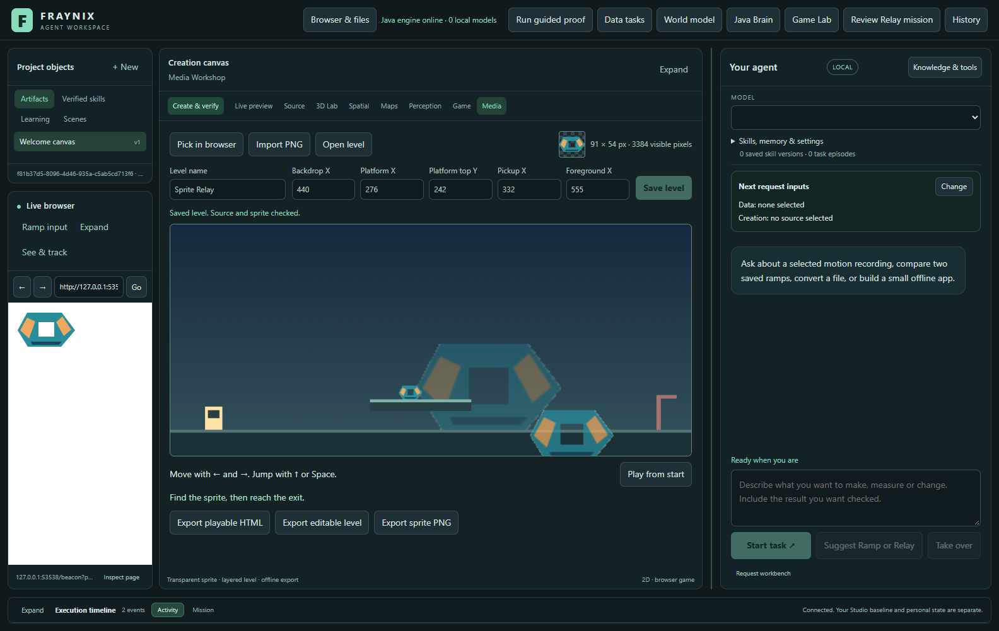
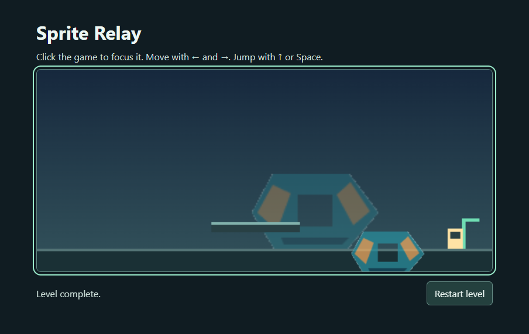

# Fraynix Agent Workspace · Edition 229

[Install on Mac, Windows or Linux](docs/INSTALL.md) · [Edition 228](README-228.md) · [Offline walkthrough](docs/readmes/229/index.html) · [Edition history](docs/readmes/INDEX.md)

The Media Workshop turns a graphic you click in the in-app browser, or a local PNG, into a transparent sprite. Place it in a short playable level, preview the layers as you edit, and export a game that runs from a single HTML file offline.

## Make and play a level

1. Open a graphic with a contrasting plain background in **Live browser**. In the creation canvas, choose **Media → Pick in browser**, then click the graphic. Or choose **Import PNG** to use a local file with transparency.
2. Name the level and position the backdrop, foreground, platform and pickup. The canvas shows valid draft changes as you make them. The pickup must sit on the platform.
3. Choose **Save level**, then **Play from start**. Use the arrow keys to move and Up or Space to jump. Collect the sprite before heading to the exit.
4. Export **playable HTML** for a desktop browser, **editable level** to reopen through Media → Open level, or **sprite PNG** to use in another project. The save message shows where Fraynix wrote the file.

## What the test checked

A click on an original beacon graphic produced a **91 × 54 px** sprite with **3,384 visible pixels**. Independent pixel samples confirmed the transparent opening, a transparent corner, and the original teal color. Keyboard input drove both game sessions into the platform wall, onto the platform, through the pickup, and past the exit. In the standalone session, the source web server was stopped and network requests were blocked.

The app reopened the saved level after restart, revised a layer using the same checked sprite, and imported both the editable package and the exported PNG into a separate project. Java refused changes to the retained package or sprite hash.

[Download the playable HTML](docs/readmes/229/sprite-relay.html) · [Editable level](docs/readmes/229/sprite-relay.json) · [Sprite PNG](docs/readmes/229/beacon.png) · [Playtest receipt](docs/readmes/229/media-evidence.json)

## Where this goes next

This release authors one screen with one source sprite in three ordered layers, a solid platform, one pickup, and a gated exit. The next milestone is a project with multiple reusable sprites and editable collision shapes. Fraynix can then connect those assets to registered-view 3D reconstruction, a shared timeline, and builds that the agent can test from a reviewed chat request. [Media production roadmap](docs/publication229/plan.md)
