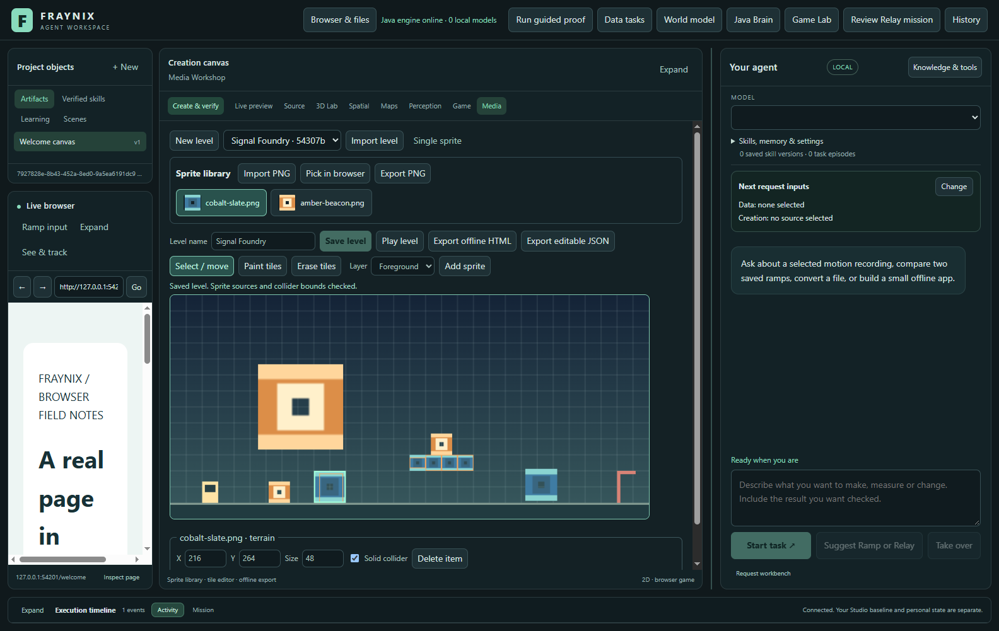
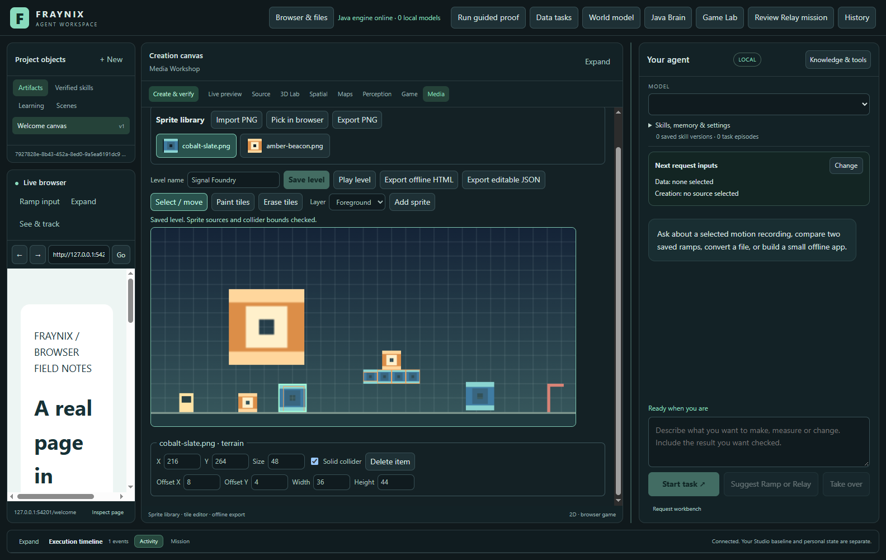
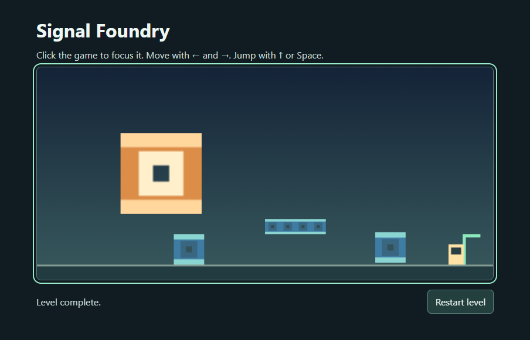

# Fraynix Agent Workspace · Edition 230

[Install on Mac, Windows or Linux](docs/INSTALL.md) · [Edition 229](README-229.md) · [Offline walkthrough](docs/readmes/230/index.html) · [Edition history](docs/readmes/INDEX.md)

The Media Workshop has a reusable sprite library and a tile editor. A single imported image can serve as a backdrop, a pickup, a solid prop, a foreground detail, or a tile in more than one level.

## Make a level

1. Open **Creation canvas → Media**. Import PNGs or pick a graphic in the in-app browser. Select a sprite from the library.
2. Choose a layer and select **Add sprite**. Drag it on the stage, or set its position and size in the inspector. Place a pickup to give the level a goal.
3. Choose **Paint tiles** and drag across the grid. **Erase tiles** removes tiles from a stroke or a single cell. Switch to **Select / move** and click a tile or solid prop to edit its collider.
4. Turn **Solid collider** on or off. Use the width, height and offsets to set the contact area within the art. The orange outline shows the actual rectangle the player collides with.
5. Save the level, then select **Play level**. Use Left and Right to move and Up or Space to jump. The exit opens after all pickups are collected.
6. Export **offline HTML** to play in a desktop browser, **editable JSON** to reopen through Import level, or **PNG** from the library. Saved versions appear in the level chooser. Use **Single sprite** for edition 229 projects.

## What passed

Two original sprites were reused across two saved levels. In Signal Foundry, pointer input moved a backdrop, painted five cells and erased one. The player hit the edited prop at **x = 200 px** and landed at **y = 236 px**. A separate jump landed on the inset tile at **y = 212 px**, as expected from its edited top. The main level completed in the app before and after restart and from the standalone export with network requests blocked.

The recovered level produced the same HTML bytes. A separate project imported its editable file and recovered both sprites. Java refused an out-of-bounds collider, a changed saved sprite, and a changed bundle. A second course reached the exit without its pickup and stayed locked.

[Playable HTML file](docs/readmes/230/signal-foundry.html) · [Editable level](docs/readmes/230/signal-foundry.json) · [Reusable tile PNG](docs/readmes/230/library-slate.png) · [Playtest receipt](docs/readmes/230/tile-evidence.json) · [Implementation and next steps](docs/publication230/plan.md)
