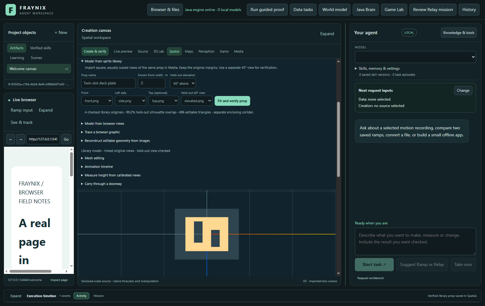

# Fraynix Agent Workspace · Edition 231

[Install on Mac, Windows or Linux](docs/INSTALL.md) · [Edition 230](README-230.md) · [Offline walkthrough](docs/readmes/231/index.html) · [Edition history](docs/readmes/INDEX.md)

You can now turn registered views stored in the Media sprite library into an editable prop in Spatial. Fraynix keeps each original image linked to the prop, checks a separate view before saving, and exports the visual mesh and its box collider to Blender.

## Build and check a prop

1. In **Creation canvas → Media**, import square PNGs from the front and left side. Keep the same scale and center, and leave a margin around the object. Add a top view when it exposes features the side views miss.
2. Select **Model sprites in 3D**. Assign the original views, enter the known front width, and choose a separate 45° image halfway between the front and side. Its elevation can be level or 60° above the horizon.
3. Select **Fit and verify prop**. The held-out view checks the chosen fit before Fraynix saves a scene.
4. Use **Export Blender** to edit the visual surface, or **Export GLB** for interchange. In Spatial, **Import Blender** opens the returned edit as another scene.

## What the test showed

- A fresh Blender plate with two through-openings produced **496 editable triangles** and **99.2%** overlap with the separate elevated view. A different prop scored **24.6%**, below the **86%** threshold, and saved no scene. A copied front image was also refused when it was assigned as the witness.
- Blender 4.5.17 LTS measured the visual hull at **15.5 L**. The collider was a separate **500 × 100 × 400 mm** box in Fraynix’s X/Y/Z axes. We raised the visual top by **5 mm** in Blender and imported it with the same collider.
- Restart reproduced the original GLB byte for byte. Fraynix refused export after either a library record or the retained evidence package was altered.

The known width sets the scene scale. The visual mesh carries both through-openings, while the enclosing box governs physics. The workflow reconstructs geometry supported by the supplied silhouettes. [Registration and verification details](docs/publication231/plan.md)

[Verified GLB](docs/readmes/231/library-prop.glb) · [Original Blender export](docs/readmes/231/library-prop.blend) · [Edited Blender file](docs/readmes/231/library-prop-edited.blend) · [Playtest evidence](docs/readmes/231/library-prop-evidence.json)
