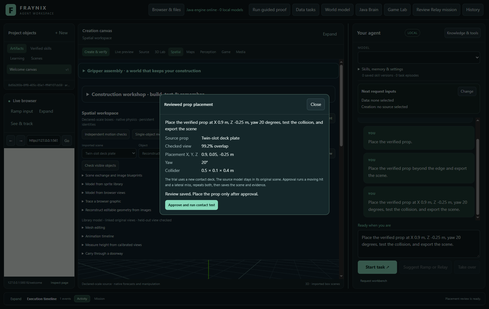
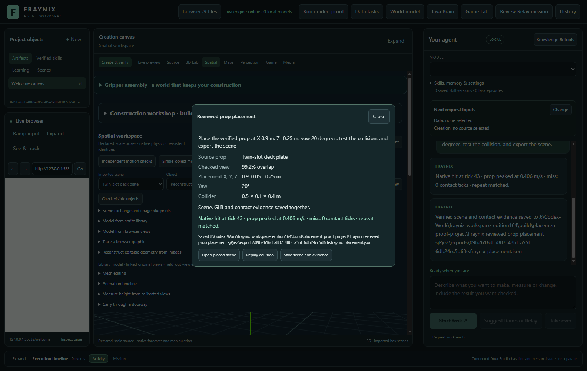

# Fraynix Agent Workspace · Edition 232

[Install on Mac, Windows or Linux](docs/INSTALL.md) · [Edition 231](README-231.md) · [Offline walkthrough](docs/readmes/232/index.html) · [Edition history](docs/readmes/INDEX.md)

Chat can place a checked Spatial prop into a new test scene, run a real Bullet collision in simulation, and export the scene with the measured evidence. The review names the source model, position, yaw and collider before you approve it.

## Try it

1. Open a reconstructed prop in **Spatial** that passed an independent held-out view. Select the dynamic prop.
2. Ask chat to place it using a request like this.

   > Place the verified prop at X 0.9 m, Z -0.25 m, yaw 20 degrees, test the collision, and export the scene.

   You can also say “Place the verified prop 0.5 m to the left.” X and Z are measured from the new deck’s center. Fraynix seats the box on the deck and shows the computed height in the review.
3. Select **Approve and run contact test**. Fraynix runs a moving hit and a lateral miss in fresh native worlds and repeats both before saving a result.
4. Use **Open placed scene** to inspect the authored pose. **Spatial → Placement review** reopens the latest review or result after restart. From there you can replay the collision and save the bundle again.

## What passed

At the approved pose, the moving test sphere contacted the rotated prop at **tick 43**. The prop reached **0.406 m/s**. The lateral control made **zero contacts**. Fraynix matched a fresh replay after restarting and reproduced the export byte for byte. The test also resumed approval saved before the run and refused stale or unverified sources.

The export bundles the editable scene, a GLB, fitted-source provenance, and the hit, miss, and repeat traces. The scene keeps the approved starting pose. The traces record what happened during the isolated simulations.

[Scene and evidence bundle](docs/readmes/232/verified-placement.fraynix-placement.json) · [GLB](docs/readmes/232/verified-placement.glb) · [Measured receipt](docs/readmes/232/placement-proof.json) · [Design and verification](docs/publication232/plan.md)
