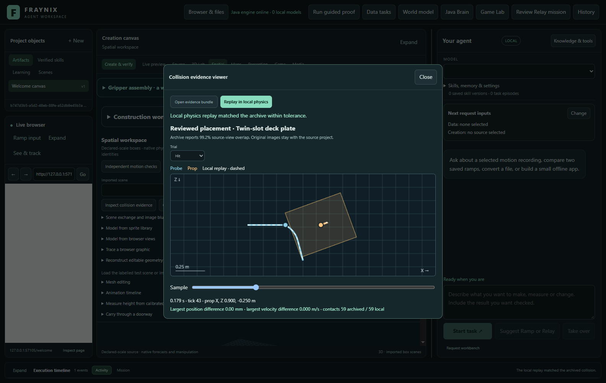
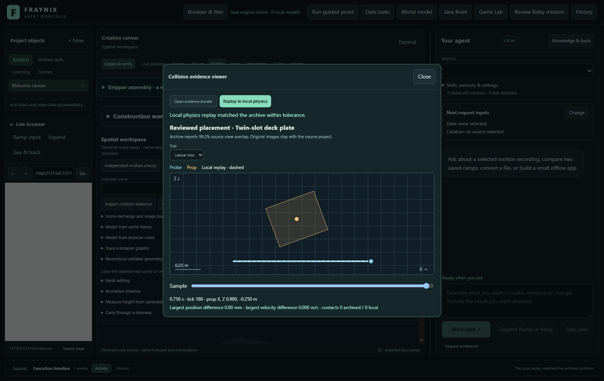

# Fraynix Agent Workspace · Edition 233

[Install on Mac, Windows or Linux](docs/INSTALL.md) · [Edition 232](README-232.md) · [Offline walkthrough](docs/readmes/233/index.html) · [Edition history](docs/readmes/INDEX.md)

A recipient can now open a Fraynix collision bundle in a fresh project, check the exported geometry, and rerun the hit and miss in local physics. The viewer overlays the fresh and archived paths and lets you inspect their measured samples.

## Try it

1. Open **Spatial → Inspect collision evidence**.
2. Select **Open evidence bundle** and choose a [scene and contact evidence bundle](docs/readmes/232/verified-placement.fraynix-placement.json). The scene, GLB, and archived trace checks run when the file opens.
3. Select **Replay in local physics**. Fraynix runs two independent local hit/miss pairs and compares them with the archive.
4. Switch between **Hit** and **Lateral miss**. Scrub the measured samples to see elapsed time, tick, and position. White dashes show the local paths.
5. Reopen the viewer after restart to see the saved comparison. If the local replay record changes, run a fresh check to recover it.

## What the review and test showed

Edition 232 could export a reviewed placement with its evidence. Its recipient could reopen the GLB, while the original project was still needed to rerun the collision. Edition 233 makes the dedicated contact-deck experiment portable.

A clean Windows project replayed the published edition 232 bundle. Both sides recorded first contact at **tick 43**, **59 hit contact steps**, and **zero miss contacts**. The observed differences in sampled positions and velocities were **0**. Restart restored the checked comparison, and editing the saved local replay hid it until the new run verified it again. A false trajectory with a recomputed checksum was refused by the native replay.

The original reconstruction images stay with the source project. The recipient verifies the bundle’s geometry and collision outcome. Opening evidence creates no authored scene or placement approval.

[Measured comparison](docs/readmes/233/exchange-evidence.json) · [Local replay samples](docs/readmes/233/local-replay.json) · [Review and verification details](docs/publication233/plan.md)
