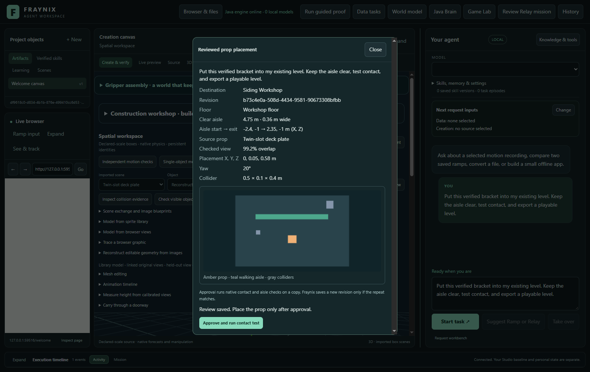
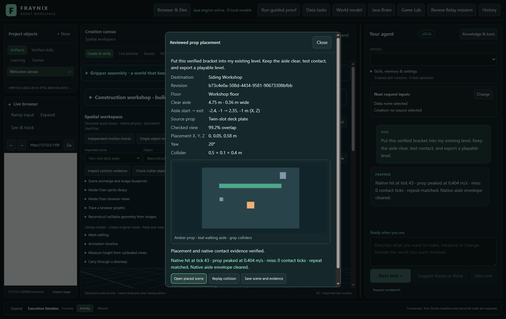
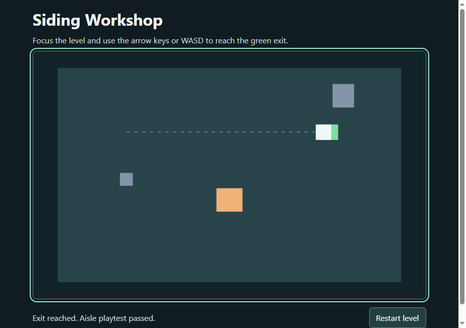

# Edition 234 — Place a verified prop in an existing level

2026-11-24 · [Read edition 233](README-233.md) · [Offline walkthrough and playable sample](docs/readmes/234/index.html) · [All editions](docs/readmes/INDEX.md)

Fraynix can now add a held-out-verified Spatial prop to an existing level. The review shows the exact destination revision, pose, collision bounds and walking aisle. Java runs a moving contact test, a lateral control, and an aisle check in isolated native worlds. A fresh repeat must agree before the app saves a new scene revision.

## Try it

1. Open **Spatial** and select the original reconstructed prop with a checked held-out view. Import or prepare a separate Spatial scene in metres with a flat, axis-aligned floor.
2. Ask Chat, “Put this verified bracket into my existing level. Keep the aisle clear, test contact, and export a playable level.”
3. Choose the destination and floor. Enter the prop’s X, Z, and yaw and the start and end of a straight aisle. The review shows the exact pose and a top-down preview. Java checks both the prop footprint and the player clearance.
4. Approve and run the contact test. The saved review and approval can be reopened with **Spatial → Placement review** after a restart.
5. Use **Open placed scene** to continue editing the new revision. **Save offline playable level** writes a single HTML file with arrow-key and WASD controls. **Save scene and evidence** writes editable scene JSON and a checked GLB inside a separate evidence bundle.

## What was verified

| Level | Clear aisle | Prop yaw | First hit tick | Hit contact ticks | Miss contact ticks |
|---|---:|---:|---:|---:|---:|
| Siding Workshop | 4.75 m | 20° | 43 | 52 | 0 |
| Raised Switchyard | 4.90 m | 65° | 47 | 73 | 0 |

The Windows desktop test preserved the original scene objects and the source prop. It refused an unapproved run, a blocked aisle, overlap, an off-floor pose, a collider that intercepted a native trial, a modified source, and both an outdated and a modified destination. The same approval created one revision across retries. Both the pending review and approval were reopened after restart. The completed result replayed, and both exports reproduced their hashes.

A clean project reopened the editable scene. In a separate browser window with network requests blocked, the exported HTML stopped the player at a real collider and accepted a clear path to the exit.

## What this edition covers

- Chat opens the supported placement workflow. The user supplies the coordinates and selects the destination. An outside model and network access are unnecessary for this path after installation.
- The native tests use the level’s authored rigid-body settings. The portable game is a static top-down traversal of the checked floor and collider bounds. Its player footprint is 0.36 m wide and the native clearance envelope is 1.70 m tall.
- The original destination remains an editable historical revision. The new scene preserves its authored source IDs, geometry, placements, and declared physics properties. The previous revision remains available for inspection.
- The evidence archive includes the review, verified repeat, exact authored scene, and GLB. The original reference images remain in the author’s project. Edition 233’s recipient replay viewer continues to handle the earlier contact-deck format.

## Next phase

Carry the same durable mission upstream. Let a user pick a browser reference, reconstruct an editable prop from registered views, and carry that source directly into this placement review. Compare against a held-out Blender view, test ambiguous references, and keep the user’s approval tied to the exact asset and destination. Verify the exported scene in Blender and add recipient-side replay for the authored-level bundle.

[Implementation and test contract](docs/publication234/plan.md) · [File tree](docs/readmes/234/FILE_TREE.md) · [Evidence summary](docs/readmes/234/level-proof.json) · [Obsidian map](docs/obsidian/242-existing-level-placement.canvas)
