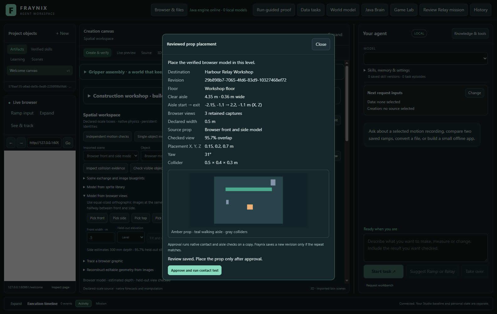
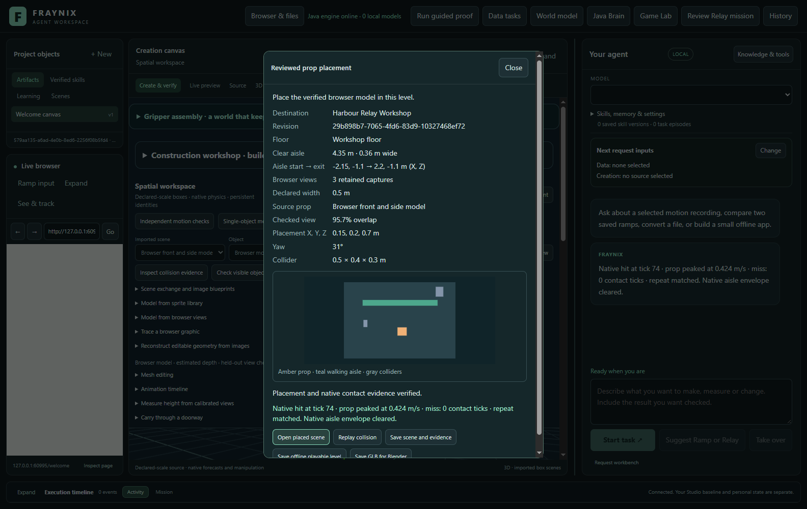
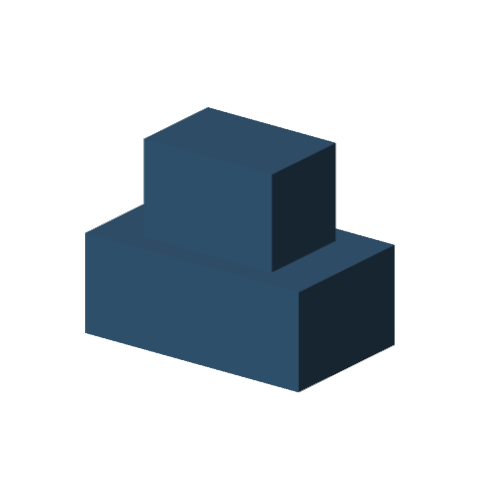
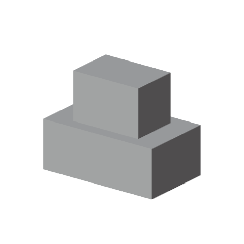

# Edition 235 — From a browser reference to a placed Blender scene

2026-11-24 · [Edition 234](README-234.md) · [Offline walkthrough](docs/readmes/235/index.html) · [Full history](docs/readmes/INDEX.md)

Fraynix can now take an item you pick in the in-app browser, reconstruct it as editable geometry, and hand that exact mesh to the placement review for an existing Spatial level. It holds the source and the review through a desktop restart. After the native contact and aisle checks agree, save the assembled scene as a GLB and open it in Blender.

## Try it

1. Import or open the destination Spatial level in metres. In **Spatial → Model from browser views**, pick the item’s registered front, side, and separate 45° held-out views in the in-app browser. Add a registered top view where available. Enter the known width and choose the level or 60° elevated witness.
2. Choose **Fit and review placement**. Fraynix fits the source and checks the held-out view before opening the placement review. **Resume browser placement** restores the saved model from the project, even when the original page is offline.
3. Choose the destination level and floor, enter the prop position and the aisle endpoints, and preview the edit. Review the browser view count, declared width, checked-view overlap, and exact destination revision before approving.
4. Approve the placement. Java must reproduce the moving hit, lateral miss, and player clearance in isolated native worlds before saving one new level revision.
5. Select **Save GLB for Blender** and use Blender’s glTF import to open it. **Save scene and evidence** retains the source identities, exact destination, editable JSON, GLB, and trial traces. **Save offline playable level** remains available for the checked aisle.

## What the test measured

| Check | Observed result |
|---|---|
| Browser reconstruction from actual clicks on freshly rendered registered views | 656 editable triangles, 300 mm depth, 95.7% held-out silhouette overlap |
| Java placement in Harbour Relay Workshop | First hit at tick 74, 15 contact ticks, zero lateral miss contacts, 4.35 m aisle clear |
| Blender 5.3 GLB import and native file reopen | All three original bodies and the new prop preserved, including the 31° rotation, separate box collider, and editable visual mesh |
| Fourth angle rendered in Blender only for evaluation | 99.81% silhouette overlap and 0.43% volume difference from Blender’s original stepped fixture |

The desktop test shut down the source page before restarting and resumed the exact saved mesh. It also restarted after saving the placement review, confirmed that an unapproved run was refused, checked that a retry made one revision, and reproduced the export hash and native replay after another restart. The wrong held-out view, changed placement source record, and changed capture package were refused. A vertex edit preview changed the mesh hash while preserving the saved revision.

| Blender’s original fixture | Imported Fraynix visual mesh |
|---|---|
|  |  |

## What the result covers

The width and image registration are supplied by the user. The reconstruction and the fourth-view measurement apply to the test fixture and its visible surfaces. The Blender verification covers geometry, placement, collision metadata, and editing structure. The contact and aisle checks run in Fraynix’s native physics. Placement uses the original checked mesh. A saved edit is a new revision that needs its own qualification.

[Download the checked GLB](docs/readmes/235/browser-level.glb) · [Open the Blender sample](docs/readmes/235/browser-level.blend) · [Read the evidence bundle](docs/readmes/235/browser-level.fraynix-level.json) · [Test results](docs/readmes/235/browser-placement-proof.json)

## Next phase

Qualify edits to a reconstructed mesh against a separate view, then let a recipient independently replay the authored-level collision evidence in a clean project. That would let a user refine what the agent reconstructed and share a result someone else can check.

[Implementation and reproducible commands](docs/publication235/plan.md) · [File tree](docs/readmes/235/FILE_TREE.md) · [Obsidian map](docs/obsidian/243-browser-placement.canvas)
