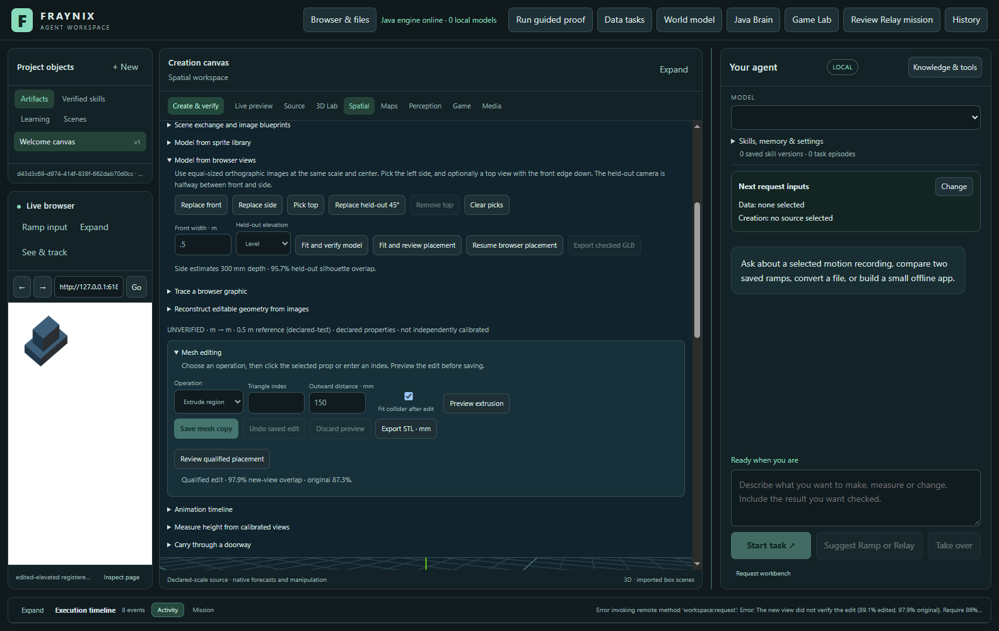
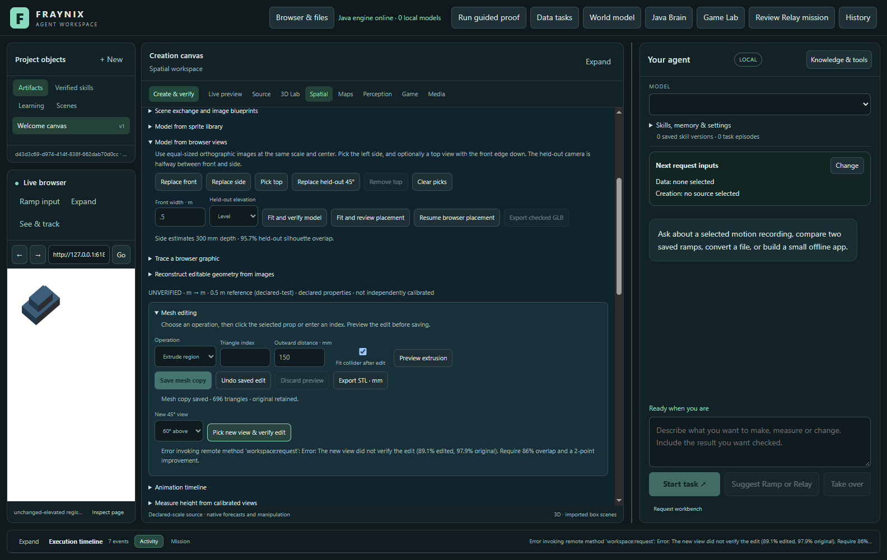
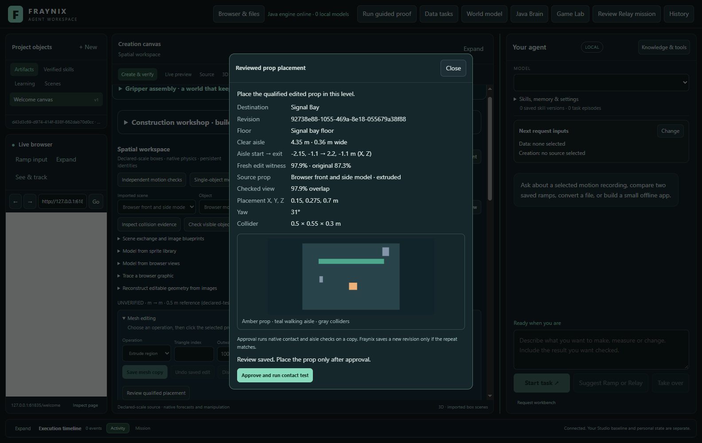

# Edition 236 — Qualify a mesh edit with a new browser view

2026-11-24 · [Edition 235](README-235.md) · [Offline walkthrough](docs/readmes/236/index.html) · [All editions](docs/readmes/INDEX.md)

Edition 235 connected a verified browser reconstruction to placement and Blender. Its evidence applied to the exact reconstructed mesh. Edition 236 gives a saved edit its own check. Fraynix projects both the original and edited meshes into a fresh registered view and asks which one better explains the observation before offering the existing-level placement review.

## Try it

1. Start with an original registered browser reconstruction. In **Spatial → Mesh editing**, preview a change and **Save mesh copy**. Fit the collider if the shape grows beyond its original bounds.
2. Open a new orthographic browser view at the other supported elevation. Use the same 45° azimuth, framing, scale and crop size as the original registration. Choose **Level** or **60° above** to match the new view.
3. Choose **Pick new view & verify edit** and click the graphic in the in-app browser. The result shows how well both meshes matched. If the edit qualifies, choose **Review qualified placement**.
4. Set the destination floor, exact pose and walking aisle, then approve the existing placement review. After the contact and clearance checks pass, save the checked GLB or the existing scene and evidence export.

## Measured results

The Windows study raised the upper region of an original stepped prop by 150 mm. Blender independently authored and rendered a taller reference and an unchanged control.

| Fresh view | Edited mesh | Original mesh | Outcome |
|---|---:|---:|---|
| Taller prop | 97.9% overlap | 87.3% overlap | Qualified |
| Unchanged prop | 89.1% overlap | 97.9% overlap | Refused |

The qualification requires at least 86% overlap and an improvement of at least two percentage points. The unchanged reference illustrates why the improvement check matters. The edited mesh passed the absolute threshold on that image, while the original was the better explanation.

The selected scene revision retained 696 triangles and a fitted 550 mm collider. After approval in Signal Bay, the moving probe hit at tick 75 and recorded 14 contact ticks. The lateral control recorded zero contacts and the 4.35 m player aisle cleared. Blender 5.3 opened the exact exported GLB with the three existing bodies and a distinct prop collider. The edited mesh measured 550 mm high with a 0.35% volume difference from the independently authored reference.

The test refused the original witness when reused, a placement attempted before qualification, and a run without approval. It stopped the source page, reopened the qualified draft, restored the pending placement review, and reproduced the collision and GLB after restart. Altering either retained source blocked release of the result.

## What this qualifies

The current path covers direct edits of original browser reconstructions with fixed registration and a visible change. One new silhouette checks visible contours under its declared camera and scale. Hidden details need their own evidence. Qualification preserves the original and edited drafts and creates a new checked revision. Placement remains a separate approval and native verification.

## Next phase

Let a clean recipient project replay authored-level evidence with its edited geometry, existing colliders, and route bound to the imported bundle.

[Implementation and reproduction](docs/publication236/plan.md) · [Windows test evidence](docs/readmes/236/mesh-qualification-proof.json) · [Blender verification](docs/readmes/236/qualified-blender-proof.json) · [Checked GLB](docs/readmes/236/qualified-edit.glb) · [Blender project](docs/readmes/236/qualified-edit.blend) · [File tree](docs/readmes/236/FILE_TREE.md) · [Obsidian map](docs/obsidian/244-mesh-qualification.canvas)
