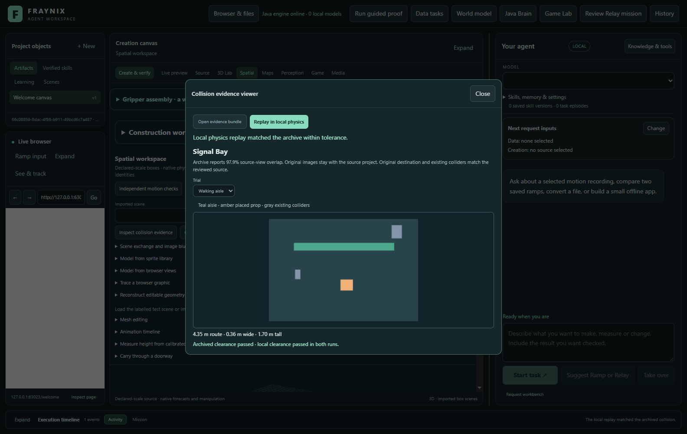
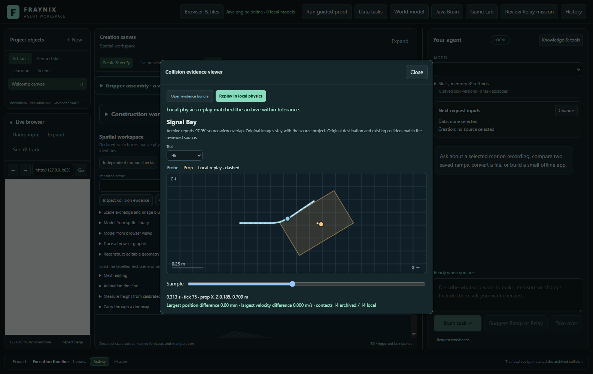

# Edition 237 — Replay an authored level in a clean project

2026-11-24 · [Edition 236](README-236.md) · [Offline walkthrough](docs/readmes/237/index.html) · [Full history](docs/readmes/INDEX.md)

A recipient can open an authored-level evidence bundle and independently replay the placement in local physics. New bundles carry the exact pre-edit destination. Fraynix checks that the final model contains only the approved addition, matches the included GLB, and preserves the original colliders. It then reruns both the contact and aisle checks in the full scene.

## Try it

1. After completing and verifying a placement, choose **Save scene and evidence** in the placement review.
2. In a separate project, open **Spatial → Inspect collision evidence → Open evidence bundle**. To try the published test, use the [Signal Bay bundle](docs/readmes/237/edited-signal-bay.fraynix-level.json).
3. Choose **Replay in local physics**. Inspect **Hit**, **Lateral miss**, and **Walking aisle** to compare the saved evidence with the local run.
4. Reopen the viewer after restart. The checked local receipt stays with the recipient project. Opening a bundle preserves the author’s original bytes and gives the recipient a read-only view of the scene and its evidence.

## What the replay verified

The Windows test re-exported the edited Signal Bay level from edition 236 and opened it in a project without the sender’s assets, scenes, or approvals. The source had a 550 mm edited prop with a separate collider. The recipient verified the included destination and GLB, then ran two fresh copies of each contact test and of the player envelope check.

| Check | Archived result | Local result |
|---|---:|---:|
| First hit | Tick 75 | Tick 75 |
| Hit contact ticks | 14 | 14 |
| Lateral miss contacts | 0 | 0 |
| Clear walking aisle | 4.35 m | 4.35 m |

The replay matched every sampled position and velocity in this Windows test. The view restored after restart, and a changed local receipt was withheld and rebuilt. Additional tests refused a changed existing collider even with a matching replacement GLB, a blocked aisle with rehashed identifiers, and a false hit trace with freshly computed hashes.

## Compatibility and scope

Edition 235’s original authored-level bundle replayed its finished scene and aisle. Edition 233’s contact-deck exchange replayed as before. New exports include the exact original destination for the extra comparison. The archive reports image qualification from the author. Local replay independently checks the supplied scene’s collision and straight-axis player envelope. The original browser pixels stay with the author, and opening an archive creates no editable scene or placement approval in the recipient project.

## Next phase

Give the recipient an explicit way to branch a verified scene into an editable local project. Keep the imported evidence attached, then require fresh verification and approval for any new edit.

[Implementation and reproduction](docs/publication237/plan.md) · [Measured results](docs/readmes/237/exchange-evidence.json) · [Full local replay](docs/readmes/237/local-replay.json) · [File tree](docs/readmes/237/FILE_TREE.md) · [Obsidian map](docs/obsidian/245-authored-level-replay.canvas)
