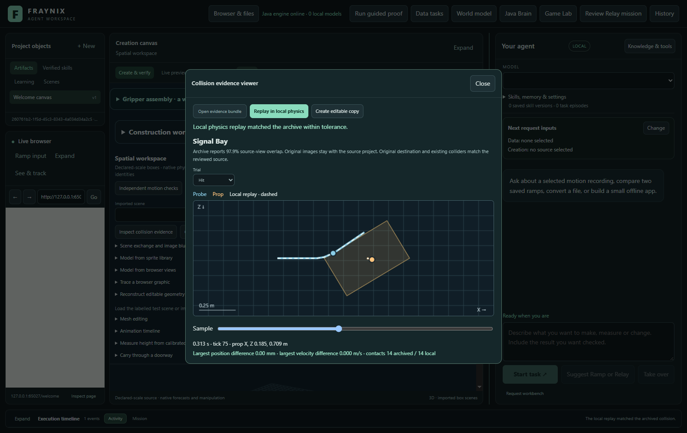
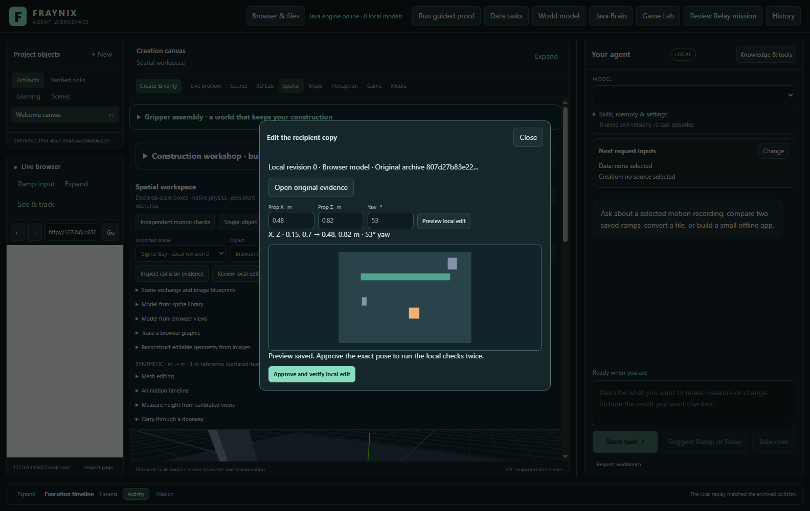
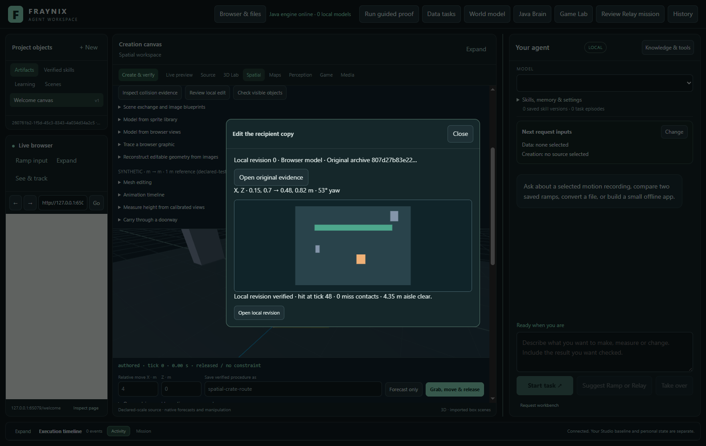

# Edition 238 — Edit a verified recipient copy

2026-11-24 · [Edition 237](README-237.md) · [Offline walkthrough](docs/readmes/238/index.html) · [Full history](docs/readmes/INDEX.md)

After replaying an authored-level bundle, a recipient can create an editable local copy. The copy keeps the original archive and its exact local replay attached. A proposed change to the placed prop goes through its own preview, approval, and physics verification before it becomes a new revision.

## Try it

1. In a separate project, open **Spatial → Inspect collision evidence** and load a current authored-level bundle. The [Signal Bay sample](docs/readmes/237/edited-signal-bay.fraynix-level.json) contains the finished scene and the exact pre-edit destination.
2. Choose **Replay in local physics**. When the replay matches, choose **Create editable copy**. The local project opens revision 0 with the placed prop selected.
3. Enter its X, Z, and yaw and choose **Preview local edit**. Review the position and the aisle, then choose **Approve and verify local edit**. A pending review or an approved request can be reopened with **Review local edit** after restart.
4. Open the verified revision. Use **Open original evidence** to inspect the attached archive and replay from either the original local copy or a later revision.

## Measured result

On Windows, Signal Bay's placed prop moved from X 0.15 m and Z 0.70 m to X 0.48 m and Z 0.82 m with a 53° yaw. Two fresh runs agreed. The hit started at tick 48 with 63 contact ticks, the lateral control recorded zero contacts, and the 4.35 m aisle cleared. A second edit passed and became a separate local revision.

The test refused a pose that blocked the aisle and an approved pose whose probe hit an existing collider. An unapproved run, a stale approved alternative, a changed approval file, and an altered archive were also refused. The preview and approval survived separate restarts. Reopening an existing copy returned the newest verified revision. Opening the attached evidence still returned its original replay after the viewer's separate cache changed.

## Current editing scope

This recipient workflow covers the originally placed prop's horizontal position and yaw. It preserves the other bodies and floor, visual geometry, collider, and the reviewed walking aisle. Each new commit has its own native trial receipt. Authored bundles with an included pre-edit destination support creating a copy. Earlier bundles continue to open in the replay viewer.

## Next phase

Carry a recipient revision through export and a second clean-project replay. Then extend the same review and evidence rules to local collider and mesh edits.

[Implementation and reproduction](docs/publication238/plan.md) · [Windows evidence](docs/readmes/238/recipient-edit-proof.json) · [First local edit receipt](docs/readmes/238/local-edit-receipt.json) · [File tree](docs/readmes/238/FILE_TREE.md) · [Obsidian map](docs/obsidian/246-recipient-edit.canvas)
