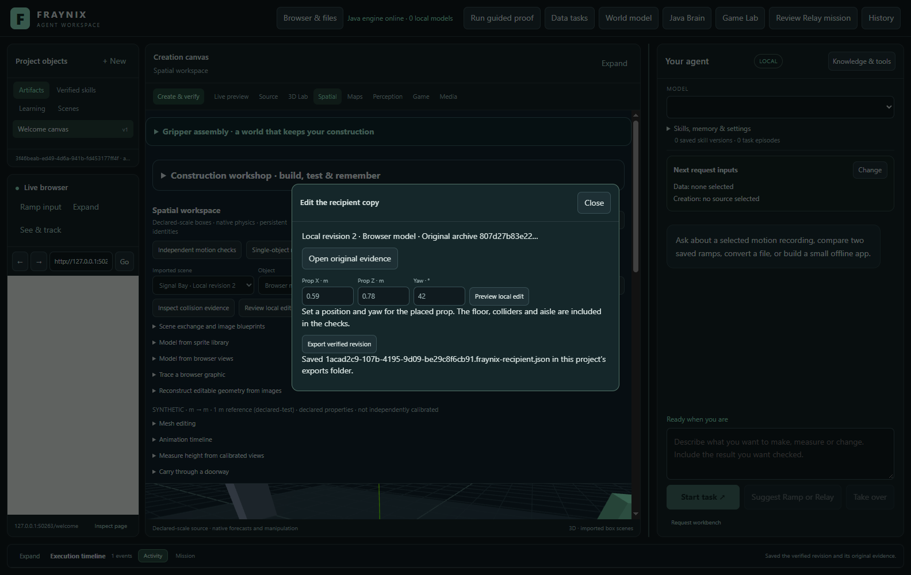
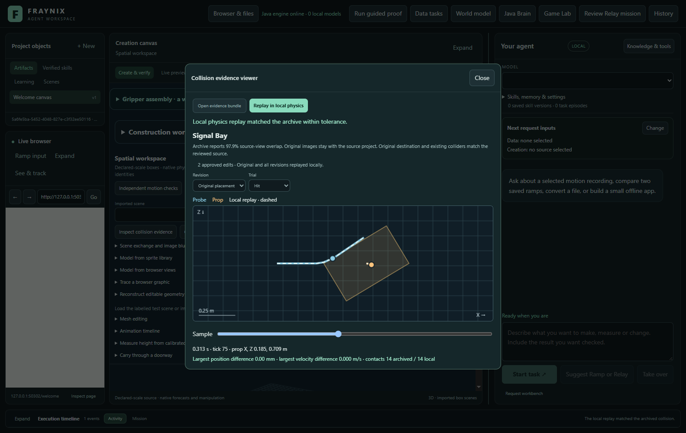
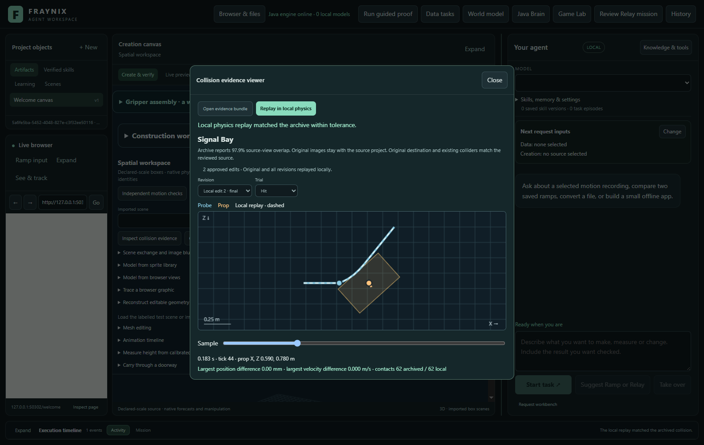
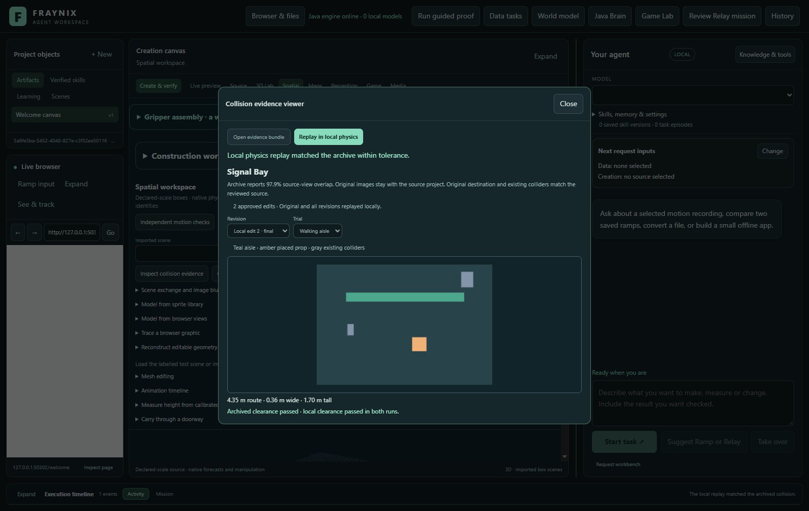

# Edition 239 — Forward and replay a verified recipient revision

2026-11-24 · [Edition 238](README-238.md) · [Offline walkthrough](docs/readmes/239/index.html) · [Full history](docs/readmes/INDEX.md)

Send an approved local revision together with the exact authored level, the recipient’s original replay, the ordered approvals and native trial receipts, and the final scene GLB. In a clean project, Fraynix reconstructs each stage and reruns the physics before reporting a match.

## Try it

1. In the source project, select the verified scene in **Spatial**. Open **Review local edit** and choose **Export verified revision**. The export appears in the project’s exports folder.
2. Open a separate, empty project. Go to **Spatial → Inspect collision evidence** and choose the `.fraynix-recipient.json` file. You can use the [Signal Bay sample](docs/readmes/239/signal-bay-revision.fraynix-recipient.json) without recreating the source project.
3. Choose **Replay in local physics**. Use **Revision** to inspect the original placement, the first local edit, or the final revision. Choose **Hit**, **Miss**, or **Walking aisle** for the corresponding evidence.
4. Restart, reopen **Inspect collision evidence**, and check the retained local result.

## Measured replay in a clean Windows project

The sample is the exact second revision recorded in [edition 238](docs/readmes/238/recipient-edit-proof.json). Its final prop pose is X 0.59 m, Z 0.78 m, and yaw 42°. The receiver ran two native passes per stage. Each pass checked an expected probe hit, a lateral miss, and the walking aisle.

| Stage | First contact, archived / local tick | Hit contact ticks | Miss contact ticks |
| --- | ---: | ---: | ---: |
| Original placement | 75 / 75 | 14 | 0 |
| First approved edit | 48 / 48 | 63 | 0 |
| Final approved edit | 44 / 44 | 62 | 0 |

The **4.35 m aisle** cleared in all three stages. The sampled position and velocity differences were zero on this Windows replay. The second project recovered its replay after restart. The test also replaced a saved local receipt, confirmed that the viewer withheld the result, and regenerated it from fresh physics.

## What the receiver can verify

The archive includes both exact pose reviews and their bound approval hashes. The viewer checks the original destination, each parent and aisle binding, the embedded trial receipts, and the final GLB. Changed approval or GLB bytes and missing earlier approvals are refused. Fresh native replay catches false motion even when the receipt and its descendant review hashes have been recomputed. Only an entirely successful replay produces a new local receipt.

The forwarded bundle opens in the evidence viewer. Creating or editing a scene remains a separate, local approval workflow. Checksums bind the supplied evidence to the revisions. Sender authentication would require a separate signature scheme. The original browser reference images stay in the original source project.

## Next phase

Let the next recipient create a fresh editable copy from a successfully reproduced forwarded revision. Retain the complete earlier history and require a new approval for any new edit.

[Implementation and reproduction](docs/publication239/plan.md) · [Export proof](docs/readmes/239/recipient-export-proof.json) · [Windows replay summary](docs/readmes/239/exchange-evidence.json) · [Local replay receipt](docs/readmes/239/local-replay.json) · [File tree](docs/readmes/239/FILE_TREE.md) · [Obsidian map](docs/obsidian/247-recipient-revision-exchange.canvas)
