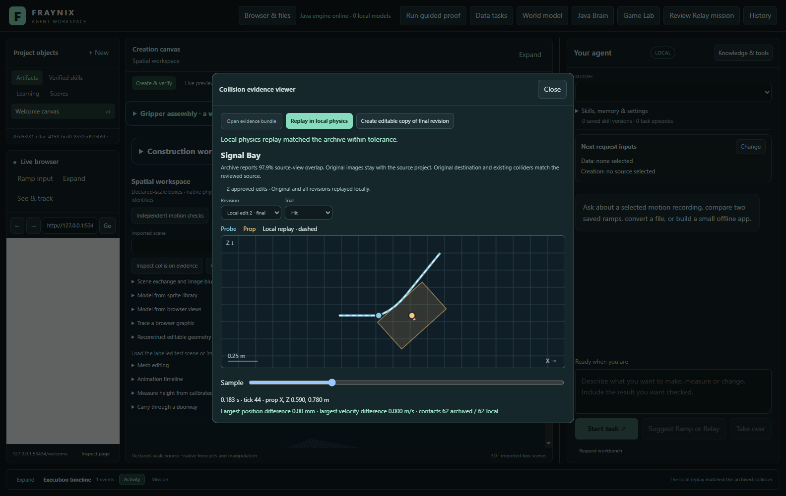
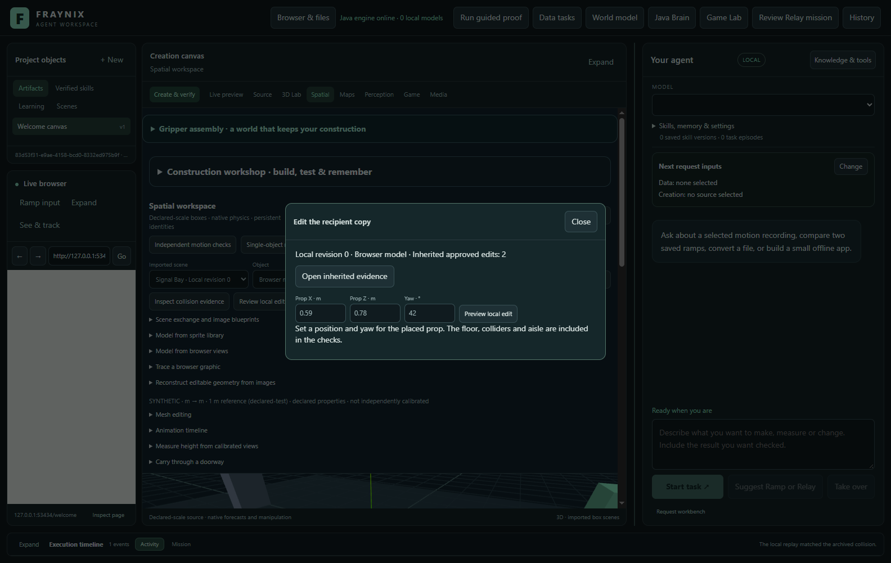
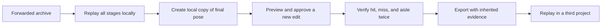
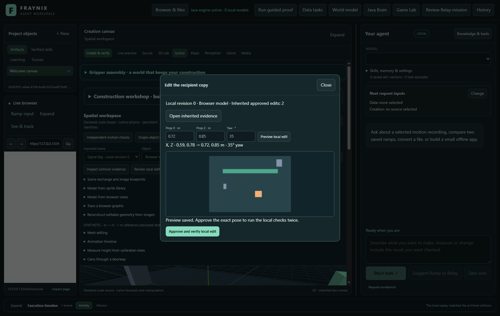
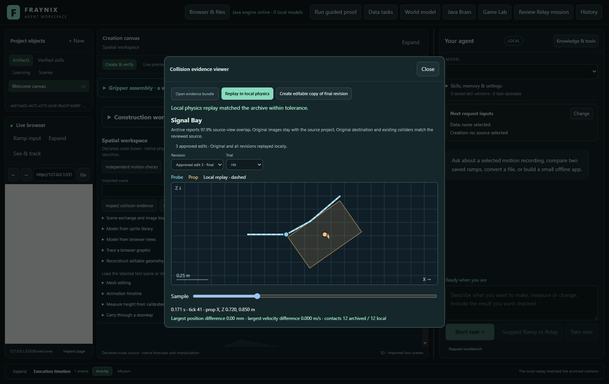

# Edition 240 — Edit a forwarded revision with fresh local approval

2026-11-24 · [Edition 239](README-239.md) · [Offline walkthrough](docs/readmes/240/index.html) · [Full history](docs/readmes/INDEX.md)

A recipient can now continue working from a forwarded Spatial scene. After Fraynix reproduces the incoming evidence, the recipient creates a local copy of the final scene and can review, approve, verify, and export a new prop pose. The source archive and earlier trials stay available through the local copy.

## Try it offline

1. Open a blank project. In **Spatial → Inspect collision evidence**, load the [edition 239 Signal Bay bundle](docs/readmes/239/signal-bay-revision.fraynix-recipient.json) and choose **Replay in local physics**.
2. Choose **Create editable copy of final revision**. The new project shows **Local revision 0** and two inherited approved edits. **Open inherited evidence** shows the earlier stages and the replay pinned to the copy.
3. In **Review local edit**, change X, Z, or yaw, then choose **Preview local edit**. Approve the exact change to start two native checks. Both a pending review and an accepted approval can be reopened after a restart.
4. Choose **Export verified revision**. The resulting file includes the exact incoming archive, this project's pinned replay, the new approval and trials, and a matching final scene GLB.
5. In another blank project, open the [new handoff bundle](docs/readmes/240/signal-bay-handoff.fraynix-recipient.json) in the evidence viewer and replay it. The **Revision** selector can open every stage, from the original placement to the newest edit.

## Signal Bay results

The receiving project's new pose moved from X 0.59 m and Z 0.78 m at 42° to X 0.72 m and Z 0.85 m at 35°. Fraynix reproduced the full sequence in a third clean Windows project with two native passes per stage.

| Stage | First contact tick | Hit contact ticks | Miss contact ticks |
| --- | ---: | ---: | ---: |
| Original placement | 75 | 14 | 0 |
| First inherited edit | 48 | 63 | 0 |
| Second inherited edit | 44 | 62 | 0 |
| New local edit | 41 | 12 | 0 |

The 4.35 m walking aisle cleared in all four stages. The last stage had zero sampled position and velocity difference from the archive on this run. The third project restored the replay after restart.

## What the handoff checks

- A successful replay is required before a copy can be created. Reopening the same copy returns its newest verified local revision.
- Incoming approvals remain part of the evidence. The new patch must match its own local parent and requires a fresh approval. A blocked aisle and a mismatched approval were refused.
- The copy pins its local replay independently of the evidence viewer's replay cache. Tests damaged that cache, changed the attached archive, and removed earlier replay stages. The saved copy still opened with an intact attachment and refused a changed one.
- The supported edit affects the placed prop's horizontal pose and yaw. The mesh, collider and other bodies accompany the scene. The package limit is 1.5 MB and 31 approved edits across the full history, with up to six forwarded handoff layers. Size can be reached first.

## Next phase

Extend the same review to one bounded collider edit. Show the proposed collider against the existing mesh, replay the collision and aisle checks, and verify the forwarded GLB against the new collider.

[Implementation and reproduction](docs/publication240/plan.md) · [Handoff evidence](docs/readmes/240/handoff-evidence.json) · [Third-project results](docs/readmes/240/exchange-evidence.json) · [Replay receipt](docs/readmes/240/local-replay.json) · [File tree](docs/readmes/240/FILE_TREE.md) · [Obsidian map](docs/obsidian/248-forwarded-recipient-edit.canvas)
