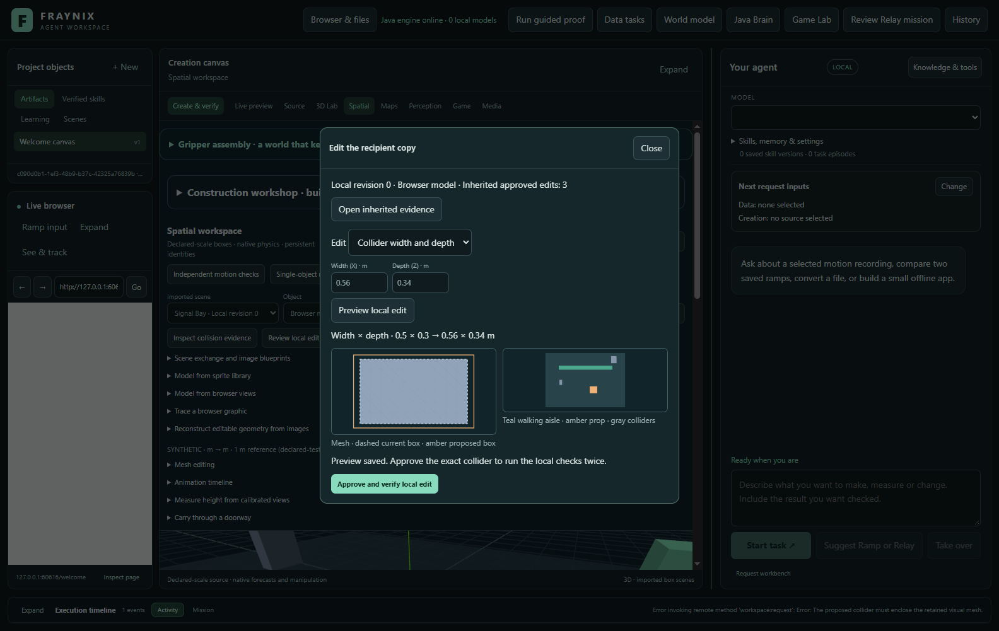
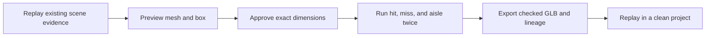
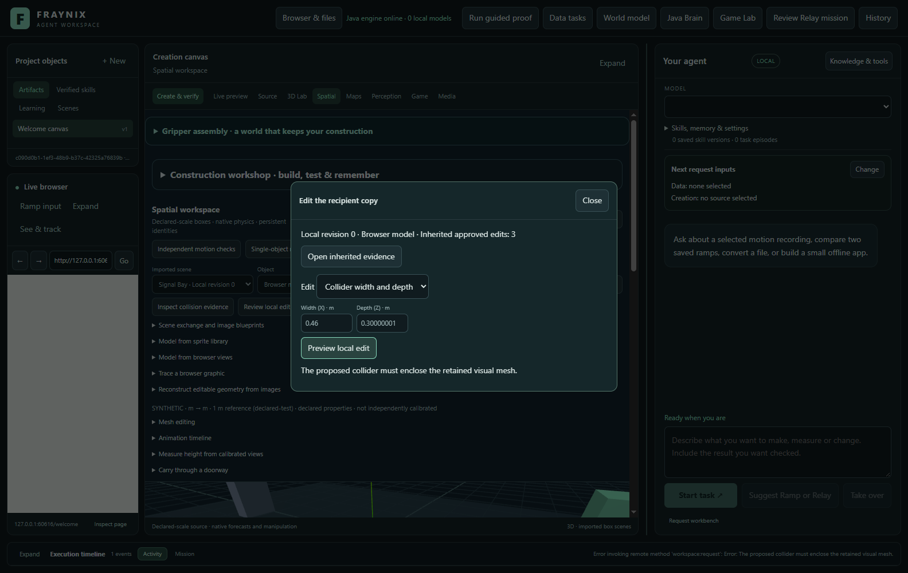
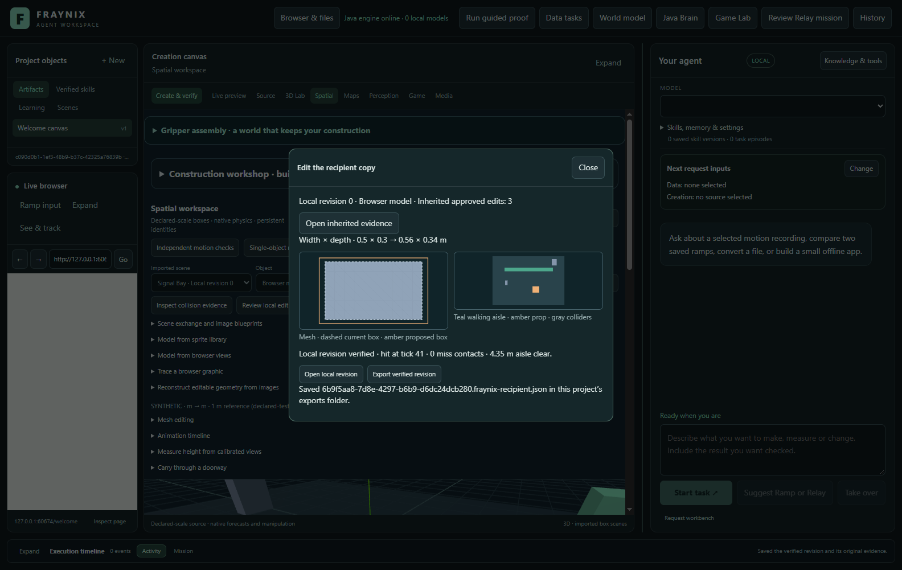
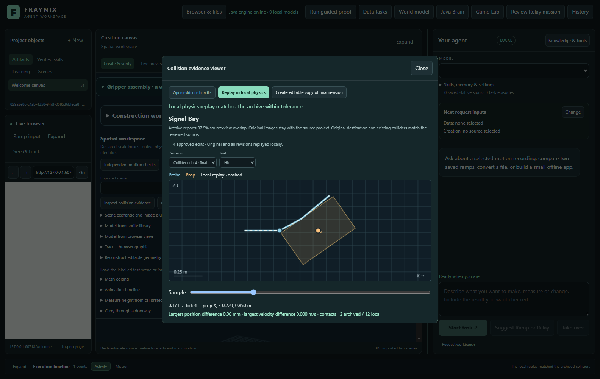

# Edition 241 — Review and replay a bounded collider edit

2026-11-25 · [Edition 240](README-240.md) · [Offline walkthrough](docs/readmes/241/index.html) · [Full history](docs/readmes/INDEX.md)

A recipient can now adjust the width and depth of the placed prop's box collider. The approval binds the exact new box to the retained mesh, existing scene, and protected walking aisle. A clean project can replay that result with the original placement and earlier approved edits.

## Try it offline

1. In an empty project, choose **Spatial → Inspect collision evidence**, open the [edition 240 Signal Bay bundle](docs/readmes/240/signal-bay-handoff.fraynix-recipient.json), and select **Replay in local physics**.
2. Choose **Create editable copy of final revision**. In **Review local edit**, select **Collider width and depth**.
3. Enter a width and depth in metres. Signal Bay starts at 0.50 × 0.30 m. The verified example uses **0.56 × 0.34 m**.
4. Choose **Preview local edit**. The preview shows the actual mesh from above, both boxes, and the aisle. Approve the exact proposal to run the hit, miss, and aisle checks twice. Reopen **Review local edit** after restart to recover a pending proposal or a saved approval.
5. Choose **Export verified revision**. A clean project can open the [new bundle](docs/readmes/241/signal-bay-collider.fraynix-recipient.json) and replay the whole lineage. The **Revision** selector identifies the collider edit.

## What passed

| Check | Signal Bay result |
| --- | --- |
| Box width × depth | 0.50 × 0.30 m → 0.56 × 0.34 m |
| Box height and pose | 0.55 m height, X 0.72 m, Z 0.85 m, yaw 35° |
| Native hit and miss | First hit at tick 41, 12 contact ticks, zero miss contacts |
| Walking aisle | 4.35 m clear |
| Independent Windows replay | Original placement and four edits reproduced after restart |
| Blender 5.3.0 import | 696 visual triangles, zero measured visual vertex movement, three other bodies matched |

The probe start is derived from the collider in each stage. The result establishes replay under the same per-stage test protocol. A fixed-approach comparison would measure whether the collider change affects timing on an identical trajectory.

Each horizontal dimension can change by up to **0.10 m per edit**. The proposal must enclose the retained local mesh, and the floor, neighboring colliders, and player aisle must pass existing checks. The editor changes the collider dimensions while retaining height, center, yaw, mass, material properties and mesh. A forged height change, an enlargement that blocks the aisle, a reused approval, and the previous GLB carrying its own valid checksum were all refused.

## Next phase

Add a fixed-approach comparison of two approved collider revisions, then use those measurements to review bounded mesh edits.

[Reproduction](docs/publication241/plan.md) · [Verified GLB](docs/readmes/241/collider-final.glb) · [Local edit evidence](docs/readmes/241/collider-evidence.json) · [Blender measurements](docs/readmes/241/blender-collider-proof.json) · [Independent replay](docs/readmes/241/exchange-evidence.json) · [File tree](docs/readmes/241/FILE_TREE.md) · [Obsidian map](docs/obsidian/249-reviewed-collider-edit.canvas)
