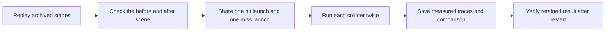
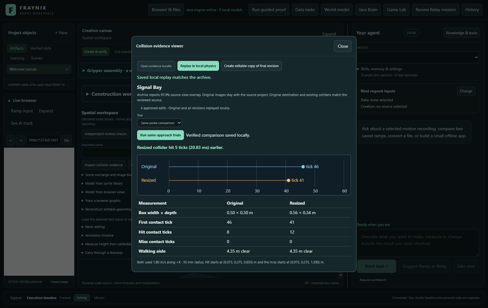
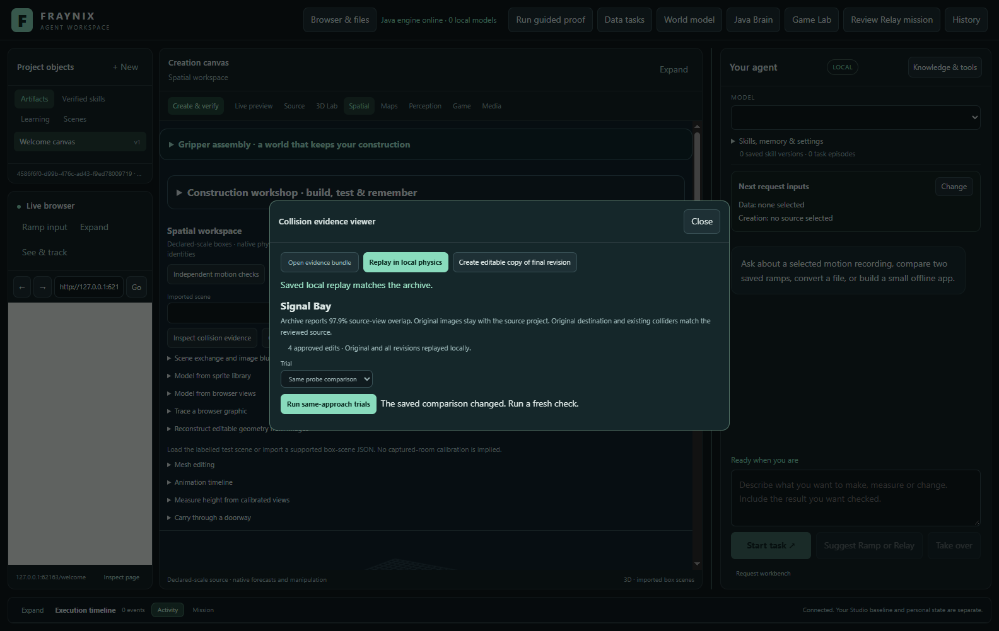

# Edition 242 — Compare collider sizes with the same probe approach

2026-11-25 · [Edition 241](README-241.md) · [Offline walkthrough](docs/readmes/242/index.html) · [Full history](docs/readmes/INDEX.md)

Signal Bay's resized collider made first contact **5 simulation ticks (20.83 ms) earlier** when both colliders used the same probe launch. The comparison pairs edition 241's resized box with the box immediately before that edit, at the same pose. Fraynix checks that the underlying scene differs only in the approved box dimensions.

## Run the comparison

1. In a clean project, choose **Spatial → Inspect collision evidence** and open the [edition 241 Signal Bay archive](docs/readmes/241/signal-bay-collider.fraynix-recipient.json).
2. Choose **Replay in local physics**. This reproduces the original placement and all four approved edits with their archived protocols.
3. In **Trial**, choose **Same probe comparison**, then select **Run same-approach trials**. The viewer uses the most recent collider edit and its immediate predecessor.
4. After a desktop restart, reopen the evidence viewer and choose **Same probe comparison** again. The saved result is checked against the exact archive and local replay before it is shown.

## Signal Bay results

Both trials used a 35 mm radius sphere moving at 1.80 m/s along +X, with a 240 Hz physics step. The straight hit started at approximately (0.073, 0.275, 0.850) m and the lateral control started at (0.073, 0.275, 1.290) m. The test checked the actual first probe sample against the shared start and velocity. The prop stayed at X 0.72 m, Z 0.85 m, yaw 35°, and height 0.55 m.

| Measurement | Original 50 × 30 cm | Resized 56 × 34 cm |
| --- | ---: | ---: |
| Archived per-collider approach, first contact tick | 41 | 41 |
| Same approach, first contact tick | 46 | 41 |
| Same approach, contact ticks | 8 | 12 |
| Lateral miss contacts | 0 | 0 |
| Peak planar prop speed | 0.385 m/s | 0.366 m/s |
| Walking aisle clearance | 4.35 m clear | 4.35 m clear |

The earlier archive derived each launch from that collider's own dimensions. The common launch starts far enough back for both colliders. Fraynix ran eight native trials in total, two hits and two misses per box, and required matching repeats. Each shape also passed the protected aisle check. This result measures one simulated approach to the Signal Bay prop.

## Verification and recovery

The comparison needs an exact successful local replay and preserves the archive and the original replay receipt. It saves a separate record of both sizes, the shared launch, the native trajectories, and the measured differences. The test recovered that record after restart, withheld it after a saved launch sample was altered, and regenerated it with the same digest. Loading or comparing scene evidence leaves scene creation and edit approvals as explicit actions.

## Next phase

Test a small set of shared approaches with different headings and offsets. Use the measured differences to review future collider and mesh edits.

[Reproduction](docs/publication242/plan.md) · [Comparison summary](docs/readmes/242/fixed-approach-evidence.json) · [Full measured receipt](docs/readmes/242/fixed-approach-receipt.json) · [File tree](docs/readmes/242/FILE_TREE.md) · [Obsidian map](docs/obsidian/250-same-probe-collider-comparison.canvas)
