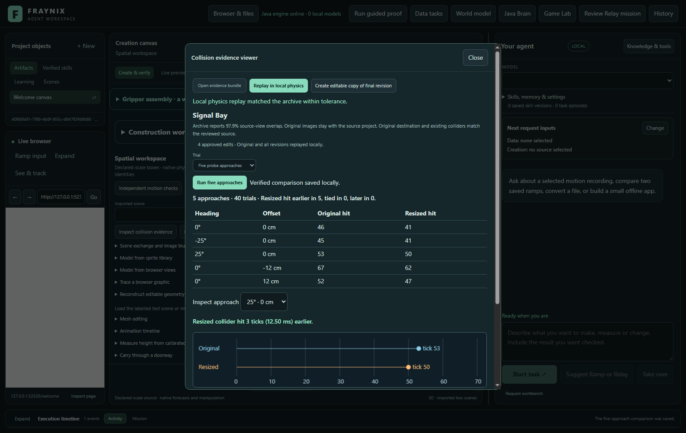
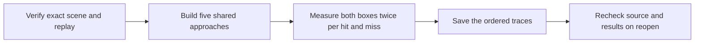
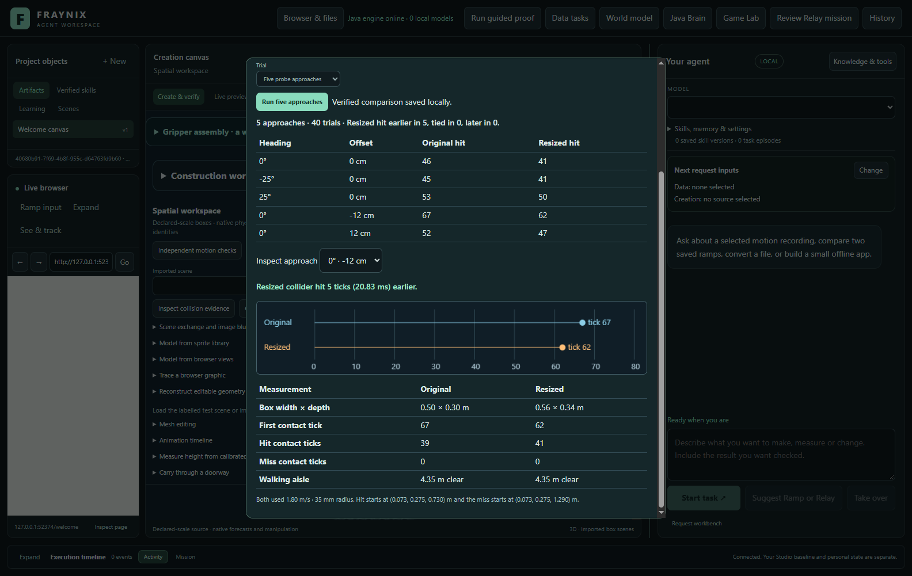
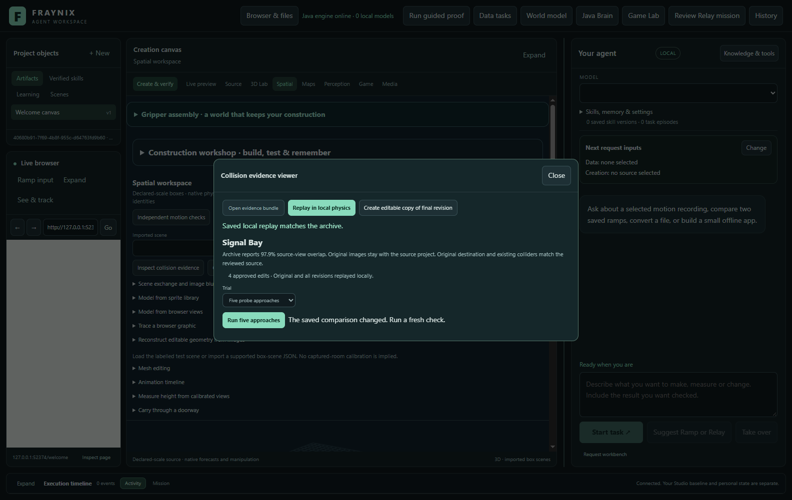

# Edition 243 — Compare colliders across five probe approaches

2026-11-25 · [Edition 242](README-242.md) · [Offline walkthrough](docs/readmes/243/index.html) · [Full history](docs/readmes/INDEX.md)

The resized Signal Bay collider made first contact **3–5 ticks earlier** in all five matched approaches. The test compared the original 50 × 30 cm box with the approved 56 × 34 cm box while holding the rest of the scene fixed.

## Run it

1. In **Spatial → Inspect collision evidence**, load the [approved Signal Bay archive](docs/readmes/241/signal-bay-collider.fraynix-recipient.json).
2. Choose **Replay in local physics** to verify the original placement and each approved edit.
3. In **Trial**, choose **Five probe approaches** and select **Run five approaches**. The table shows the measured first contact for each box. Use **Inspect approach** for the timeline, contact counts, launch, and aisle checks.
4. After restarting, reopen the viewer and choose **Five probe approaches**. The saved report is checked against the same archive and verified local replay.

## Measured results

Each heading is relative to world +X. The offset moves the hit line perpendicular to its heading. Each case used the same hit and lateral miss launches for both boxes, with a 35 mm sphere at 1.80 m/s and a 240 Hz physics step.

| Heading | Offset | Original first hit | Resized first hit | Resized lead |
| ---: | ---: | ---: | ---: | ---: |
| 0° | 0 cm | 46 | 41 | 5 ticks |
| −25° | 0 cm | 45 | 41 | 4 ticks |
| +25° | 0 cm | 53 | 50 | 3 ticks |
| 0° | −12 cm | 67 | 62 | 5 ticks |
| 0° | +12 cm | 52 | 47 | 5 ticks |

All **40 native sphere trials** matched their repeats. All 20 lateral miss trials recorded zero contacts, and each case cleared the same 4.35 m aisle. The center case reproduced edition 242's result. Total time in contact varied by approach. These are simulated results for five specified launches on this scene.

## Verification and recovery

Java checks the source scenes, the exact local replay, the shared starts and velocities, and both sets of native trials. It saves all five results together after they pass. Switching into the sweep leaves the single-approach report and archived replay available. The desktop test reordered two stored cases. The app withheld the changed report and regenerated the original receipt on a fresh run.

## Next phase

Use a verified multi-approach result when reviewing a new collider or mesh change. Show which approaches improve, regress, or require another check before approval.

[Reproduction](docs/publication243/plan.md) · [Measured summary](docs/readmes/243/approach-sweep-evidence.json) · [Full trial receipt](docs/readmes/243/approach-sweep-receipt.json) · [File tree](docs/readmes/243/FILE_TREE.md) · [Obsidian map](docs/obsidian/251-collider-approach-sweep.canvas)
