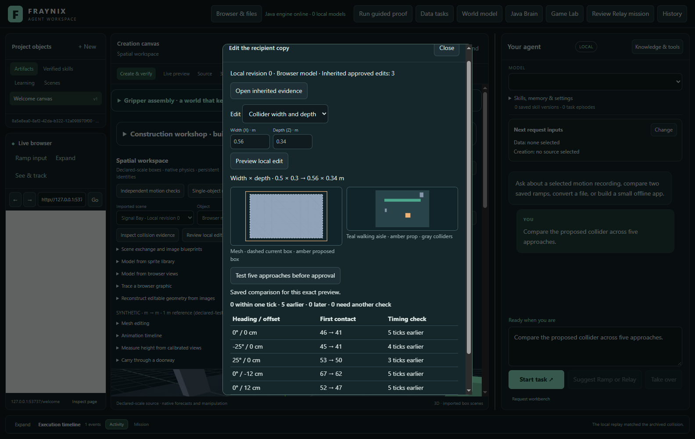
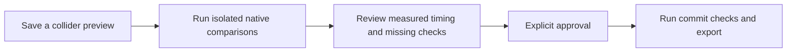
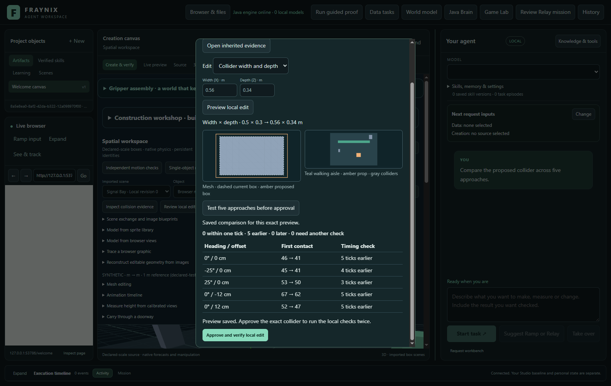
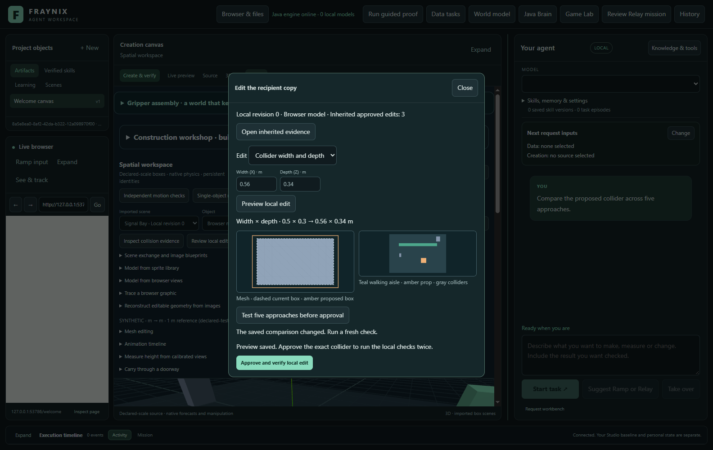

# Edition 244 — Test a proposed collider before approval

2026-11-25 · [Edition 243](README-243.md) · [Independent system review](docs/publication244/review.md) · [Offline walkthrough](docs/readmes/244/index.html) · [Full history](docs/readmes/INDEX.md)

The collider comparison now runs while the edit is pending, when the result can inform approval. From Chat, **“Compare the proposed collider across five approaches”** opens the saved proposal in Spatial and runs the comparison. You can also select **Test five approaches before approval** in the recipient editor.

## Try it from a clean project

1. In **Spatial → Inspect collision evidence**, open the [verified Signal Bay bundle](docs/readmes/240/signal-bay-handoff.fraynix-recipient.json). Choose **Replay in local physics**, then **Create editable copy of final revision**.
2. In **Review local edit**, select **Collider width and depth**. Set the width to **0.56 m** and the depth to **0.34 m**, then select **Preview local edit**.
3. Close the editor and enter **“Compare the proposed collider across five approaches”** in Chat. The comparison opens on the selected recipient copy. The same test is available directly in the editor.
4. Check the measured rows. **Within one tick** answers whether timing is retained. Earlier or later describes the measured change. An intercepted or unverifiable trial shows why it needs another check.
5. Approve only when the proposal fits your intent. Fraynix verifies the saved evidence it displays, then runs the existing commit-time hit, miss, aisle and repeat checks. **Export verified revision** saves the approved result and its source lineage.

## What was verified

On Windows, the proposed resize made contact **3–5 ticks earlier** in every one of the five simulated approaches. Against a one-tick timing tolerance, all five cases showed a change. That measurement lets the operator judge the resize against the task's goal. Chat and the comparison left the scene and approval state intact. A second native test intercepted one angled trial with a real scene collider. The report retained four measured rows and marked the intercepted row unverified.

The desktop test reopened the exact comparison after restart, refused the old evidence for a replacement preview, withheld an altered trace, and regenerated its original receipt. Explicit approval still triggered native repeat checks and a verified export. The advisory report stays in the project. The exchange format continues to carry the approved scene's existing collision and lineage evidence.

## What the reviewer found

Fraynix has working local paths through simulation, artifact creation, retained procedures, and Blender exchange. The main gap is using those paths together through a clear request, review, evidence, and completion flow. Edition 244 makes that connection for one supported collider request. The next proof is a held-out scene and a supported task routed by a real local model. The broader [review and evidence map](docs/publication244/review.md) records the present scope and test gaps.

[Reproduction](docs/publication244/plan.md) · [Local results](docs/readmes/244/pending-approach-evidence.json) · [Full comparison receipt](docs/readmes/244/pending-approach-receipt.json) · [File tree](docs/readmes/244/FILE_TREE.md) · [Obsidian map](docs/obsidian/252-pending-collider-review.canvas)
