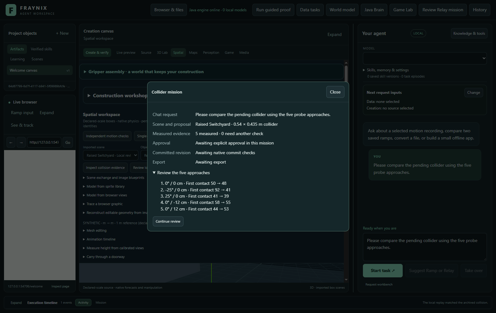
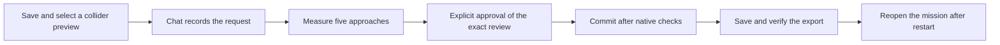
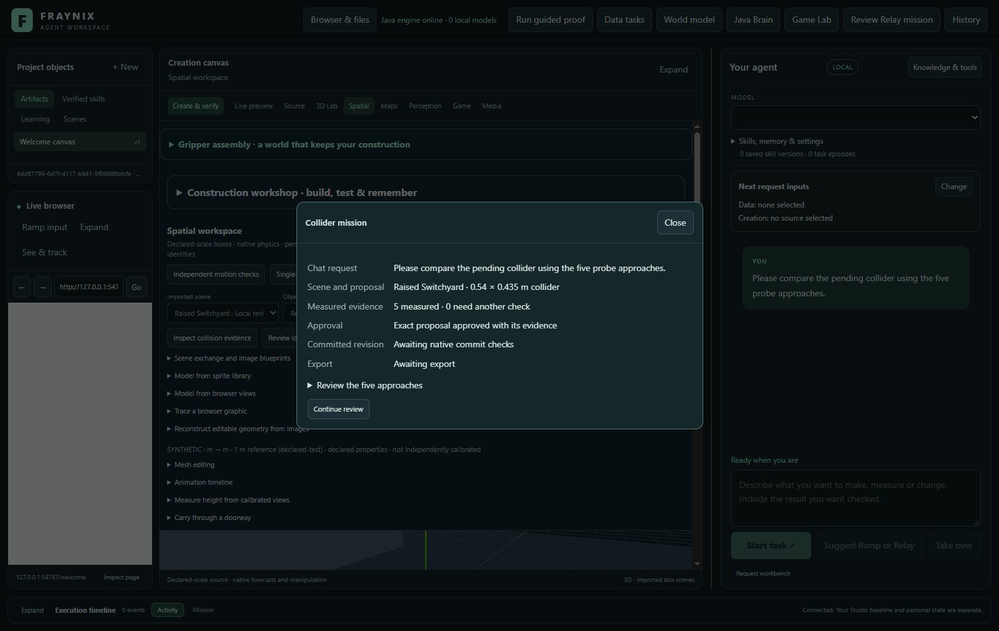
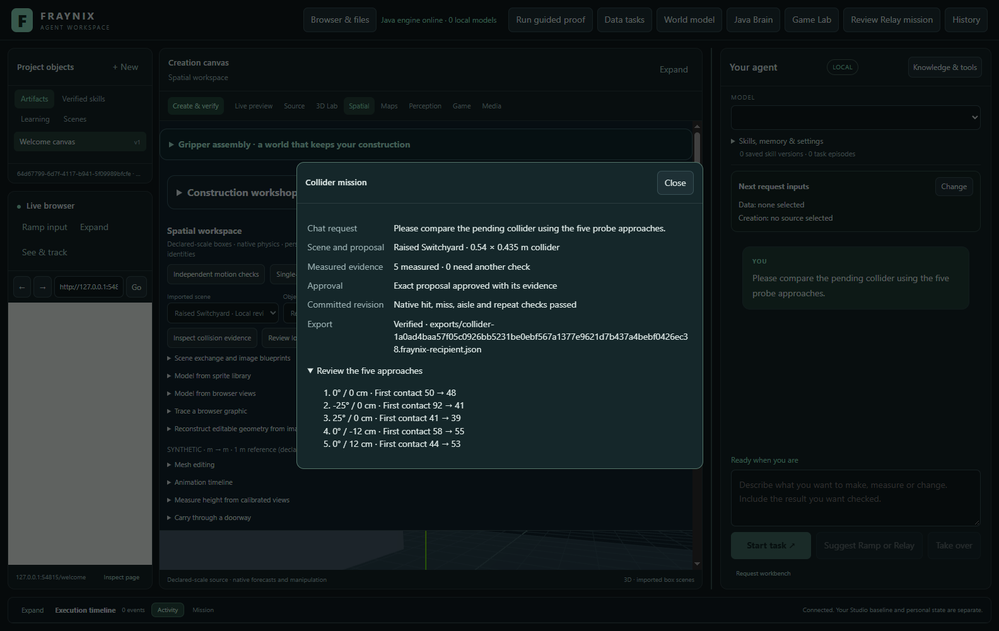

# Edition 245 — Keep a Chat collider review in one durable mission

2026-11-25 · [Edition 244](README-244.md) · [Offline walkthrough](docs/readmes/245/index.html) · [Full history](docs/readmes/INDEX.md)

A Chat-driven collider review now has one mission record. **Spatial → Collider mission** shows the original request, the exact proposal and measurements, the explicit approval, the committed revision, and its verified export. The mission opens after restart even when the preview cache has been damaged.

## Try it

1. In a clean project, open **Spatial → Inspect collision evidence** and load [Raised Switchyard](docs/readmes/245/raised-switchyard.fraynix-level.json). Replay it locally and choose **Create editable copy**.
2. In **Review local edit**, choose **Collider width and depth**, enter **0.54 m** and **0.435 m**, and preview the edit.
3. Close the editor and send **“Please compare the pending collider using the five probe approaches.”** Open **Collider mission** to see the request and captured evidence.
4. Select **Continue review** to return to the exact proposal. Approve explicitly, then let the native checks finish. Back in the mission, select **Save verified export**.
5. Restart and reopen **Collider mission**. The export appears only as verified when its bytes match the saved digest. If the file is missing or changed, use **Save verified export** to recover it.

## Held-out scene result

Raised Switchyard uses a different prop, a raised floor, a divider, a 65° prop yaw, and a 4.90 m aisle. This was its first run through the Chat-driven collider mission. The same-launch tests compared the original 0.50 × 0.40 m box and the proposed 0.54 × 0.435 m box.

| Probe heading | Lateral offset | Original hit tick | Proposed hit tick |
| ---: | ---: | ---: | ---: |
| 0° | 0 cm | 50 | 48 |
| −25° | 0 cm | 92 | 41 |
| +25° | 0 cm | 41 | 39 |
| 0° | −12 cm | 58 | 55 |
| 0° | +12 cm | 44 | 53 |

The resize made contact earlier in four approaches and **9 ticks later** at +12 cm. Each case passed the hit, miss, aisle, and native repeat checks. These timings describe the tested launches. The operator approved the proposal with those results visible. An independent clean project replayed the exported original and approved revision at ticks 47 and 48 under their respective archived protocols, with zero miss contacts and a clear 4.90 m aisle.

## Recovery and scope

The test restarted before approval, after saving approval, and after export. It altered the preview cache and a copy of the exported file. The sealed mission retained the measured approaches, withheld the changed export, and regenerated the exact package. The mission view opens the most recent Chat-driven collider mission in this project. Its advisory evidence stays in the local mission, and the shareable scene export carries the original and committed collision evidence. The Chat route works offline without a model.

[Reproduction](docs/publication245/plan.md) · [Measured summary](docs/readmes/245/held-out-evidence.json) · [Mission snapshot](docs/readmes/245/collider-mission.json) · [Verified export](docs/readmes/245/raised-switchyard-reviewed.fraynix-recipient.json) · [Independent replay](docs/readmes/245/independent-replay.json) · [File tree](docs/readmes/245/FILE_TREE.md) · [Obsidian map](docs/obsidian/253-collider-mission.canvas)
