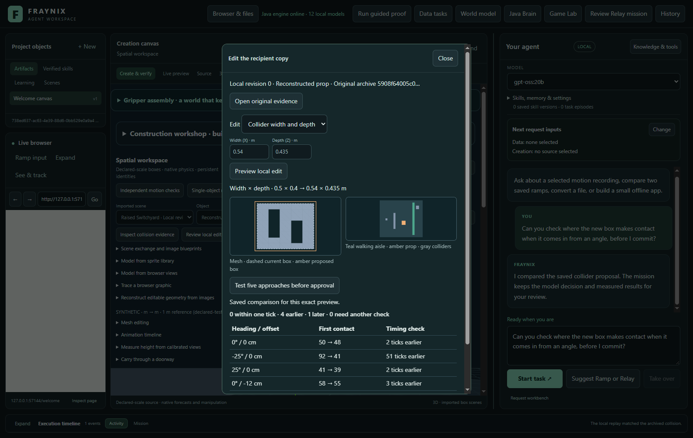
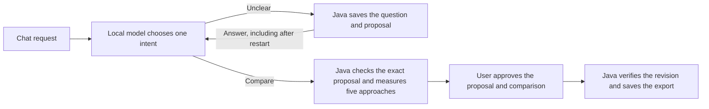
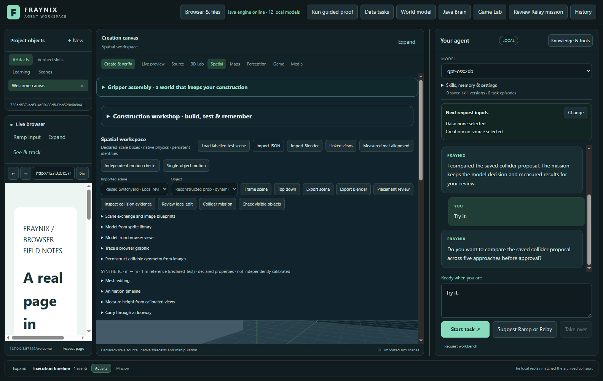
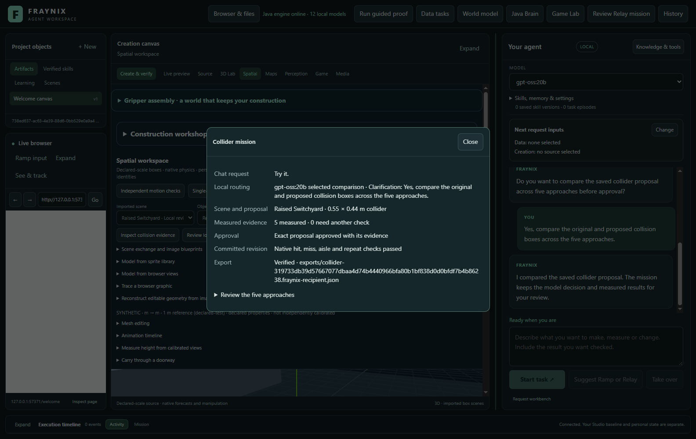

# Edition 246 — Route plain-language collider missions with a local model

2026-11-25 · [Edition 245](README-245.md) · [Offline walkthrough](docs/readmes/246/index.html) · [Full history](docs/readmes/INDEX.md)

With an editable recipient scene open in **Spatial**, describe the contact you want to check in Chat. The selected local model can choose to run a comparison, ask for clarification, or leave the request to the existing chat routes. Java binds the comparison to the saved collider proposal and runs the native checks. The model receives a single intent-selection tool. The approval and export steps use the existing review controls.

## Try it

1. Start Ollama with a local tool-capable model and select it under **Your agent**. The recorded desktop run used **gpt-oss:20b** through loopback.
2. In a clean project, load [Raised Switchyard](docs/readmes/245/raised-switchyard.fraynix-level.json) through **Spatial → Inspect collision evidence**. Replay it locally, then choose **Create editable copy**.
3. In **Review local edit**, preview a **0.54 × 0.435 m** collider. Close the editor and send **“Can you check where the new box makes contact when it comes in from an angle, before I commit?”**.
4. To try clarification, save a new **0.55 × 0.44 m** preview, close the editor and send **“Try it.”**. You can restart before answering. The app restores the pending question in Chat once and binds your reply to it.
5. After comparison, review the measured approaches, then choose **Approve and verify local edit** when satisfied. Open **Collider mission** to save the verified export and to reopen the complete record later.

## Results on Raised Switchyard

| Chat input | Observed result |
| --- | --- |
| Can you check where the new box makes contact when it comes in from an angle, before I commit? | Opened the first preview with five matched approaches. |
| Try it. | Asked **“Do you want to compare the saved collider proposal across five approaches before approval?”** without starting a mission for the second preview. |
| Yes, compare the original and proposed collision boxes across the five approaches. | After restart, bound the reply to the saved question and compared the second preview. |

The second preview measured **5 earlier**, **0 later**, and **0 requiring another check**. Before approval the source scene was identical, there was one scene in the project, and Java refused both a native commit and a mission export. After explicit approval, both native runs agreed. The miss probe recorded zero contacts and the aisle cleared. The export retained the exact original archive. A second clean project replayed both archive stages at ticks 47 and 48, recorded zero miss contacts in both, and refused a changed approval. After a second restart, **Collider mission** reopened the request, model choice, comparison, verified approval, committed revision and the file with its saved SHA-256.

## Scope

The tests exercised three turns on one local model and one scene. The measured CPU inference calls took 36.2, 10.0, and 8.2 seconds. The next evaluation should vary phrasing and scenes, including wrong scene names and ambiguous references, and measure time as well as routing accuracy. The selector uses the current Spatial recipient copy or an outstanding question. For a new comparison, opening that copy and saving a preview gives it an exact target. If that proposal changes between the question and its reply, Java requires a new confirmation. An unsupported model reply leaves the mission unopened. The model-free comparison phrase from [edition 245](README-245.md) remains available when a model is absent.

[Reproduction](docs/publication246/plan.md) · [Real model receipt](docs/readmes/246/model-routing-proof.json) · [Mission record](docs/readmes/246/collider-mission.json) · [Verified export](docs/readmes/246/raised-switchyard-model-reviewed.fraynix-recipient.json) · [Independent replay](docs/readmes/246/independent-replay.json) · [File tree](docs/readmes/246/FILE_TREE.md) · [Obsidian map](docs/obsidian/254-collider-model-routing.canvas)
