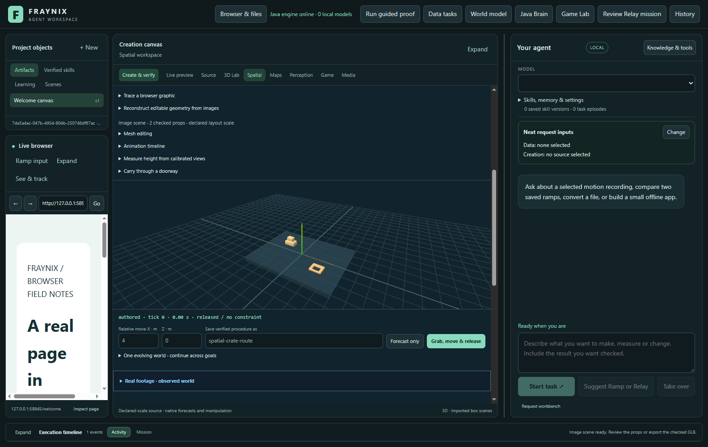
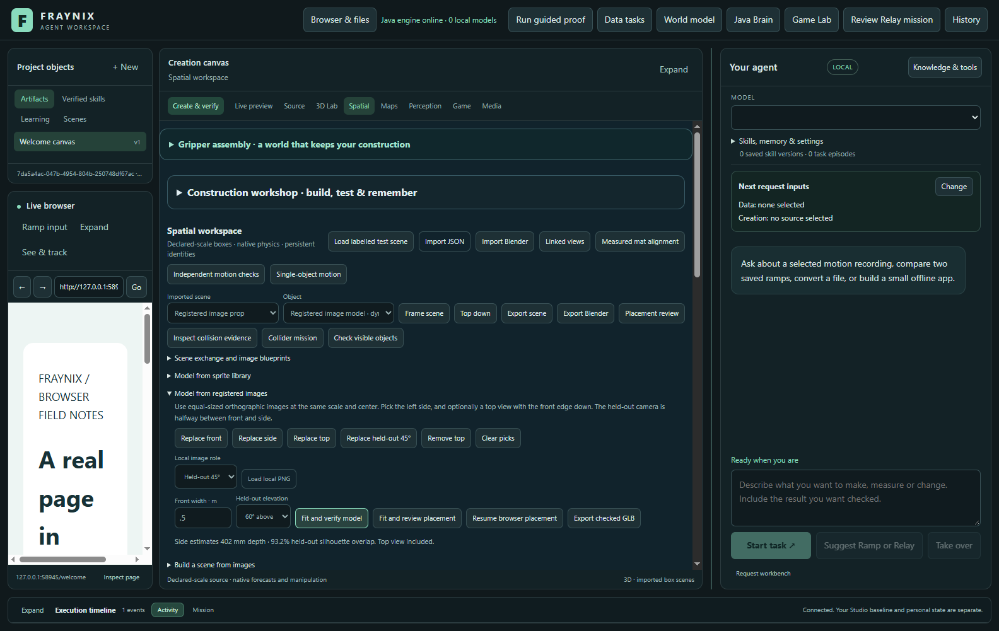
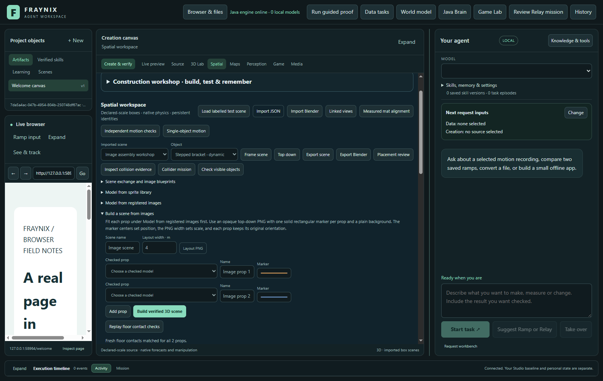

# Edition 247 — Build editable 3D scenes from registered images

2026-11-25 · [Edition 246](README-246.md) · [Offline walkthrough](docs/readmes/247/index.html) · [Full history](docs/readmes/INDEX.md)

Fraynix now accepts registered PNGs from disk as well as views picked in its browser. It fits each prop as an editable triangle mesh, checks a separate image, then assembles two to four checked props onto one floor. A scaled overhead PNG places the props. The meshes retain their separate box colliders and can be selected and manipulated independently in Spatial.

## Try it offline

1. In **Spatial → Model from registered images**, load the front and left side for the first prop. Load the separate 45° view under **Held-out 45°**. Use square orthographic images with a common center, framing and scale. Leave a plain border around the full silhouette.
2. Enter the known front width and choose **Fit and verify model**. Repeat for the other prop. A top image can help resolve holes, and a separate view from 60° above can check the result. [Bracket source PNGs](workspace-desktop/test/fixtures/browser-views) · [Plate source PNGs](workspace-desktop/test/fixtures/browser-top)
3. In **Spatial → Build a scene from images**, load the [sample layout](docs/readmes/247/overhead.png) and enter **4 m** for its full width. Choose the bracket for orange and the plate for blue. Choose **Build verified 3D scene** to save a separate scene.
4. Use **Frame scene** or **Top down** to see both props. Reopen this scene after restart and choose **Replay floor contact checks**. Under **Scene exchange and image blueprints**, choose **Export GLB** to open the scene in Blender.

## What the test showed

| Prop | Separate view overlap | Placed X, Z | First floor contact | Editable triangles in Blender |
| --- | ---: | --- | ---: | ---: |
| Stepped bracket | 95.8% | −0.90 m, −0.45 m | 46 | 656 |
| Perforated plate | 93.2% | +1.05 m, +0.60 m | 46 | 432 |

The test loaded seven local PNGs through the desktop. Two native trials dropped both bodies by 18 cm and measured repeatable contacts and settled positions. After restart a fresh run matched the saved measurements. The app refused overlapping boxes, a changed overhead image, and a changed registered source set. It preserved both original reconstruction scenes.

Blender **4.5.17 LTS** opened the exact GLB and found three box bodies and two separate editable visual meshes. The maximum vertex drift was below **0.001 mm**. Importing the GLB back into Fraynix preserved the scene geometry and recorded the import digest. The original image bytes and physics receipt stay with the authored Fraynix project.

## Scope

The overhead layout supplies positions on a flat floor. It uses opaque, solid rectangular colour markers with one assigned color per prop. The full PNG width supplies the scale, and the verified models supply shape and size. The first version places axis-aligned props. A single ordinary photograph still needs additional information to establish scale, hidden surfaces and camera pose. A next step is to locate the checked objects in an unmarked registered overhead view and verify the positions against a second view.

[Reproduction](docs/publication247/plan.md) · [Measured evidence](docs/readmes/247/image-assembly-evidence.json) · [Layout PNG](docs/readmes/247/overhead.png) · [Scene JSON](docs/readmes/247/image-workshop.json) · [GLB](docs/readmes/247/image-workshop.glb) · [Blender verification](docs/readmes/247/blender-readback.json) · [File tree](docs/readmes/247/FILE_TREE.md) · [Obsidian map](docs/obsidian/255-image-scene-assembly.canvas)
